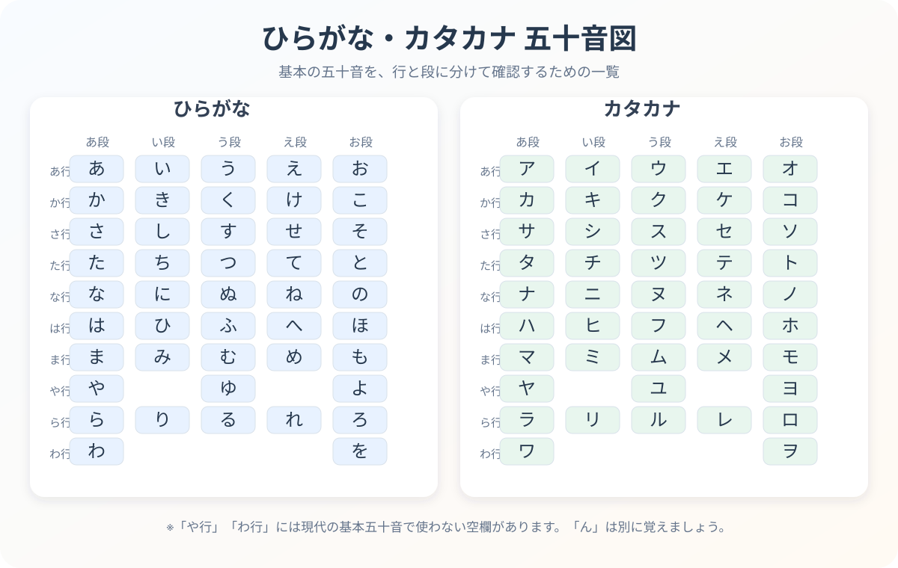

# ひらがな・カタカナ（五十音図）

## ひらがな・カタカナ（五十音図）

### 1. 五十音とは

日本語では、主にひらがな・カタカナ・漢字の3種類の文字を使用します。

ひらがなとカタカナは、それぞれ基本となる五十音があります。

### 2. ひらがな（平仮名）

| 
 
 | あ段 | い段 | う段 | え段 | お段 |
| ----------- | -- | -- | -- | -- | -- |
| あ行          | あ  | い  | う  | え  | お  |
| か行          | か  | き  | く  | け  | こ  |
| さ行          | さ  | し  | す  | せ  | そ  |
| た行          | た  | ち  | つ  | て  | と  |
| な行          | な  | に  | ぬ  | ね  | の  |
| は行          | は  | ひ  | ふ  | へ  | ほ  |
| ま行          | ま  | み  | む  | め  | も  |
| や行          | や  | -  | ゆ  | -  | よ  |
| ら行          | ら  | り  | る  | れ  | ろ  |
| わ行          | わ  | -  | -  | -  | を  |
| ん           | ん  | -  | -  | -  | -  |

### 3. カタカナ（片仮名）

| 
 
 | あ段 | い段 | う段 | え段 | お段 |
| ----------- | -- | -- | -- | -- | -- |
| あ行          | ア  | イ  | ウ  | エ  | オ  |
| か行          | カ  | キ  | ク  | ケ  | コ  |
| さ行          | サ  | シ  | ス  | セ  | ソ  |
| た行          | タ  | チ  | ツ  | テ  | ト  |
| な行          | ナ  | ニ  | ヌ  | ネ  | ノ  |
| は行          | ハ  | ヒ  | フ  | ヘ  | ホ  |
| ま行          | マ  | ミ  | ム  | メ  | モ  |
| や行          | ヤ  | -  | ユ  | -  | ヨ  |
| ら行          | ラ  | リ  | ル  | レ  | ロ  |
| わ行          | ワ  | -  | -  | -  | ヲ  |
| ん           | ン  | -  | -  | -  | -  |

### 4. ひらがなとカタカナの違い

* ひらがな：主に日本語の文章や助詞、活用語尾などに使用します。
* カタカナ：主に外国語、外来語、擬音語などに使用します。

例：

| ひらがな | カタカナ | 意味 |
| ---- | ---- | -- |
| ねこ   | ネコ   | 猫  |
| みず   | ミズ   | 水  |
| さくら  | サクラ  | 桜  |

### 5. 濁音・半濁音

| 種類 | 文字        |
| -- | --------- |
| が行 | が ぎ ぐ げ ご |
| ざ行 | ざ じ ず ぜ ぞ |
| だ行 | だ ぢ づ で ど |
| ば行 | ば び ぶ べ ぼ |
| ぱ行 | ぱ ぴ ぷ ぺ ぽ |

### 6. 拗音（ようおん）

| きゃ行 | きゃ | きゅ | きょ |
| --- | -- | -- | -- |
| しゃ行 | しゃ | しゅ | しょ |
| ちゃ行 | ちゃ | ちゅ | ちょ |
| にゃ行 | にゃ | にゅ | にょ |
| ひゃ行 | ひゃ | ひゅ | ひょ |
| みゃ行 | みゃ | みゅ | みょ |
| りゃ行 | りゃ | りゅ | りょ |

### 7. 練習問題

1. 「あいうえお」を順番に読んでください。
2. 「かきくけこ」を書いてください。
3. 「こんにちは」をカタカナで書いてください。
4. 「ありがとう」の意味を答えてください。

### 8. まとめ

ひらがなとカタカナは、日本語学習の最も基本的な文字です。

まずは五十音を正しく読めるようになり、少しずつ書く練習もしていきましょう。

### 9. 解答・確認ポイント

1. あ・い・う・え・お の順に読みます。
2. か・き・く・け・こ と書きます。
3. コンニチハ と書きます。通常の文章では「こんにちは」とひらがなで書くのが一般的です。
4. 「ありがとう」は感謝を伝える表現で、中国語の「谢谢」に当たります。

※ 書く問題は、文字の形と順序が正しければ正解です。

---

## 中文辅助学习｜假名是什么？

平假名和片假名都是日语的表音文字。它们主要表示声音，不像汉字那样直接表示词义。

| 日语 | 中文说明 |
|---|---|
| ひらがな（平仮名） | 平假名，常用于日语固有词、助词和动词/形容词词尾 |
| カタカナ（片仮名） | 片假名，常用于外来语、外国人名、拟声词等 |
| 五十音図（ごじゅうおんず） | 五十音图，按行和段排列的假名表 |
| 濁音（だくおん） | 浊音，例如「か」加浊点变成「が」 |
| 半濁音（はんだくおん） | 半浊音，例如「は」加半浊点变成「ぱ」 |
| 拗音（ようおん） | 拗音，例如「き」＋小「ゃ」组成「きゃ」 |

### 读一读：平假名与片假名

| 平假名 | 片假名 | 罗马字 | 示例中文 |
|---|---|---|---|
| あ | ア | a | — |
| い | イ | i | — |
| う | ウ | u | — |
| え | エ | e | — |
| お | オ | o | — |
| か | カ | ka | — |
| き | キ | ki | — |
| く | ク | ku | — |
| け | ケ | ke | — |
| こ | コ | ko | — |

### 初学者注意

- 「し」读 shi，不读 si；「ち」读 chi；「つ」读 tsu。
- 「ふ」的发音接近 fu，但发音时双唇不要像中文“夫”那样用力摩擦。
- 平假名和片假名的形状不同，但通常对应相同的基本音。
- 学习时先熟悉平假名，再学习片假名；每天朗读并默写一行。
