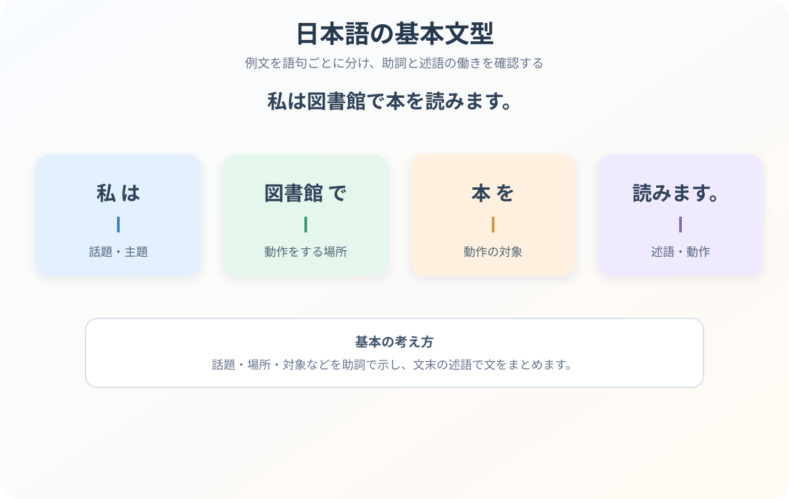

# 日本語の基本文型

## 日本語の基本文型

### 1. 日本語の語順

日本語の基本的な語順は「主語＋目的語＋動詞」です。

例：

私はりんごを食べます。

* 私は：主語
* りんごを：目的語
* 食べます：動詞

### 2. 名詞文

名詞＋です

例：

| 日本語        | 中国語      |
| ---------- | -------- |
| 私は学生です。    | 我是学生。    |
| これは本です。    | 这是书。     |
| 田中さんは先生です。 | 田中先生是老师。 |

否定形：ではありません／じゃありません

例：私は学生ではありません。

### 3. 形容詞文

#### い形容詞

例：

* この本はおもしろいです。
* 今日は暑いです。
* この料理はおいしいです。

#### な形容詞

例：

* この町は静かです。
* 彼は親切です。
* この部屋はきれいです。

### 4. 動詞文

動詞＋ます

例：

| 日本語          | 中国語      |
| ------------ | -------- |
| 私は毎日勉強します。   | 我每天学习。   |
| 毎朝コーヒーを飲みます。 | 每天早上喝咖啡。 |
| 昨日映画を見ました。   | 昨天看了电影。  |

### 5. 疑問文

文末に「か」を付けると、丁寧な疑問文になります。

例：

* あなたは学生ですか。
* これは何ですか。
* 毎日日本語を勉強しますか。

### 6. 基本的な助詞

| 助詞 | 主な使い方    | 例文        |
| -- | -------- | --------- |
| は  | 話題       | 私は学生です。   |
| が  | 主語・対象    | 雨が降っています。 |
| を  | 目的語      | 水を飲みます。   |
| に  | 時間・到着点など | 7時に起きます。  |
| で  | 動作の場所・手段 | 学校で勉強します。 |
| へ  | 方向       | 日本へ行きます。  |
| の  | 所有・修飾    | 私の本です。    |
| と  | 一緒・引用    | 友達と行きます。  |
| も  | 追加・同様    | 私も学生です。   |
| から | 起点・理由    | 9時から働きます。 |
| まで | 終点       | 5時まで働きます。 |

### 7. 練習問題

次の中国語を日本語に訳してください。

1. 我是学生。
2. 我每天学习日语。
3. 这是我的书。
4. 你是日本人吗？
5. 我在学校学习。

### 8. まとめ

日本語の基本文型を理解することは、文法学習の第一歩です。

名詞文・形容詞文・動詞文の違いを理解し、助詞の使い方を練習しましょう。

### 9. 解答・解説

1. 私は学生です。
2. 私は毎日日本語を勉強します。
3. これは私の本です。
4. あなたは日本人ですか。
5. 私は学校で勉強します。

「は」は話題、「の」は所有、「か」は疑問、「で」は動作を行う場所を表します。主語の「私は」は文脈で明らかな場合、省略することもできます。
