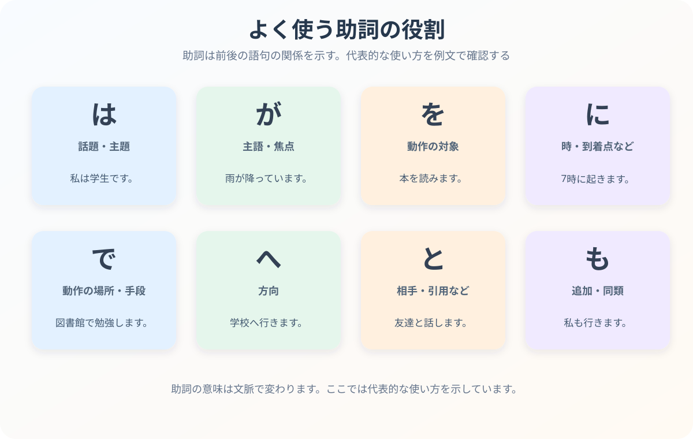

# 日本語の助詞（じょし）

## 日本語の助詞（じょし）

### 1. 助詞とは

助詞は、名詞や動詞などの後ろに付いて、言葉同士の関係や文の意味を表す言葉です。

### 2. は・が

| 助詞 | 用法    | 例文        |
| -- | ----- | --------- |
| は  | 話題を示す | 私は学生です。   |
| が  | 主語を示す | 雨が降っています。 |

ポイント：

* 「は」は話題を提示するときに使います。
* 「が」は主語や新しい情報を示すときに使います。

### 3. を

動作の対象を表します。

例：

* ご飯を食べます。
* 本を読みます。
* 音楽を聞きます。

### 4. に

時間、存在する場所、到着点、動作の相手などを表します。

例：

* 7時に起きます。
* 部屋に猫がいます。
* 日本に行きます。
* 友達に電話します。

### 5. で

動作が行われる場所や手段を表します。

例：

* 学校で勉強します。
* 電車で会社へ行きます。
* 箸でご飯を食べます。

### 6. へ

移動する方向を表します。

例：

* 日本へ行きます。
* 学校へ向かいます。

### 7. の

所有や名詞の修飾を表します。

例：

* 私の本です。
* 日本語の先生です。
* 会社の名前です。

### 8. と

一緒に行動する相手や、並列、引用を表します。

例：

* 友達と映画を見ます。
* パンと牛乳を買います。
* 彼は「行きます」と言いました。

### 9. も

同じ内容を追加するときに使います。

例：

* 私も学生です。
* 彼も日本語を勉強しています。

### 10. から・まで

| 助詞 | 用法     | 例文        |
| -- | ------ | --------- |
| から | 起点・開始点 | 9時から働きます。 |
| まで | 終点・終了点 | 5時まで働きます。 |

### 11. や・か・より

* や：本や雑誌を買いました。
* か：コーヒーか紅茶を飲みます。
* より：電車はバスより速いです。

### 12. 練習問題

（　）に適切な助詞を入れてください。

1. 私（　）学生です。
2. 毎日、日本語（　）勉強します。
3. 学校（　）勉強します。
4. 7時（　）起きます。
5. 友達（　）映画を見ます。
6. 日本（　）行きます。

### 13. まとめ

助詞は日本語の文を正しく理解し、自然に話すために欠かせない要素です。

それぞれの助詞の基本的な意味と使い方を覚え、例文を通して練習しましょう。

### 14. 解答・解説

1. 私**は**学生です。：「は」は文の話題を示します。
2. 毎日、日本語**を**勉強します。「を」は動作の対象を示します。
3. 学校**で**勉強します。「で」は動作を行う場所を示します。
4. 7時**に**起きます。「に」は具体的な時刻を示します。
5. 友達**と**映画を見ます。「と」は一緒に行動する相手を示します。
6. 日本**へ／に**行きます。「へ」は方向、「に」は到着点を表し、この文ではどちらも使えます。
