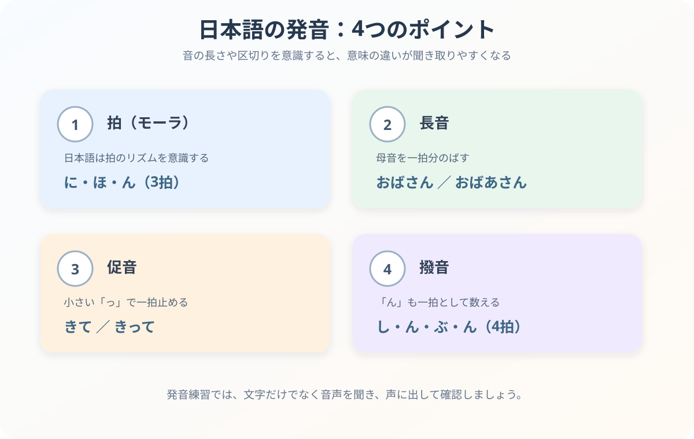

# 日本語の発音・音声ルール

## 日本語の発音・音声ルール

### 1. 日本語の発音の基本

日本語は、基本的に一つ一つの音を一定の長さで発音します。

発音を学習するときは、音の長さとリズムを意識することが大切です。

### 2. 清音（せいおん）

「あ・か・さ・た・な・は・ま・や・ら・わ」の各行の基本音です。

例：

* あ：a
* か：ka
* さ：sa
* た：ta
* な：na

### 3. 濁音（だくおん）

濁点「゛」を付けた音です。

| 行  | 文字        |
| -- | --------- |
| が行 | が・ぎ・ぐ・げ・ご |
| ざ行 | ざ・じ・ず・ぜ・ぞ |
| だ行 | だ・ぢ・づ・で・ど |
| ば行 | ば・び・ぶ・べ・ぼ |

### 4. 半濁音（はんだくおん）

半濁点「゜」を付けた音です。

ぱ・ぴ・ぷ・ぺ・ぽ

### 5. 拗音（ようおん）

小さい「ゃ・ゅ・ょ」を使って表す音です。

| 種類  | 例        |
| --- | -------- |
| きゃ行 | きゃ・きゅ・きょ |
| しゃ行 | しゃ・しゅ・しょ |
| ちゃ行 | ちゃ・ちゅ・ちょ |
| にゃ行 | にゃ・にゅ・にょ |
| ひゃ行 | ひゃ・ひゅ・ひょ |
| みゃ行 | みゃ・みゅ・みょ |
| りゃ行 | りゃ・りゅ・りょ |

### 6. 促音（そくおん）

小さい「っ」を使い、一拍分の間を作る音です。

例：

| 言葉   | 読み方     |
| ---- | ------- |
| きって  | ki-tte  |
| がっこう | ga-kkou |
| ざっし  | za-sshi |

### 7. 長音（ちょうおん）

母音を通常より一拍長く発音する音です。

例：

| 言葉    | 読み方     |
| ----- | ------- |
| おばさん  | obasan  |
| おばあさん | obaasan |
| こうこう  | koukou  |
| コーヒー  | koohii  |

長音の有無によって意味が変わる場合があります。

### 8. 撥音（はつおん）

「ん」で表す音です。

例：

* にほん
* せんせい
* しんぶん

### 9. アクセントとイントネーション

日本語には高低アクセントがあります。

同じ音の並びでも、アクセントによって意味や聞こえ方が変わる場合があります。

また、疑問文や感情表現ではイントネーションも重要です。

### 10. 練習問題

1. 「きゃ・きゅ・きょ」を読んでください。
2. 「きって」と「きて」の違いを説明してください。
3. 「おばさん」と「おばあさん」の違いを説明してください。
4. 「がっこう」を正しく発音してください。

### 11. まとめ

日本語の発音では、清音・濁音・拗音だけでなく、促音・長音・撥音の違いも重要です。

毎日声に出して練習し、自然な発音を身につけましょう。

### 12. 解答・解説

1. 「きゃ・きゅ・きょ」は、き・ゃ、き・ゅ、き・ょを一つのまとまりとして読みます。
2. 「きって」は小さい「っ」で一拍分の間を置きます。「きて」にはその間がありません。
3. 「おばさん」は「ば」の後を長くしません。「おばあさん」は「あ」を一拍長く発音します。
4. 「がっこう」は「が・っ・こ・う」と、促音と長音を意識して発音します。
