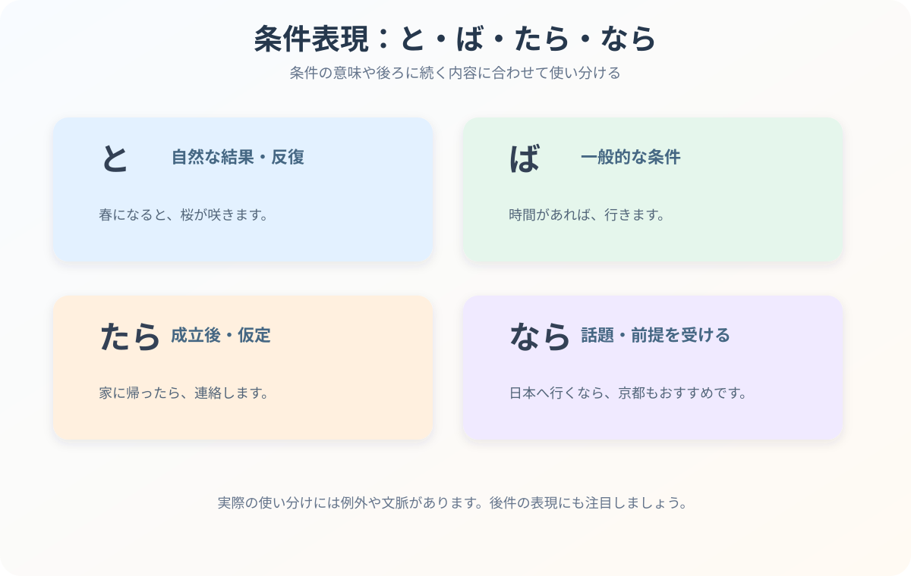

# 日本語の条件表現（条件形）

## 日本語の条件表現（条件形）

### 1. 条件表現とは

条件表現は、ある条件が成立した場合に、別の結果や行動が起こることを表す文法です。

日本語では、主に「と」「ば」「たら」「なら」の4つの表現を使います。

例：

* 春になると、桜が咲きます。
* 時間があれば、旅行に行きたいです。
* 雨が降ったら、家にいます。
* 日本へ行くなら、京都がおすすめです。

### 2. ～と

#### 2.1 意味と使い方

ある条件が成立すると、自然な結果や決まった結果が起こることを表します。

機械の操作、自然現象、習慣などによく使われます。

#### 2.2 接続方法

動詞・形容詞・名詞の普通形 + と

例：

* 春になると、暖かくなります。
* このボタンを押すと、ドアが開きます。
* 夜になると、星が見えます。

#### 2.3 注意点

後ろの文には、命令・依頼・意志などを基本的に使いません。

### 3. ～ば

#### 3.1 意味と使い方

ある条件が成立すれば、その結果が実現することを表します。

一般的な条件や仮定を表すときによく使います。

#### 3.2 接続方法

| 品詞   | 接続      | 例       |
| ---- | ------- | ------- |
| 五段動詞 | エ段 + ば  | 書けば     |
| 一段動詞 | る → れば  | 食べれば    |
| する   | すれば     | すれば     |
| 来る   | くれば     | くれば     |
| い形容詞 | い → ければ | 安ければ    |
| な形容詞 | なら（ば）   | 静かなら（ば） |
| 名詞   | なら（ば）   | 学生なら（ば） |

#### 3.3 例文

* 毎日練習すれば、上手になります。
* 安ければ、買いたいです。
* 時間があれば、手伝います。
* 天気がよければ、散歩します。

### 4. ～たら

#### 4.1 意味と使い方

ある動作や状態が成立した後に、別の動作や結果が起こることを表します。

仮定条件や、実際に起きた後の条件にも使えます。

#### 4.2 接続方法

動詞・形容詞・名詞のた形 + ら

| 品詞   | 基本形 | たら形    |
| ---- | --- | ------ |
| 動詞   | 行く  | 行ったら   |
| い形容詞 | 忙しい | 忙しかったら |
| な形容詞 | 静かだ | 静かだったら |
| 名詞   | 学生だ | 学生だったら |

#### 4.3 例文

* 家に帰ったら、電話してください。
* 時間があったら、映画を見ます。
* 雨が降ったら、出かけません。
* 日本に行ったら、寿司を食べたいです。

### 5. ～なら

#### 5.1 意味と使い方

相手の話や状況を受けて、その条件について判断や提案をするときに使います。

#### 5.2 接続方法

動詞・形容詞・名詞の普通形 + なら

例：

* 日本へ行くなら、京都がおすすめです。
* 車を買うなら、燃費のいい車がいいです。
* 暇なら、一緒に映画を見ませんか。
* 学生なら、この割引を利用できます。

### 6. 4つの条件表現の違い

| 表現  | 主な意味・使い方       |
| --- | -------------- |
| ～と  | 自然な結果・必然的な結果   |
| ～ば  | 一般的な条件・仮定      |
| ～たら | 動作や状態が成立した後の条件 |
| ～なら | 相手の話や状況を受けた条件  |

#### 比較例

* 春になると、桜が咲きます。
* 暖かければ、出かけます。
* 雨が降ったら、家にいます。
* 日本へ行くなら、京都に行きたいです。

### 7. 学習のポイント

* 「と」は自然な結果や決まった結果に使う。
* 「ば」は一般的な条件や仮定に使う。
* 「たら」は時間的な前後関係や仮定に使う。
* 「なら」は相手の話や状況を受けて使う。
* 文脈に応じて4つの表現を使い分ける。

### 8. まとめ

条件表現は、仮定・条件・結果・提案などを伝えるための重要な文法です。

「と・ば・たら・なら」の違いを理解し、例文を使って正しく使い分けられるように練習しましょう。

### 9. 練習問題

#### 問題1：最も適切な条件表現を選びましょう。

1. 春に（なると・なら）、桜が咲きます。
2. 時間が（あれば・あると）、手伝ってください。
3. 家に（帰ったら・帰るなら）、電話してください。
4. 京都へ（行くなら・行くと）、この寺もおすすめです。

#### 問題2：文を完成させましょう。

1. 雨が降ったら、（　　　　　　　　　）。
2. 安ければ、（　　　　　　　　　）。
3. このボタンを押すと、（　　　　　　　　　）。

#### 問題3：「と」「ば」「たら」「なら」の使い分けを説明しましょう。

### 10. 解答・解説

#### 問題1

1. なると：春になると桜が咲くという、自然に起こる結果を表します。
2. あれば：時間があることを条件として依頼しています。
3. 帰ったら：帰宅した後に電話するという時間的な順序を含む条件です。
4. 行くなら：相手が京都へ行くという話を受けて提案しています。

#### 問題2

例：1. 家にいます。 2. 買います。 3. 画面が表示されます。

#### 問題3

「と」は自然・必然的な結果、「ば」は一般的な仮定、「たら」は成立後の条件や仮定、「なら」は相手の話や状況を受けた条件に使うことが多いです。
