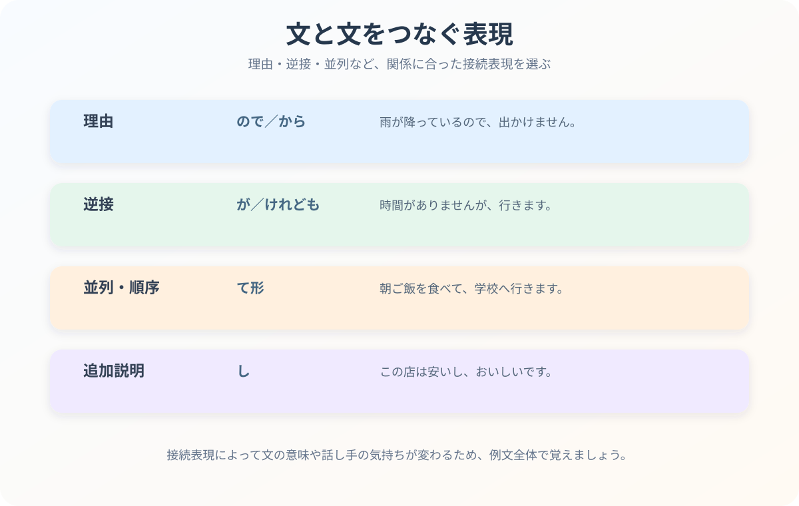

# 日本語の文法総合整理

## 日本語の文法総合整理

### 1. 日本語の文法とは

日本語の文法とは、単語を正しく組み合わせて、意味の通る文を作るためのルールです。

日本語では、品詞の種類や活用、助詞、文型、文末表現などを理解することが重要です。

文法を体系的に理解することで、正確な文章を書いたり、自然な会話をしたりできるようになります。

### 2. 品詞の種類

日本語の単語は、文の中での働きによって品詞に分類されます。

| 品詞   | 役割            | 例            |
| ---- | ------------- | ------------ |
| 名詞   | 人・物・事柄を表す     | 学生、学校、仕事     |
| 動詞   | 動作・状態を表す      | 食べる、行く、ある    |
| い形容詞 | 性質・状態を表す      | 高い、暑い、難しい    |
| な形容詞 | 性質・状態を表す      | 静か、便利、元気     |
| 副詞   | 動詞や形容詞などを修飾する | とても、ゆっくり、かなり |
| 助詞   | 単語の関係や意味を示す   | は、が、を、に      |
| 接続詞  | 文や内容をつなぐ      | しかし、そして、だから  |
| 連体詞  | 名詞を修飾する       | この、大きな、ある    |
| 感動詞  | 感情や返事を表す      | はい、いいえ、ああ    |

### 3. 動詞・形容詞の活用

日本語では、動詞や形容詞が文の内容に応じて形を変えます。

#### ① 動詞の活用

| 活用形 | 例    | 主な使い方 |
| --- | ---- | ----- |
| 辞書形 | 書く   | 基本形   |
| ます形 | 書きます | 丁寧な表現 |
| ない形 | 書かない | 否定    |
| て形  | 書いて  | 接続・依頼 |
| た形  | 書いた  | 過去・完了 |
| 可能形 | 書ける  | 能力・可能 |
| 受身形 | 書かれる | 受身    |
| 使役形 | 書かせる | 使役    |
| 意向形 | 書こう  | 意志・勧誘 |
| 条件形 | 書けば  | 条件    |

#### ② 形容詞の活用

| 種類   | 基本形 | 否定形    | 過去形   |
| ---- | --- | ------ | ----- |
| い形容詞 | 高い  | 高くない   | 高かった  |
| な形容詞 | 静かだ | 静かではない | 静かだった |

### 4. 日本語の基本文型

日本語の基本的な文型を理解すると、文の構造を正しく把握できます。

| 文型   | 構造            | 例文           |
| ---- | ------------- | ------------ |
| 名詞文  | 名詞＋です         | 私は学生です。      |
| 動詞文  | 名詞＋動詞         | 私は本を読みます。    |
| 形容詞文 | 名詞＋形容詞        | この本は面白いです。   |
| 存在文  | 場所＋に＋あります／います | 部屋に猫がいます。    |
| 授受文  | 人＋に／から＋物をもらう  | 友達に本をもらいました。 |

### 5. 時制・肯定・否定の表現

日本語では、動詞や形容詞の形を変えることで、現在・過去や肯定・否定を表します。

| 時制     | 肯定    | 否定       |
| ------ | ----- | -------- |
| 現在・未来  | 行きます  | 行きません    |
| 過去     | 行きました | 行きませんでした |
| 普通体・現在 | 行く    | 行かない     |
| 普通体・過去 | 行った   | 行かなかった   |

**例文：**

* 毎日学校へ行きます。
* 明日は会社へ行きません。
* 昨日、映画を見ました。
* 昨日は勉強しませんでした。

### 6. 助詞の基本的な使い分け

助詞は、単語と単語の関係や、文の中での役割を示します。

| 助詞 | 主な役割        | 例文        |
| -- | ----------- | --------- |
| は  | 話題を示す       | 私は学生です。   |
| が  | 主語・対象を示す    | 雨が降っています。 |
| を  | 動作の対象を示す    | 本を読みます。   |
| に  | 時間・場所・対象を示す | 7時に起きます。  |
| で  | 動作の場所・手段を示す | 電車で行きます。  |
| へ  | 方向を示す       | 日本へ行きます。  |
| と  | 並列・相手を示す    | 友達と話します。  |
| から | 起点・理由を示す    | 9時から働きます。 |
| まで | 終点・範囲を示す    | 5時まで働きます。 |
| の  | 所属・修飾を示す    | 私の本です。    |
| も  | 追加・同様を示す    | 私も行きます。   |

### 7. 接続表現の使い分け

接続表現は、文と文の関係を明確にするために使います。

| 意味    | 主な表現         | 例文                   |
| ----- | ------------ | -------------------- |
| 原因・理由 | ～から、～ので      | 雨が降ったので、出かけませんでした。   |
| 条件    | ～たら、～ば、～なら   | 時間があれば、行きます。         |
| 逆接    | ～けれども、～のに    | 高いけれども、買いました。        |
| 目的    | ～ために、～ように    | 日本語を勉強するために、日本へ来ました。 |
| 追加    | ～だけでなく、～も    | 日本語だけでなく、英語も話せます。    |
| 順序    | ～てから、～あとで    | 食事をしてから、勉強します。       |
| 並列    | ～たり～たり、～や～など | 本を読んだり、映画を見たりします。    |

### 8. 推量・判断・意志の表現

話し手の考えや判断、予測、意志などを表す文法です。

| 表現      | 意味      | 例文             |
| ------- | ------- | -------------- |
| ～でしょう   | 推量・確認   | 明日は晴れるでしょう。    |
| ～かもしれない | 可能性     | 彼は来ないかもしれません。  |
| ～はずだ    | 根拠のある予測 | 彼はもう着いたはずです。   |
| ～ようだ    | 推定・比喩   | 雨が降るようです。      |
| ～らしい    | 推定・伝聞   | 彼は忙しいらしいです。    |
| ～つもりだ   | 意志・予定   | 来年、日本へ行くつもりです。 |
| ～と思う    | 意見・判断   | この方法がいいと思います。  |

### 9. 敬語・丁寧表現

日本語では、相手や場面に応じて表現を使い分ける必要があります。

| 種類  | 役割          | 例            |
| --- | ----------- | ------------ |
| 丁寧語 | 丁寧に話す       | 行きます、食べます    |
| 尊敬語 | 相手の動作を高める   | いらっしゃる、召し上がる |
| 謙譲語 | 自分の動作をへりくだる | 伺う、申し上げる     |

**例文：**

* 社長はもうお帰りになりました。
* 私が資料をお持ちします。
* 明日、会議に参加します。

### 10. 文法表現の使い分けで注意する点

#### ① ～から と ～ので

* ～から：話し手の判断や主観的な理由を表す。
* ～ので：理由や原因を比較的やわらかく説明する。

**例文：**

* 疲れたから、帰ります。
* 雨が降っているので、出かけません。

#### ② ～そうだ と ～ようだ

* ～そうだ：見た目から判断したり、情報を伝えたりする。
* ～ようだ：状況や根拠から推測する。

**例文：**

* このケーキはおいしそうです。
* 外が暗いので、雨が降っているようです。

#### ③ ～なければならない と ～なくてもいい

* ～なければならない：義務や必要性を表す。
* ～なくてもいい：不必要であることを表す。

**例文：**

* 明日までに提出しなければなりません。
* この資料は提出しなくてもいいです。

### 11. 学習のポイント

* 品詞の種類と、それぞれの役割を理解する。
* 動詞・形容詞の活用を正確に覚える。
* 助詞の意味と使い分けを理解する。
* 文型の構造を意識して文章を読む。
* 接続表現を使って、文と文の関係を理解する。
* 推量・判断・意志など、話し手の気持ちを表す文法を整理する。
* 日常会話とビジネス場面で、適切な表現を使い分ける。
* 似ている文法は、意味だけでなく接続方法や使用場面も比較する。

### 12. まとめ

日本語の文法は、品詞・活用・助詞・文型・接続表現など、さまざまな要素から成り立っています。

それぞれの文法を個別に覚えるだけでなく、文の中でどのような役割を果たしているのかを理解することが重要です。

これまで学習した文法を繰り返し整理し、読解・聴解・会話・作文の中で実際に使えるようにしましょう。

## 総合練習問題

### 問題1：文に合う文型を選びましょう。

1. 雨が降った（ので・のに）、試合は中止になりました。
2. 日本語が話せる（ように・ために）、毎日練習しています。
3. 彼は来る（はずだ・つもりだ）と思います。本人がそう言っていました。
4. 音楽を聞き（ながら・まま）、料理をしています。
5. 忙しい（にもかかわらず・ために）、最後まで手伝ってくれました。

### 問題2：正しい文には〇を付け、誤りがある文は正しく直しましょう。

1. 私は日本語を話すことができます。
2. 先生が資料を拝見しました。
3. 雨が降っているので、試合が中止になりました。
4. 彼は毎日勉強することにしています。

### 問題3：次の二つの文型の違いを説明しましょう。

1. 「～そうだ（伝聞）」と「～そうだ（様態）」
2. 「～ために」と「～ように」
3. 「～ながら」と「～たまま」

## 総合練習問題の解答・解説

### 問題1

1. ので：理由を表します。
2. ように：能力が身に付く状態を目標にしています。
3. はずだ：本人の発言を根拠にした判断です。
4. ながら：音楽を聞く動作と料理をする動作を同時に行います。
5. にもかかわらず：忙しいという状況に反して手伝ったことを表します。

### 問題2

1. 正しい文です。「話すことができます」は可能を表します。
2. 「先生が資料をご覧になりました」が正しい表現です。先生の動作なので尊敬語を使います。
3. 正しい文です。「ので」は理由を表します。
4. 正しい文です。自分で決めた習慣を表します。

### 問題3

1. 伝聞の「そうだ」は聞いた情報を伝え、様態の「そうだ」は見た目や様子から判断します。
2. 「ために」は目的を明確に表し、「ように」は能力や状態の実現を目標にする場合によく使います。
3. 「ながら」は二つの動作の同時進行、「たまま」は状態を変えずに保つことを表します。
