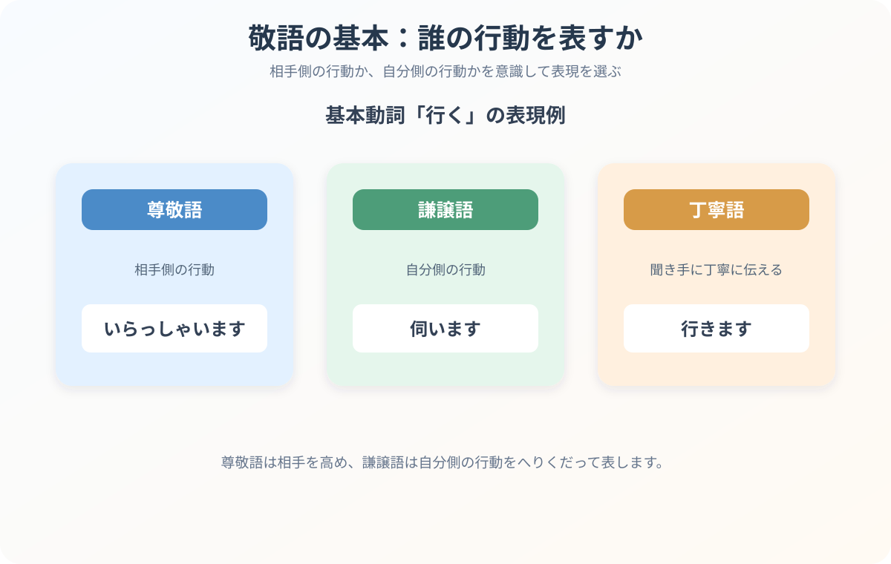

# 日本語の敬語（尊敬語・謙譲語・丁寧語）

## 日本語の敬語（尊敬語・謙譲語・丁寧語）

### 1. 敬語とは

敬語とは、相手への敬意や丁寧な気持ちを表すための表現です。

日本語の敬語は、主に次の3種類に分けられます。

* 尊敬語：相手や相手側の人の動作・状態を高める表現
* 謙譲語：自分や自分側の人の動作をへりくだって表現する言い方
* 丁寧語：聞き手に対して丁寧に伝える表現

### 2. 尊敬語

尊敬語は、相手や目上の人の動作・状態を高める表現です。

#### 代表的な表現

| 普通形      | 尊敬語    |
| -------- | ------ |
| 行く・来る・いる | いらっしゃる |
| 言う       | おっしゃる  |
| 見る       | ご覧になる  |
| 食べる・飲む   | 召し上がる  |
| する       | なさる    |
| 知っている    | ご存じだ   |
| くれる      | くださる   |

#### 「お・ご～になる」の形

* 読む → お読みになる
* 帰る → お帰りになる
* 利用する → ご利用になる

例：

* 先生はもう帰られました。
* 社長は資料をご覧になりました。

### 3. 謙譲語

謙譲語は、自分や自分側の人の動作をへりくだって表現し、相手への敬意を示す言い方です。

#### 代表的な表現

| 普通形    | 謙譲語      |
| ------ | -------- |
| 行く・来る  | 参る・伺う    |
| 言う     | 申し上げる・申す |
| 見る     | 拝見する     |
| 食べる・飲む | いただく     |
| 聞く・尋ねる | 伺う       |
| する     | いたす      |
| 会う     | お目にかかる   |

#### 「お・ご～する」の形

* 持つ → お持ちする
* 案内する → ご案内する
* 説明する → ご説明する

例：

* 私が資料をお持ちします。
* 後ほど担当者に確認いたします。

### 4. 丁寧語

丁寧語は、聞き手に対して丁寧に話す表現です。

#### 基本的な形

| 普通形 | 丁寧語  |
| --- | ---- |
| 行く  | 行きます |
| 食べる | 食べます |
| 学生だ | 学生です |
| 便利だ | 便利です |

「です」「ます」を使うことで、丁寧な表現になります。

### 5. 敬語の使い分け

| 場面       | 使用する敬語 | 例           |
| -------- | ------ | ----------- |
| 相手の動作を話す | 尊敬語    | 部長がおっしゃいました |
| 自分の動作を話す | 謙譲語    | 私が申し上げます    |
| 丁寧に話す    | 丁寧語    | 明日、確認します    |

### 6. 間違いやすい敬語

#### 二重敬語

同じ種類の敬語を重ねて使うと、不自然になる場合があります。

* 誤：おっしゃられました
* 正：おっしゃいました
* 誤：ご覧になられました
* 正：ご覧になりました

#### 尊敬語と謙譲語の混同

* 相手の動作：ご覧になります
* 自分の動作：拝見します

### 7. 学習のポイント

* 尊敬語は相手を高める表現
* 謙譲語は自分をへりくだる表現
* 丁寧語は聞き手に丁寧に伝える表現
* 誰の動作なのかを意識して使い分ける
* ビジネスや日常会話の例文を使って練習する

### 8. まとめ

敬語は、相手や場面に応じて適切に使い分けることが重要です。

まずは尊敬語・謙譲語・丁寧語の基本的な違いを理解し、よく使われる表現から少しずつ身につけましょう。

### 9. 練習問題

#### 問題1：正しい敬語を選びましょう。

1. 社長はもう（お帰りになりました・参りました）。
2. 私は資料を（拝見しました・ご覧になりました）。
3. お客様がこちらに（いらっしゃいます・伺います）。
4. 私から後ほどご連絡（いたします・なさいます）。

#### 問題2：尊敬語・謙譲語・丁寧語に分類しましょう。

1. おっしゃる
2. 申し上げる
3. です・ます
4. 召し上がる

### 10. 解答・解説

#### 問題1

1. お帰りになりました：社長の動作なので尊敬語です。
2. 拝見しました：自分の動作なので謙譲語です。
3. いらっしゃいます：お客様の動作なので尊敬語です。
4. いたします：自分の動作をへりくだって表す謙譲語です。

#### 問題2

1. 尊敬語
2. 謙譲語
3. 丁寧語
4. 尊敬語

相手の動作を高める場合は尊敬語、自分の動作をへりくだる場合は謙譲語を使います。
