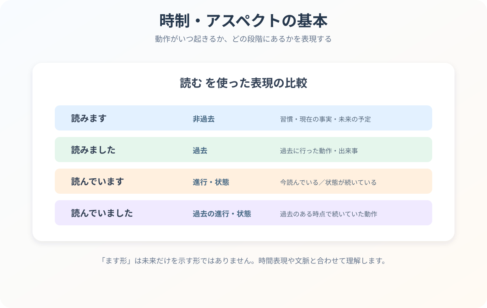

# 日本語の補助動詞・アスペクト表現

## 日本語の補助動詞・アスペクト表現

### 1. 補助動詞・アスペクト表現とは

補助動詞とは、動詞の後ろに付いて、動作や状態にさまざまな意味を加える表現です。

アスペクト表現は、動作が進行中なのか、完了しているのか、結果が残っているのかなどを表します。

### 2. 「～ている」：進行・状態・習慣

動作の進行中、動作の結果として続いている状態、習慣などを表します。

**例文：**

* 今、本を読んでいます。（進行）
* 窓が開いています。（結果の状態）
* 毎朝ジョギングをしています。（習慣）

### 3. 「～てある」：意図的な結果の状態

誰かが意図的に行った動作の結果が、そのまま残っていることを表します。

**例文：**

* 机の上に資料が置いてあります。
* 壁に予定表が貼ってあります。
* 会議室のドアが開けてあります。

### 4. 「～ておく」：準備・事前の対応

後で必要になることを考えて、前もって何かをしておくことを表します。

**例文：**

* 明日の会議のために、資料を準備しておきます。
* 旅行の前にホテルを予約しておきました。
* 忘れないように、メモしておいてください。

### 5. 「～てしまう」：完了・後悔

動作が完全に終わったことや、残念な気持ち・後悔を表します。

**例文：**

* 宿題を全部終わらせてしまいました。（完了）
* 大切な資料をなくしてしまいました。（後悔）
* ケーキを全部食べてしまいました。（完了）

### 6. 「～てみる」：試す・経験する

実際に何かを行い、その結果を確かめることを表します。

**例文：**

* この料理を食べてみます。
* 分からないときは、先生に聞いてみてください。
* 新しい方法を試してみました。

### 7. 「～ていく」：継続・変化の進行

動作や状態が、これから先に向かって続いたり変化したりすることを表します。

**例文：**

* これからも日本語を勉強していきます。
* これから気温が上がっていくでしょう。
* 少しずつ仕事に慣れていきます。

### 8. 「～てくる」：変化・移動・状態の出現

ある変化が現在に向かって進んできたことや、動作をして戻ることなどを表します。

**例文：**

* 日本語が少しずつ分かってきました。
* 最近、寒くなってきました。
* ちょっと飲み物を買ってきます。

### 9. 補助動詞・アスペクト表現の比較

| 表現    | 主な意味       | 例      |
| ----- | ---------- | ------ |
| ～ている  | 進行・状態・習慣   | 読んでいる  |
| ～てある  | 意図的な結果の状態  | 置いてある  |
| ～ておく  | 事前の準備      | 予約しておく |
| ～てしまう | 完了・後悔      | 忘れてしまう |
| ～てみる  | 試す         | 食べてみる  |
| ～ていく  | これからの継続・変化 | 増えていく  |
| ～てくる  | 現在までの変化・移動 | 分かってくる |

### 10. 間違いやすい表現

#### 「～ている」と「～てある」

* 窓が開いています：窓が開いた状態です。
* 窓が開けてあります：誰かが意図的に開けた状態です。

#### 「～ておく」と「～てしまう」

* 資料を準備しておく：後で使うために準備する。
* 資料を準備してしまう：準備を完全に終える。

### 11. 学習のポイント

* 「～ている」は進行・状態・習慣を表す
* 「～てある」は意図的な動作の結果を表す
* 「～ておく」は事前の準備を表す
* 「～てしまう」は完了や後悔を表す
* 「～てみる」は試しに行うことを表す
* 「～ていく」「～てくる」は変化の方向や時間的な流れを表す

### 12. まとめ

補助動詞・アスペクト表現を理解すると、動作の進行や完了、結果、変化などをより細かく伝えられるようになります。

それぞれの意味と使い方を例文と一緒に覚え、自然な日本語表現を身につけましょう。

### 13. 練習問題

#### 問題1：文に合う表現を選びましょう。

1. 今、資料を（読んでいます・読んであります）。
2. 会議の前に、資料を机の上に（置いてあります・置いておきます）。
3. 明日のために、ホテルを予約して（おきました・しまいました）。
4. 財布をなくして（みました・しまいました）。
5. この料理を一度（食べてみます・食べてあります）。

#### 問題2：「～ている」と「～てある」の違いを説明しましょう。

#### 問題3：空欄に「～ていく」または「～てくる」を入れましょう。

1. 日本語が少しずつ分かっ（　　　）。
2. これからも日本語を勉強し（　　　）。

### 14. 解答・解説

#### 問題1

1. 読んでいます：今進行中の動作です。
2. 置いてあります：誰かが意図的に置いた結果の状態です。
3. おきました：後で必要になることを考えて、前もって予約したことを表します。
4. しまいました：望ましくない結果や後悔を表します。
5. 食べてみます：試しに食べることを表します。

#### 問題2

「～ている」は進行中の動作、結果の状態、習慣などを表します。「～てある」は誰かが意図的に行った動作の結果が残っている状態を表します。

#### 問題3

1. きました：現在までに変化が進んだことを表します。
2. ていきます：これから先も継続することを表します。
