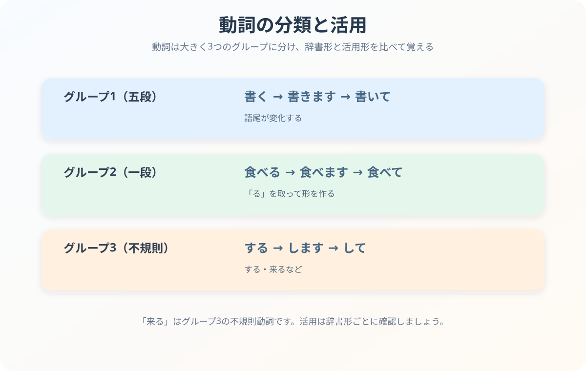

# 日本語の可能形と可能表現

## 日本語の可能形と可能表現

### 1. 可能形とは

可能形は、何かをする能力があることや、ある動作が実現できることを表す文法です。

中国語の「能」「会」「可以」に相当します。

例：

* 日本語が話せます。
* 一人で料理ができます。
* ここで写真を撮れます。

### 2. 動詞の可能形の作り方

#### 2.1 五段動詞

動詞の最後の音を「エ段」に変えて、「る」を付けます。

| 辞書形 | 可能形 |
| --- | --- |
| 書く  | 書ける |
| 話す  | 話せる |
| 読む  | 読める |
| 買う  | 買える |
| 待つ  | 待てる |
| 帰る  | 帰れる |

例：

* 漢字が書けます。
* 日本語の新聞が読めます。
* 明日は早く帰れます。

#### 2.2 一段動詞

「る」を取って「られる」を付けます。

| 辞書形 | 可能形   |
| --- | ----- |
| 食べる | 食べられる |
| 見る  | 見られる  |
| 起きる | 起きられる |
| 寝る  | 寝られる  |

例：

* 辛い料理も食べられます。
* この映画はインターネットで見られます。

#### 2.3 不規則動詞

| 辞書形    | 可能形        |
| ------ | ---------- |
| する     | できる        |
| 来る（くる） | 来られる（こられる） |

例：

* 私は運転ができます。
* 明日は会社に来られます。

### 3. 可能形の否定形・過去形

可能形も一般的な動詞と同じように活用します。

| 活用    | 書ける    | 食べられる    |
| ----- | ------ | -------- |
| 否定形   | 書けない   | 食べられない   |
| 過去形   | 書けた    | 食べられた    |
| 過去否定形 | 書けなかった | 食べられなかった |
| 丁寧形   | 書けます   | 食べられます   |

例：

* 今日は泳げません。
* 昨日は忙しくて勉強できませんでした。
* 子供のころは泳げませんでした。

### 4. 「ことができる」による可能表現

動詞の辞書形に「ことができる」を付けても、可能を表すことができます。

**基本文型：**

動詞の辞書形 + ことができる

例：

* 私は日本語を話すことができます。
* この図書館では本を借りることができます。
* ここでクレジットカードを使うことができます。

### 5. 可能形と「ことができる」の違い

| 表現     | 例文             |
| ------ | -------------- |
| 可能形    | 日本語が話せます。      |
| ことができる | 日本語を話すことができます。 |

どちらも可能を表します。

「ことができる」は、説明文や案内などでもよく使われます。

### 6. 助詞の使い方

可能を表す文では、「を」の代わりに「が」を使うことがあります。

例：

* 日本語を話します。
* 日本語が話せます。
* ピアノを弾きます。
* ピアノが弾けます。

ただし、可能形でも「を」を使う表現があります。

例：

* 今日はお酒を飲めません。
* 長い文章を読めます。

### 7. 学習のポイント

* 五段動詞・一段動詞・不規則動詞の可能形を覚える。
* 可能形の否定形と過去形を練習する。
* 「可能形」と「ことができる」の違いを理解する。
* 「が」と「を」の使い方に注意する。

### 8. まとめ

可能形は、能力や可能性を伝えるための重要な文法です。

動詞の活用ルールを覚え、日常生活の中で自分ができることやできないことを表現してみましょう。

### 9. 練習問題

#### 問題1：正しい可能形を選びましょう。

1. 書く →（書ける・書かれる）
2. 食べる →（食べられる・食べれる）
3. する →（できる・しれる）
4. 来る →（来られる・来れる）

#### 問題2：文に合う形を入れましょう。

1. 私は日本語を少し（話す）ことができます。→ 日本語が少し（　　　）。
2. 昨日は忙しくて、買い物に（行く）ことができませんでした。→ 昨日は買い物に（　　　）。
3. この図書館では本を（借りる）ことができます。→ この図書館では本を（　　　）。

#### 問題3：可能形と「ことができる」の共通点を説明しましょう。

### 10. 解答・解説

#### 問題1

1. 書ける：五段動詞は「う段」を「え段」に変えて「る」を付けます。
2. 食べられる：一段動詞は「る」を取って「られる」を付けます。標準的な書き言葉では「食べれる」より「食べられる」を使います。
3. できる：「する」の可能形は特別な形です。
4. 来られる（こられる）：「来る」の可能形は不規則な形です。

#### 問題2

1. 話せます
2. 行けませんでした
3. 借りられます

#### 問題3

どちらも能力や状況として可能であることを表します。「日本語が話せます」と「日本語を話すことができます」は、どちらも日本語を話す能力があるという意味です。
