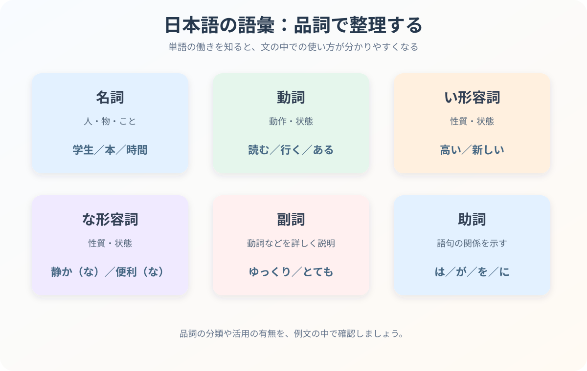

# 03 語彙

## 1. 語彙学習とは

語彙学習とは、日本語の単語や表現の意味、読み方、品詞、使い方を理解し、実際の会話や文章で正しく使えるようにする学習です。

語彙力を身につけることで、読解力・聴解力・会話力・作文力を総合的に高めることができます。単語の意味だけを暗記するのではなく、どのような場面で、どの言葉と一緒に使われるかを理解することが大切です。

## 2. このカテゴリーで学ぶ内容

| 分類         | 学習内容                    |
| ---------- | ----------------------- |
| 基本語彙       | 日常生活、学校、仕事などでよく使う単語     |
| 品詞別語彙      | 名詞・動詞・形容詞・副詞・接続詞など      |
| 意味別語彙      | 感情・性格・行動・状態・時間・数量など     |
| 類義語・対義語    | 似た意味や反対の意味を持つ言葉の違い      |
| 慣用句・ことわざ   | 単語の意味だけでは理解しにくい慣用表現     |
| 擬音語・擬態語    | 音・状態・動き・気持ちを表す言葉        |
| カタカナ語・外来語  | 外来語、日本語独自の意味を持つカタカナ語    |
| 生活分野の語彙    | 食事・住居・健康・買い物・交通・旅行など    |
| 社会・専門分野の語彙 | 社会・文化・ニュース・IT・ビジネス・職業など |
| 手続き・行政の語彙  | 契約、申請、届出、証明などに関する言葉     |

## 3. 品詞別の語彙

日本語の単語は、文の中での働きによって分類できます。

* **名詞**：人・物・場所・事柄を表す言葉
* **動詞**：動作や状態を表す言葉
* **い形容詞**：性質や状態を表し、「高い」「新しい」のように活用する言葉
* **な形容詞**：性質や状態を表し、「静かな」「便利な」のように名詞を修飾する言葉
* **副詞**：動詞や形容詞などを詳しく説明する言葉
* **接続詞**：文と文、話題と話題をつなぐ言葉

単語を覚えるときは、品詞と一緒に、文の中でどのように使うかも確認しましょう。

## 4. 意味・場面別の語彙

単語を意味や使用場面ごとに整理すると、関連する語彙をまとめて覚えやすくなります。

* 感情・性格・人の特徴
* 動作・行動・状態・変化
* 時間・頻度・程度・数量
* 人間関係・コミュニケーション
* 学校・教育・学習
* 日常生活・食事・住居・健康
* 買い物・お金・交通・旅行
* 自然・天気・季節
* 社会・文化・ニュース
* 職業・仕事・ビジネス
* IT・技術・インターネット
* 契約・手続き・行政

## 5. 類義語・対義語の学習

類義語は意味が似ている言葉、対義語は意味が反対の言葉です。

似ている言葉でも、使える場面、対象、文体、ニュアンスが異なる場合があります。例えば、「心配」と「不安」は近い意味ですが、使われる文脈や気持ちの焦点が異なります。

単語の意味だけでなく、例文や一緒に使われる助詞・動詞も比較しましょう。

## 6. 慣用句・ことわざ・擬音語・擬態語

日本語には、単語の意味を組み合わせただけでは理解できない表現や、音・状態を生き生きと伝える表現があります。

* **慣用句**：複数の言葉が結び付き、全体で特別な意味を表す表現
* **ことわざ**：経験や教訓を短い言葉で表した表現
* **擬音語**：実際の音を表す言葉
* **擬態語**：状態・様子・動き・気持ちなどを表す言葉

例：

* 雨がザーザー降る。
* 星がキラキラ光る。
* 彼はニコニコ笑っている。
* 部屋がすっきりしている。

## 7. 語彙の覚え方

1. **読み方と意味を確認する**：漢字の読み方、アクセント、品詞を一緒に確認します。
2. **例文で使い方を理解する**：単語が文の中でどのように使われるかを確認します。
3. **関連語と比較する**：類義語・対義語・反対の表現を並べて違いを整理します。
4. **自然な組み合わせで覚える**：「薬を飲む」「雨が降る」のように、よく一緒に使う言葉を覚えます。
5. **自分の文を作る**：学んだ語彙を使って、自分の生活や経験を説明します。
6. **間隔を空けて復習する**：学習当日、翌日、数日後、一週間後などに繰り返し確認します。

## 8. 練習問題の活用方法

各テーマの練習問題では、主に次の力を確認します。

* 文脈に合う語彙を選ぶ力
* 意味から適切な単語を思い出す力
* 似た言葉の意味や使い方を区別する力
* 学んだ語彙を自然な文の中で使う力

間違えた問題は、正解だけを覚えるのではなく、ほかの選択肢がなぜ合わないのかも確認しましょう。説明できなかった単語は、自分の語彙ノートに記録して復習します。

## 9. JLPTとの関係

日本語能力試験では、語彙の意味だけでなく、文脈に合った単語を選ぶ力、漢字の読み方、表記、似た言葉の使い分けなどが問われます。

N5からN1まで、学習段階に応じて語彙を増やしましょう。上級レベルでは、抽象的な語彙、社会・文化に関する語彙、文章で使われる硬い表現も理解することが重要です。

## 10. 学習の進め方

* まず日常生活や基本的な動作に関する語彙を学ぶ。
* 次に感情・性格・時間・数量など、意味ごとの語彙を整理する。
* 類義語・対義語や慣用表現を学び、表現の幅を広げる。
* 学校・仕事・社会・専門分野の語彙へ進む。
* 各テーマの練習問題を解き、間違えた語彙を復習する。
* 最後に複数のテーマの語彙を組み合わせて、読解や作文で使う。

## 11. まとめ

語彙力は、日本語を正しく理解し、自然に使うための重要な基礎です。

単語を一つずつ暗記するだけでなく、読み方・意味・品詞・使い方・関連語・例文を組み合わせて学習することが大切です。

日々の学習と復習を通して、覚えた語彙を実際の会話や文章で使える力にしていきましょう。
