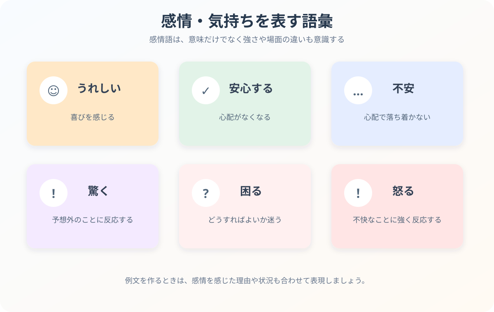

# 感情・性格に関する語彙

## 感情・性格に関する語彙

### 1. 感情・性格に関する語彙とは

感情・性格に関する語彙とは、人の気持ちや心の状態、性格、考え方、態度などを表す言葉です。

これらの語彙を覚えることで、自分や他人の気持ち、性格、行動の特徴をより具体的に説明できるようになります。

### 2. 喜び・幸福に関する語彙

| 単語  | 読み方    | 意味                  |
| --- | ------ | ------------------- |
| 喜び  | よろこび   | うれしいと感じる気持ち         |
| 幸福  | こうふく   | 心が満たされている状態         |
| 満足  | まんぞく   | 期待や希望が満たされること       |
| 感動  | かんどう   | 強く心を動かされること         |
| 感謝  | かんしゃ   | ありがたいと思う気持ち         |
| 安心  | あんしん   | 心配がなく落ち着いた状態        |
| 希望  | きぼう    | 未来に期待する気持ち          |
| 達成感 | たっせいかん | 目標を達成したときの満足感       |
| 誇り  | ほこり    | 自分や関係するものを立派だと思う気持ち |
| 楽しみ | たのしみ   | 期待して心待ちにすること        |

**例文：**

* 合格したと聞いて、大きな喜びを感じました。
* 家族と過ごす時間が私の幸福です。
* 目標を達成して、満足感と達成感を得ました。

### 3. 悲しみ・不安に関する語彙

| 単語  | 読み方   | 意味               |
| --- | ----- | ---------------- |
| 悲しみ | かなしみ  | 心がつらく感じる気持ち      |
| 不安  | ふあん   | 心配で落ち着かない状態      |
| 心配  | しんぱい  | 悪い結果にならないか気にすること |
| 寂しさ | さびしさ  | 一人で心細く感じる気持ち     |
| 孤独  | こどく   | 一人であると感じる状態      |
| 絶望  | ぜつぼう  | 希望を失うこと          |
| 失望  | しつぼう  | 期待が外れてがっかりすること   |
| 後悔  | こうかい  | 過去の行動を残念に思うこと    |
| 恐怖  | きょうふ  | 強い恐れ             |
| 緊張  | きんちょう | 心や体が張り詰めた状態      |

**例文：**

* 試験の結果が分からず、不安を感じています。
* 久しぶりに友人と会えて、寂しさがなくなりました。
* あのときの判断を今でも後悔しています。

### 4. 怒り・不満に関する語彙

| 単語  | 読み方   | 意味                 |
| --- | ----- | ------------------ |
| 怒り  | いかり   | 不快なことに対して腹を立てる気持ち  |
| 不満  | ふまん   | 期待どおりでなく納得できない気持ち  |
| 苛立ち | いらだち  | 思いどおりにならず落ち着かない気持ち |
| 不快  | ふかい   | 気分が悪いこと            |
| 不愉快 | ふゆかい  | 気持ちが悪く、嫌な感じがすること   |
| 憤り  | いきどおり | 強い怒り               |
| 反感  | はんかん  | 相手に対して反発する気持ち      |
| 恨み  | うらみ   | 受けた仕打ちを忘れられない気持ち   |
| 不公平 | ふこうへい | 公平でないこと            |
| 苦情  | くじょう  | 不満や不平を相手に伝えること     |

**例文：**

* 何度説明しても理解してもらえず、苛立ちを感じました。
* サービスの対応に不満があります。
* 不公平な扱いに対して、強い憤りを感じました。

### 5. 性格を表す語彙

| 単語    | 読み方      | 意味               |
| ----- | -------- | ---------------- |
| 明るい   | あかるい     | 元気で前向きな性格        |
| おとなしい | おとなしい    | 静かで控えめな性格        |
| 積極的   | せっきょくてき  | 自分から進んで行動する性格    |
| 消極的   | しょうきょくてき | 自分から進んで行動しない性格   |
| 真面目   | まじめ      | 物事に誠実に取り組む性格     |
| 素直    | すなお      | 人の意見をそのまま受け入れる性格 |
| 頑固    | がんこ      | 自分の考えを簡単に変えない性格  |
| 社交的   | しゃこうてき   | 人と交流することが好きな性格   |
| 内向的   | ないこうてき   | 自分の内面に意識が向きやすい性格 |
| 慎重    | しんちょう    | 注意深く行動する性格       |

**例文：**

* 彼女は明るくて社交的な性格です。
* 彼は真面目で、どんな仕事にも一生懸命取り組みます。
* 慎重な性格なので、決定する前によく考えます。

### 6. 人の態度・行動を表す語彙

| 単語  | 読み方      | 意味                |
| --- | -------- | ----------------- |
| 親切  | しんせつ     | 相手を思いやって行動すること    |
| 丁寧  | ていねい     | 注意深く礼儀正しいこと       |
| 謙虚  | けんきょ     | 自分を偉いと思わず控えめなこと   |
| 誠実  | せいじつ     | 真心を持って物事に向き合うこと   |
| 冷静  | れいせい     | 感情に左右されず落ち着いていること |
| 無責任 | むせきにん    | 自分の責任を果たさないこと     |
| 無関心 | むかんしん    | 物事に興味を持たないこと      |
| 協力的 | きょうりょくてき | 他人と力を合わせようとすること   |
| 自立的 | じりつてき    | 他人に頼りすぎず行動すること    |
| 横柄  | おうへい     | 相手を見下すような態度       |

**例文：**

* 彼はいつも親切に対応してくれます。
* 問題が発生しても冷静に判断する必要があります。
* チームのメンバーには協力的な姿勢が求められます。

### 7. 感情・性格に関する動詞

| 単語   | 読み方     | 意味          |
| ---- | ------- | ----------- |
| 喜ぶ   | よろこぶ    | うれしいと感じる    |
| 悲しむ  | かなしむ    | 悲しいと感じる     |
| 怒る   | おこる     | 腹を立てる       |
| 驚く   | おどろく    | 予想外のことに反応する |
| 感動する | かんどうする  | 強く心を動かされる   |
| 安心する | あんしんする  | 心配がなくなる     |
| 緊張する | きんちょうする | 心や体が張り詰める   |
| 反省する | はんせいする  | 自分の行動を振り返る  |
| 尊敬する | そんけいする  | 相手を立派だと思う   |
| 信頼する | しんらいする  | 相手を信用する     |

**例文：**

* 友人からのプレゼントにとても喜びました。
* 初めての発表で緊張しました。
* 失敗した原因を考えて、反省しました。

### 8. 感情・性格に関する形容詞

| 単語    | 読み方   | 意味              |
| ----- | ----- | --------------- |
| うれしい  | うれしい  | 喜びを感じる          |
| 悲しい   | かなしい  | 心がつらい           |
| 恥ずかしい | はずかしい | 人に見られて気まずい      |
| 悔しい   | くやしい  | 思いどおりにならず残念に思う  |
| 恐ろしい  | おそろしい | 強い恐怖を感じる        |
| 頼もしい  | たのもしい | 信頼できて安心できる      |
| 優しい   | やさしい  | 思いやりがある         |
| 厳しい   | きびしい  | 甘くなく、要求が強い      |
| 素晴らしい | すばらしい | 非常に優れている        |
| 情けない  | なさけない | 自分の行動などを恥ずかしく思う |

**例文：**

* 試合に負けて、とても悔しかったです。
* 困ったときに助けてくれる友人は頼もしいです。
* 失敗を隠してしまい、自分が情けなくなりました。

### 9. 感情を表す副詞・表現

| 単語・表現 | 読み方   | 意味             |
| ----- | ----- | -------------- |
| とても   | とても   | 程度が非常に高いこと     |
| すっかり  | すっかり  | 完全に、全部         |
| なんとなく | なんとなく | はっきりした理由はないが   |
| ほっと   | ほっと   | 安心したときの様子      |
| がっかり  | がっかり  | 期待が外れて落胆する様子   |
| いらいら  | いらいら  | 不満や焦りで落ち着かない様子 |
| どきどき  | どきどき  | 緊張や期待で胸が高鳴る様子  |
| わくわく  | わくわく  | 楽しみで心が弾む様子     |
| しみじみ  | しみじみ  | 心の底から深く感じる様子   |
| つい    | つい    | 意識せずにしてしまう様子   |

**例文：**

* 面接が終わって、ほっとしました。
* 旅行の日が近づいてきて、わくわくしています。
* 久しぶりに故郷に帰り、家族の大切さをしみじみ感じました。

### 10. 似ている感情・性格表現の比較

| 表現  | 意味・使い方             |
| --- | ------------------ |
| 喜び  | うれしいと感じる気持ち        |
| 幸福  | 心が満たされている状態        |
| 安心  | 心配がなく落ち着くこと        |
| 満足  | 期待や希望が満たされること      |
| 不安  | 将来や結果が心配な状態        |
| 心配  | 具体的な事柄を気にすること      |
| 悲しみ | つらく感じる気持ち          |
| 寂しさ | 一人で心細く感じる気持ち       |
| 慎重  | よく考えて注意深く行動すること    |
| 臆病  | 恐れを感じやすく行動できないこと   |
| 素直  | 人の意見や気持ちを受け入れやすいこと |
| 従順  | 他人の指示や命令に従うこと      |

### 11. 学習のポイント

* 感情を表す名詞・動詞・形容詞を関連付けて覚える。
* 似ている感情表現の意味の違いを理解する。
* 性格を表す言葉は、良い意味・悪い意味の両方に注意する。
* 副詞や擬態語を使って、感情の強さや様子を具体的に表現する。
* 例文を通して、自然な使い方を身につける。
* 自分や周囲の人の性格・気持ちを日本語で説明してみる。

### 12. まとめ

感情・性格に関する語彙は、自分や他人の気持ち、考え方、行動の特徴を表現するために重要です。

単語の意味だけでなく、感情の強さや使用場面、似ている表現との違いも理解し、自然な日本語で気持ちを伝えられるようにしましょう。

### 13. 練習問題

#### 問題1：最も適切な言葉を選びましょう。

1. 試験に合格したと聞いて、大きな（喜び・絶望）を感じました。
2. 将来のことが分からず、少し（不安・満足）です。
3. 自分から進んで行動する性格を（積極的・消極的）と言います。
4. 感情に左右されず落ち着いている様子を（冷静・横柄）と言います。
5. 期待が外れてがっかりすることを（失望・幸福）と言います。

#### 問題2：意味に合う語彙を書きましょう。

1. 目標を達成したときに感じる満足感：（　　　）
2. 人と交流することが好きな性格：（　　　）
3. 相手を思いやって行動すること：（　　　）
4. 期待して心待ちにすること：（　　　）

#### 問題3：次の言葉の違いを説明しましょう。

1. 「心配」と「不安」
2. 「慎重」と「臆病」
3. 「素直」と「従順」

### 14. 解答・解説

#### 問題1

1. 喜び：合格というよい知らせに対するうれしい気持ちです。
2. 不安：先のことが分からず、落ち着かない状態です。
3. 積極的：自分から進んで行動する性格です。
4. 冷静：感情に左右されず、落ち着いている様子です。
5. 失望：期待が外れてがっかりすることです。

#### 問題2

1. 達成感
2. 社交的
3. 親切
4. 楽しみ

#### 問題3

1. 「心配」は具体的な事柄について悪い結果にならないか気にすること、「不安」は先が分からず落ち着かない気持ちを広く表します。
2. 「慎重」はよく考えて注意深く行動すること、「臆病」は恐れを感じやすく行動をためらう性質です。
3. 「素直」は人の意見や気持ちを受け入れやすいこと、「従順」は他人の指示や命令に従うことです。
