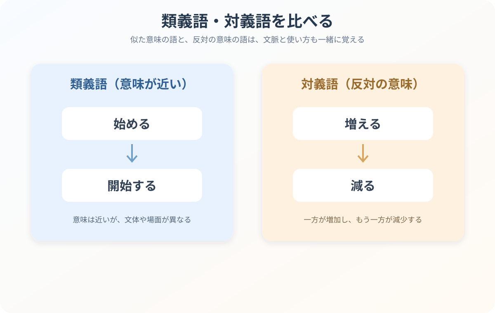

# 類義語・対義語の整理

## 1. このテーマについて

類義語は意味が似ている言葉、対義語は反対の意味を持つ言葉です。意味が似ていても、使う場面・対象・丁寧さ・強さが異なる場合があります。

単語を一対一で暗記するだけでなく、例文の中でどの言葉が自然かを考えながら学びましょう。

## 2. 主な分類・関連語彙

### 2.1 動作・変化を表す類義語と対義語

| 語彙   | 読み方    | 意味・使い分け         |
| ---- | ------ | --------------- |
| 開始   | かいし    | 物事が始まること。やや硬い表現 |
| 始める  | はじめる   | 人が何かを始める動作      |
| 開始する | かいしする  | 会議・作業などが始まること   |
| 終了   | しゅうりょう | 物事が終わること。やや硬い表現 |
| 終える  | おえる    | 人が何かを終わらせる動作    |
| 増加   | ぞうか    | 数や量が増えること       |
| 減少   | げんしょう  | 数や量が減ること        |
| 拡大   | かくだい   | 規模や範囲が大きくなること   |
| 縮小   | しゅくしょう | 規模や範囲が小さくなること   |
| 改善   | かいぜん   | 悪い状態をよくすること     |
| 悪化   | あっか    | 状態が悪くなること       |

### 2.2 感情・状態を表す類義語

| 語彙    | 読み方     | 意味・使い分け             |
| ----- | ------- | ------------------- |
| 嬉しい   | うれしい    | 喜びを感じる気持ち           |
| 楽しい   | たのしい    | 物事をしていて心地よい気持ち      |
| 面白い   | おもしろい   | 興味を引かれる、楽しい         |
| 興味がある | きょうみがある | 知りたい、関心がある          |
| 心配    | しんぱい    | 悪い結果にならないか気にすること    |
| 不安    | ふあん     | はっきりしないことに落ち着かない気持ち |
| 安心    | あんしん    | 心配がなく落ち着いた状態        |
| 満足    | まんぞく    | 希望や期待が満たされている状態     |
| 不満    | ふまん     | 希望や期待が満たされない状態      |

### 2.3 程度・評価を表す語彙

| 語彙   | 読み方   | 意味・使い分け           |
| ---- | ----- | ----------------- |
| 少し   | すこし   | 量や程度がわずか          |
| かなり  | かなり   | 程度が大きい            |
| 非常に  | ひじょうに | 程度がとても高い。やや硬い     |
| わずか  | わずか   | ごく少量・少数           |
| 多く   | おおく   | 数や量が多い            |
| ほとんど | ほとんど  | 大部分。否定と使うと「ほぼ～ない」 |
| 適切   | てきせつ  | 状況や目的に合っている       |
| 妥当   | だとう   | 判断や方法に無理がなく適切     |
| 正確   | せいかく  | 間違いがない            |
| 厳密   | げんみつ  | 細部まで正しく、あいまいさがない  |

### 2.4 文体・丁寧さの違い

| 普通の表現 | 丁寧・改まった表現   | 注意点                         |
| ----- | ----------- | --------------------------- |
| 見る    | ご覧になる／拝見する  | 相手の動作は「ご覧になる」、自分の動作は「拝見する」  |
| 言う    | おっしゃる／申し上げる | 相手の動作は「おっしゃる」、自分の動作は「申し上げる」 |
| 行く    | いらっしゃる／伺う   | 相手の動作は「いらっしゃる」、自分の訪問は「伺う」   |
| 聞く    | お聞きになる／伺う   | 相手の動作と自分の動作で使い分ける           |
| もらう   | いただく        | 自分が受け取るときに使う謙譲表現            |

## 3. 例文

**会議は午前九時に開始し、正午に終了する予定です。** 意味：会议预计上午九点开始，中午结束。

**利用者が増加する一方で、問い合わせ件数は減少しています。** 意味：用户数量增加的同时，咨询件数正在减少。

**試験の結果が分かるまで不安でしたが、合格したと聞いて安心しました。** 意味：得知考试结果之前一直很不安，听说合格后终于放心了。

**資料を拝見しました。内容について一点確認させてください。** 意味：我已经拜读了资料。关于内容，请允许我确认一点。

## 4. 使い分け・注意点

* 「開始する」は会議やイベントなどに使いやすく、「始める」は日常的な動作にも広く使えます。
* 「嬉しい」は結果などに対する喜び、「楽しい」は活動や時間そのものを楽しむ気持ちを表します。
* 「心配」は具体的な事柄を気にする場合にも使い、「不安」は先が分からないことへの落ち着かない気持ちを表すことが多いです。
* 「適切」は目的や状況に合っていること、「妥当」は判断や考え方に無理がないことを表します。
* 敬語は相手と自分のどちらの動作かを確認して選びます。「ご覧になる」は尊敬語、「拝見する」は謙譲語です。
* 類義語は完全に同じ意味とは限りません。目的語や一緒に使う言葉も確認しましょう。

## 5. 学習のポイント

* 類義語は例文を並べて、置き換えられる場合と置き換えられない場合を確認します。
* 対義語は一緒に覚えると、語彙の意味を整理しやすくなります。
* 敬語は「誰がする動作か」を基準に整理しましょう。
* 読解問題では、前後の文脈や話し手の立場から最も自然な言葉を選びます。

## 6. JLPTとの関連

類義語・対義語は、語彙問題だけでなく読解問題でも重要です。選択肢の言葉が似ている場合は、意味の違いだけでなく、文法的な組み合わせや文体も確認しましょう。

## 7. まとめ

類義語・対義語を学ぶことで、語彙の意味をより正確に理解し、表現の幅を広げられます。似た言葉の細かな違いを例文で確認することが大切です。

## 8. 練習問題

### 問題1：文に最も適切な言葉を選びましょう。

1. 会議は予定どおり午前十時に（開始・改善）しました。
2. 人口が（増加・縮小）すると、必要なサービスも変わることがあります。
3. 試験に合格したので、とても（嬉しい・不安）です。
4. 体調が悪くなることを「体調が（悪化・改善）する」と言います。
5. 目的に合った方法を選ぶことは、（適切・厳密）な方法を選ぶと言えます。

### 問題2：対義語を書きましょう。

1. 増加 ⇔（　　　）
2. 拡大 ⇔（　　　）
3. 改善 ⇔（　　　）
4. 満足 ⇔（　　　）
5. 開始 ⇔（　　　）

### 問題3：敬語として正しいものを選びましょう。

1. 先生が資料を（拝見しました・ご覧になりました）。
2. 私は先ほど報告書を（拝見しました・ご覧になりました）。
3. 私が先生の研究室へ（伺います・いらっしゃいます）。

## 9. 解答・解説

### 問題1

1. 開始：会議などが始まることです。
2. 増加：人口や数が多くなることです。
3. 嬉しい：合格というよい結果に対する喜びです。
4. 悪化：状態が悪くなることです。
5. 適切：目的や状況に合っていることです。

### 問題2

1. 減少
2. 縮小
3. 悪化
4. 不満
5. 終了

### 問題3

1. ご覧になりました：先生の動作なので尊敬語を使います。
2. 拝見しました：自分の動作なので謙譲語を使います。
3. 伺います：自分が訪問する動作なので謙譲語を使います。
