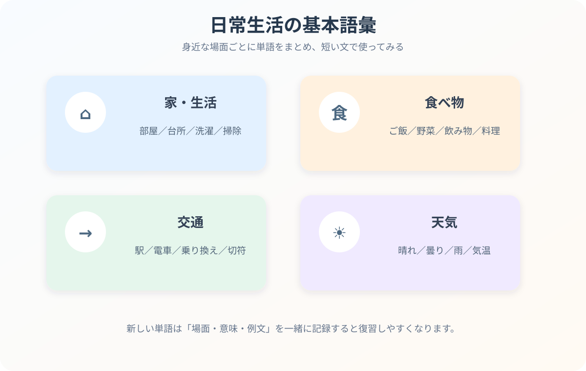

# 日常生活の基本語彙

## 日常生活の基本語彙

### 1. 日常生活の基本語彙とは

日常生活の基本語彙とは、毎日の生活や身近な場面で頻繁に使われる単語です。

家族、住まい、食事、買い物、交通など、生活に関係する語彙を覚えることで、日常会話をより自然に理解し、表現できるようになります。

### 2. 家族・人間関係に関する語彙

| 単語 | 読み方   | 意味      |
| -- | ----- | ------- |
| 家族 | かぞく   | 家族      |
| 両親 | りょうしん | 父と母     |
| 父親 | ちちおや  | 父       |
| 母親 | ははおや  | 母       |
| 兄弟 | きょうだい | 兄・弟・姉・妹 |
| 夫  | おっと   | 自分の夫    |
| 妻  | つま    | 自分の妻    |
| 友人 | ゆうじん  | 友達      |
| 同僚 | どうりょう | 一緒に働く人  |
| 近所 | きんじょ  | 近くの地域   |

**例文：**

* 私の家族は4人です。
* 週末に友人と食事をします。
* 近所に新しい店ができました。

### 3. 住まい・家具に関する語彙

| 単語  | 読み方   | 意味       |
| --- | ----- | -------- |
| 住宅  | じゅうたく | 住むための建物  |
| 部屋  | へや    | 建物の中の空間  |
| 台所  | だいどころ | 料理をする場所  |
| 玄関  | げんかん  | 家の出入り口   |
| 浴室  | よくしつ  | お風呂に入る場所 |
| 寝室  | しんしつ  | 寝るための部屋  |
| 家具  | かぐ    | 机や椅子など   |
| 冷蔵庫 | れいぞうこ | 食品を冷やす機械 |
| 洗濯機 | せんたくき | 洗濯をする機械  |
| 掃除機 | そうじき  | 掃除をする機械  |

**例文：**

* 新しい住宅に引っ越しました。
* 冷蔵庫に飲み物が入っています。
* 毎週日曜日に部屋を掃除します。

### 4. 食べ物・飲み物に関する語彙

| 単語  | 読み方     | 意味        |
| --- | ------- | --------- |
| 食材  | しょくざい   | 料理に使う材料   |
| 野菜  | やさい     | 野菜        |
| 果物  | くだもの    | 果物        |
| 肉   | にく      | 肉         |
| 魚   | さかな     | 魚         |
| 米   | こめ      | お米        |
| 調味料 | ちょうみりょう | 味付けに使うもの  |
| 飲料  | いんりょう   | 飲み物       |
| 弁当  | べんとう    | 持ち運びできる食事 |
| 食器  | しょっき    | 食事に使う器具   |

**例文：**

* スーパーで新鮮な野菜を買いました。
* 毎朝、ご飯と味噌汁を食べます。
* お弁当を持って会社へ行きます。

### 5. 買い物に関する語彙

| 単語  | 読み方      | 意味            |
| --- | -------- | ------------- |
| 商品  | しょうひん    | 売られている品物      |
| 値段  | ねだん      | 商品の価格         |
| 価格  | かかく      | 商品やサービスの金額    |
| 割引  | わりびき     | 通常の価格より安くすること |
| 特売  | とくばい     | 特別に安く売ること     |
| 会計  | かいけい     | 支払いの計算        |
| 現金  | げんきん     | 紙幣や硬貨         |
| 小銭  | こぜに      | 少額の硬貨         |
| 領収書 | りょうしゅうしょ | 支払いを証明する書類    |
| 返品  | へんぴん     | 買った商品を返すこと    |

**例文：**

* この商品の値段はいくらですか。
* セール期間中なので、20％割引です。
* 商品を返品したいのですが。

### 6. 交通・移動に関する語彙

| 単語   | 読み方   | 意味            |
| ---- | ----- | ------------- |
| 交通   | こうつう  | 人や物の移動        |
| 電車   | でんしゃ  | 電気で走る列車       |
| 地下鉄  | ちかてつ  | 地下を走る鉄道       |
| 駅    | えき    | 電車に乗り降りする場所   |
| 改札   | かいさつ  | 駅の乗車口         |
| 乗り換え | のりかえ  | 別の交通機関に移ること   |
| 運賃   | うんちん  | 交通機関の料金       |
| 定期券  | ていきけん | 一定期間利用できる乗車券  |
| 渋滞   | じゅうたい | 車が混雑して進みにくい状態 |
| 道路   | どうろ   | 車や人が通る道       |

**例文：**

* 駅で電車を乗り換えます。
* 通勤時間は道路が渋滞します。
* 定期券を更新しました。

### 7. 健康・体に関する語彙

| 単語 | 読み方    | 意味            |
| -- | ------ | ------------- |
| 健康 | けんこう   | 体や心が良い状態      |
| 体調 | たいちょう  | 体の調子          |
| 症状 | しょうじょう | 病気によって現れる状態   |
| 発熱 | はつねつ   | 熱が出ること        |
| 頭痛 | ずつう    | 頭が痛いこと        |
| 腹痛 | ふくつう   | お腹が痛いこと       |
| 病院 | びょういん  | 病気やけがを治療する施設  |
| 診察 | しんさつ   | 医師が体の状態を調べること |
| 薬  | くすり    | 病気や症状を治療するもの  |
| 休養 | きゅうよう  | 体を休めること       |

**例文：**

* 最近、体調があまりよくありません。
* 頭痛がするので、病院へ行きます。
* 疲れたときは十分に休養してください。

### 8. 時間・天気・季節に関する語彙

| 単語 | 読み方   | 意味           |
| -- | ----- | ------------ |
| 平日 | へいじつ  | 土日・祝日以外の日    |
| 週末 | しゅうまつ | 一週間の終わり      |
| 祝日 | しゅくじつ | 国が定めた休日      |
| 季節 | きせつ   | 春・夏・秋・冬      |
| 気温 | きおん   | 空気の温度        |
| 湿度 | しつど   | 空気中の水分量      |
| 晴れ | はれ    | 空が明るく晴れている状態 |
| 曇り | くもり   | 雲が多い天気       |
| 雨  | あめ    | 空から降る水       |
| 台風 | たいふう  | 強い風と雨を伴う気象現象 |

**例文：**

* 週末は友達と出かける予定です。
* 今日は気温が高く、蒸し暑いです。
* 台風が近づいているので注意してください。

### 9. 日常生活でよく使う動詞

| 単語   | 読み方    | 意味         |
| ---- | ------ | ---------- |
| 起きる  | おきる    | 目を覚まして起床する |
| 寝る   | ねる     | 睡眠をとる      |
| 出かける | でかける   | 外へ行く       |
| 戻る   | もどる    | 元の場所へ帰る    |
| 準備する | じゅんびする | 必要なものを整える  |
| 片付ける | かたづける  | 整理してきれいにする |
| 洗う   | あらう    | 水などで汚れを落とす |
| 捨てる  | すてる    | 不要なものを処分する |
| 選ぶ   | えらぶ    | 複数から一つを決める |
| 申し込む | もうしこむ  | 利用や参加を申請する |

**例文：**

* 毎朝6時に起きます。
* 出かける前に準備をします。
* 使わなくなった家具を捨てました。

### 10. 日常生活でよく使う形容詞・副詞

| 単語   | 読み方   | 意味           |
| ---- | ----- | ------------ |
| 便利   | べんり   | 使いやすく役に立つ    |
| 不便   | ふべん   | 使いにくく不都合である  |
| 快適   | かいてき  | 気持ちよく過ごせる    |
| 清潔   | せいけつ  | 汚れがなくきれい     |
| 新鮮   | しんせん  | 新しくて状態がよい    |
| 十分   | じゅうぶん | 必要な量が満たされている |
| かなり  | かなり   | 程度が大きい       |
| だいたい | だいたい  | おおよそ         |
| たまに  | たまに   | 時々           |
| しばらく | しばらく  | ある程度の時間      |

**例文：**

* このアプリはとても便利です。
* 部屋を清潔に保ちましょう。
* 週末はたまに外食します。

### 11. 学習のポイント

* 単語の読み方と意味をセットで覚える。
* 家族・住まい・食事など、場面ごとに分類して学習する。
* 名詞だけでなく、動詞や形容詞も一緒に覚える。
* 例文を通して、実際の使い方を理解する。
* 日常生活の中で見たり聞いたりした単語を記録する。
* 覚えた語彙を使って、自分の日常を日本語で説明する。

### 12. まとめ

日常生活の基本語彙は、日本語で生活し、コミュニケーションを取るための重要な基礎です。

家族、住まい、食事、買い物、交通、健康など、身近な場面の語彙から少しずつ覚え、実際の会話で使えるようにしましょう。

### 13. 練習問題

#### 問題1：最も適切な言葉を選びましょう。

1. 食べ物を冷やして保存する機械は（冷蔵庫・洗濯機）です。
2. 商品の価格を通常より安くすることを（割引・会計）と言います。
3. 電車から別の電車に移ることを（乗り換え・渋滞）と言います。
4. 体の調子を表す言葉は（体調・食器）です。
5. 土曜日と日曜日を含む週の終わりごろを（週末・平日）と言います。

#### 問題2：意味に合う語彙を書きましょう。

1. 家の出入り口：（　　　）
2. 支払いを証明する書類：（　　　）
3. 一定期間利用できる乗車券：（　　　）
4. 病気によって現れる体の状態：（　　　）
5. 必要なものを前もって整えること：（　　　）

#### 問題3：次の言葉の違いを説明しましょう。

1. 「値段」と「価格」
2. 「返品」と「割引」
3. 「平日」と「祝日」

### 14. 解答・解説

#### 問題1

1. 冷蔵庫：食品や飲み物を冷やして保存する機械です。
2. 割引：通常の価格より安くすることです。
3. 乗り換え：別の交通機関や路線に移ることです。
4. 体調：体の調子を表します。
5. 週末：一週間の終わりごろを指します。

#### 問題2

1. 玄関
2. 領収書
3. 定期券
4. 症状
5. 準備

#### 問題3

1. 「値段」は日常会話でよく使う価格の表現です。「価格」は商品やサービスの金額を示す、やや改まった表現です。
2. 「返品」は買った商品を返すこと、「割引」は通常の価格より安くすることです。
3. 「平日」は一般に土日・祝日以外の日、「祝日」は国が定めた休日です。
