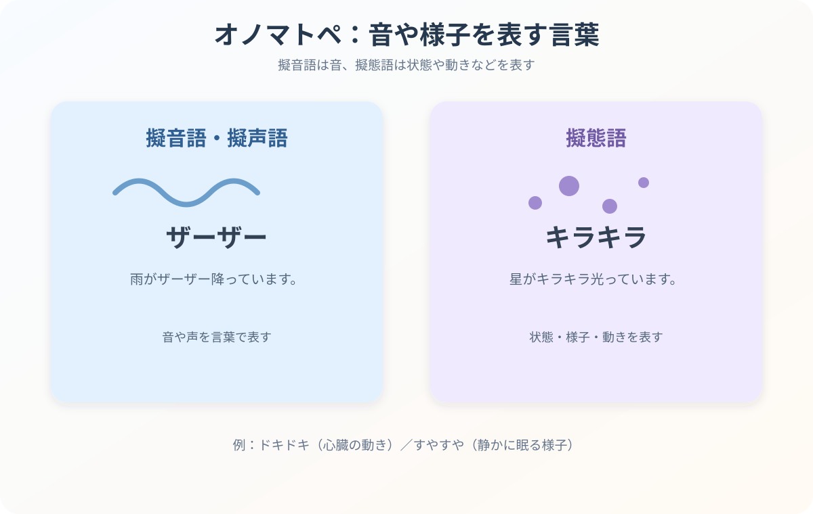

# オノマトペ（擬音語・擬態語）

## 1. オノマトペとは

オノマトペは、音・声・動き・状態・感情などを感覚的に表す言葉です。日本語では会話や漫画だけでなく、小説、広告、ニュース、日常の説明にもよく使われます。

* **擬音語**：実際に聞こえる音を表す言葉
* **擬声語**：人や動物の声を表す言葉
* **擬態語**：音がしない状態や様子を表す言葉
* **擬情語**：人の気持ちや心理状態を表す言葉

分類は学習上の目安です。同じ言葉が複数の働きを持つこともあります。

## 2. 音・声を表す言葉

| 表現          | 読み方  | 意味・使う場面       |
| ----------- | ---- | ------------- |
| 雨がザーザー降る    | ざーざー | 強い雨が続けて降る音・様子 |
| 雷がゴロゴロ鳴る    | ごろごろ | 雷などの低く大きな音    |
| ドアをバタンと閉める  | ばたん  | ドアなどが勢いよく閉まる音 |
| 時計がチクタク動く   | ちくたく | 時計の規則的な音      |
| 犬がワンワン吠える   | わんわん | 犬の鳴き声         |
| 赤ちゃんがすやすや眠る | すやすや | 静かで気持ちよさそうな寝息 |

## 3. 様子・状態を表す言葉

| 表現          | 読み方    | 意味・使う場面        |
| ----------- | ------ | -------------- |
| 星がキラキラ光る    | きらきら   | 小さな光が美しく輝く様子   |
| 服がびしょびしょになる | びしょびしょ | 水でひどくぬれた状態     |
| ふわふわのタオル    | ふわふわ   | 軽く柔らかい感触       |
| 部屋をすっきり片付ける | すっきり   | 整理されて気持ちがよい状態  |
| 道がでこぼこしている  | でこぼこ   | 表面に高低や凹凸がある状態  |
| 人がぞろぞろ歩く    | ぞろぞろ   | 多くの人が続いて移動する様子 |
| 机の上がぐちゃぐちゃだ | ぐちゃぐちゃ | 乱雑に入り混じった状態    |
| 予定が次々に決まる   | どんどん   | 物事が勢いよく進む様子    |

## 4. 気持ち・体の状態を表す言葉

| 表現           | 読み方  | 意味・使う場面          |
| ------------ | ---- | ---------------- |
| 試験の結果にわくわくする | わくわく | 期待で心が弾む          |
| 待たされていらいらする  | いらいら | 思いどおりにならず落ち着かない  |
| 人前でどきどきする    | どきどき | 緊張や興奮で心臓が強く動く感じ  |
| 安心してほっとする    | ほっと  | 緊張や心配がなくなって安心する  |
| 疲れてぐったりする    | ぐったり | 体力を失って元気がない      |
| 緊張してそわそわする   | そわそわ | 落ち着かず、じっとしていられない |

## 5. 形と一緒に覚える

オノマトペは、よく使われる動詞や形容詞と組み合わせると覚えやすくなります。

| よく使う形  | 例                    |
| ------ | -------------------- |
| ～と鳴る   | ゴロゴロと鳴る、チクタクと鳴る      |
| ～と降る   | 雨がザーザーと降る            |
| ～する    | どきどきする、わくわくする、いらいらする |
| ～した＋名詞 | すっきりした部屋、ふわふわした布     |
| ～に＋動詞  | ぐっすり眠る、ゆっくり歩く        |

## 6. 似た表現の使い分け

### きらきら・ぴかぴか

* **きらきら**：光が小さく美しく輝く様子。星や目などにも使う。
* **ぴかぴか**：表面が光っている様子。磨いた靴や新品の物などに使う。

例：

* 夜空の星がきらきら光っている。
* 靴を磨いたので、ぴかぴかになった。

### どきどき・わくわく

* **どきどき**：緊張・不安・興奮などで心臓が強く打つ感じ。
* **わくわく**：楽しいことを期待して心が弾む感じ。

例：

* 面接の前でどきどきしている。
* 旅行の日が近づいてわくわくしている。

## 7. 例文で確認する

1. 昨夜は雨がザーザー降っていたので、よく眠れませんでした。
   * 昨晚雨下得很大，所以没能睡好。
2. 新しいスマートフォンの画面がぴかぴか光っています。
   * 新手机的屏幕闪闪发亮。
3. 発表の順番を待っている間、ずっとどきどきしていました。
   * 等待发表顺序时，我一直很紧张。
4. 部屋を片付けたら、気分まですっきりしました。
   * 整理完房间后，连心情都舒畅了。

## 8. 練習問題

### 問題1：最も適切な言葉を選びましょう

（　）に入る言葉を、ア～エから一つ選んでください。

1. 面接の順番を待っている間、緊張して（　）した。
   * ア わくわく　イ どきどき　ウ すっきり　エ びしょびしょ
2. 雨にぬれて、服が（　）になった。
   * ア ふわふわ　イ きらきら　ウ びしょびしょ　エ そわそわ
3. 旅行の日が近づき、楽しみで（　）している。
   * ア わくわく　イ ぐったり　ウ ぐちゃぐちゃ　エ でこぼこ

### 問題2：意味に合う表現を書きましょう

1. 表面が光っていて、磨いた靴の様子：＿＿＿＿
2. 心配や緊張がなくなり、安心したとき：＿＿＿＿
3. 多くの人が続けて移動する様子：＿＿＿＿

### 問題3：文を完成させましょう

次の言葉を一度ずつ使って、文を完成させてください。

**ザーザー・すっきり・ぐったり**

1. 大雨が（　　　　）降っている。
2. 部屋を片付けたら、気分が（　　　　）した。
3. 一日中歩いたので、疲れて（　　　　）した。

## 9. 解答・解説

### 問題1

1. **イ どきどき**：緊張や不安で心臓が強く打つ感じです。
2. **ウ びしょびしょ**：水でひどくぬれた状態です。
3. **ア わくわく**：楽しいことを期待して心が弾む様子です。

### 問題2

1. **ぴかぴか**
2. **ほっと**
3. **ぞろぞろ**

### 問題3

1. **ザーザー**
2. **すっきり**
3. **ぐったり**

## 10. 学習のポイント

* 意味だけでなく、どの名詞・動詞と一緒に使うかを覚える。
* 音を表す言葉と、状態・感情を表す言葉を区別する。
* 似た表現は、例文を比べてニュアンスを確認する。
* 自分の日常を三つのオノマトペを使って説明してみる。

## 11. まとめ

オノマトペを使うと、音や状態、気持ちを具体的に伝えられます。単語だけを暗記するのではなく、自然な組み合わせと場面を一緒に覚えましょう。

***

**教材について：** 本ページの説明・例文は本サイト向けに作成した学習用コンテンツです。特定の市販教材やウェブ記事の文章・図版を転載したものではありません。
