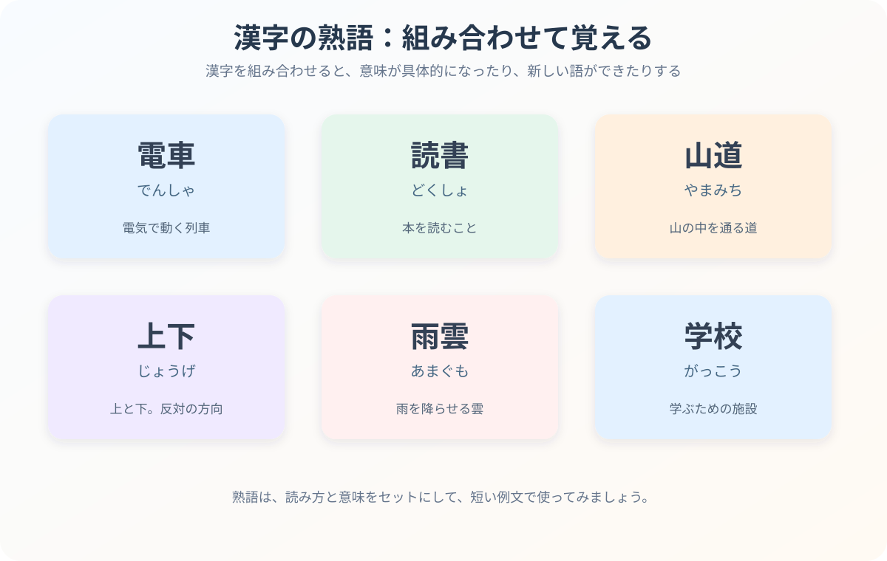

# 二字熟語・四字熟語

## 1. 熟語とは

熟語は、複数の漢字を組み合わせて一つの意味を表す言葉です。二字熟語は漢字二字、四字熟語は漢字四字で構成されるものが代表的です。

## 2. 二字熟語の主な構成

| 構成             | 例      | 意味         |
| -------------- | ------ | ---------- |
| 似た意味の漢字を組み合わせる | 安全・道路  | 関連する意味を重ねる |
| 反対の意味を組み合わせる   | 左右・売買  | 対になる意味を表す  |
| 前の漢字が後ろを説明する   | 大雨・新製品 | 後ろの語を詳しくする |
| 動作と対象を組み合わせる   | 読書・登山  | 動作や行為を表す   |
| 主語と述語の関係       | 日没・地震  | 出来事や状態を表す  |

## 3. よく使う二字熟語

| 熟語 | 読み方  | 意味             |
| -- | ---- | -------------- |
| 安全 | あんぜん | 危険がないこと        |
| 確認 | かくにん | 正しいかどうかを確かめること |
| 連絡 | れんらく | 必要な情報を伝えること    |
| 変更 | へんこう | 内容や状態を変えること    |
| 準備 | じゅんび | 前もって整えること      |
| 経験 | けいけん | 実際に見たり行ったりすること |
| 判断 | はんだん | 状況を考えて決めること    |
| 改善 | かいぜん | 悪いところをよくすること   |

## 4. 四字熟語

| 四字熟語 | 読み方      | 意味・使い方              |
| ---- | -------- | ------------------- |
| 一石二鳥 | いっせきにちょう | 一つの行動で二つの利益を得ること    |
| 自業自得 | じごうじとく   | 自分の行いの結果を自分で受けること   |
| 十人十色 | じゅうにんといろ | 人によって考えや好みが異なること    |
| 試行錯誤 | しこうさくご   | 試しながら失敗と改善を繰り返すこと   |
| 臨機応変 | りんきおうへん  | 状況に応じて適切に対応すること     |
| 温故知新 | おんこちしん   | 過去を学び、新しい知識や考えを得ること |
| 起死回生 | きしかいせい   | 非常に悪い状況から立て直すこと     |
| 公明正大 | こうめいせいだい | 公平で隠し事がないこと         |

## 5. 例文

* 作業を始める前に、安全を確認してください。
* 新しい方法を試行錯誤しながら改善しました。
* 人の好みは十人十色です。
* 一つの工夫で時間と費用を節約でき、一石二鳥でした。

## 6. 学習のポイント

* 熟語を構成する漢字の意味を確認する。
* 読み方は熟語全体で覚える。
* 四字熟語は意味だけでなく、使う場面や文脈も覚える。
* 自分の経験を使って例文を作る。

## 7. 練習問題

### 問題1：読み方を書きましょう。

1. 安全
2. 確認
3. 試行錯誤
4. 十人十色

### 問題2：意味に合う熟語を選びましょう。

1. 一つの行動で二つの利益を得ること：（一石二鳥・自業自得）
2. 状況に合わせて柔軟に対応すること：（臨機応変・温故知新）
3. 人によって好みや考えが違うこと：（十人十色・起死回生）

### 問題3：次の四字熟語を使って文を作りましょう。

1. 試行錯誤
2. 臨機応変

## 8. 解答・解説

### 問題1

1. あんぜん
2. かくにん
3. しこうさくご
4. じゅうにんといろ

### 問題2

1. 一石二鳥
2. 臨機応変
3. 十人十色

### 問題3

例：

1. 新しい方法を試行錯誤しながら見つけました。
2. 急な変更にも臨機応変に対応しました。

## 9. まとめ

熟語は漢字の意味を組み合わせて理解し、読み方と使い方を一緒に覚えましょう。四字熟語は、意味が使われる具体的な場面を想像すると記憶に残りやすくなります。
