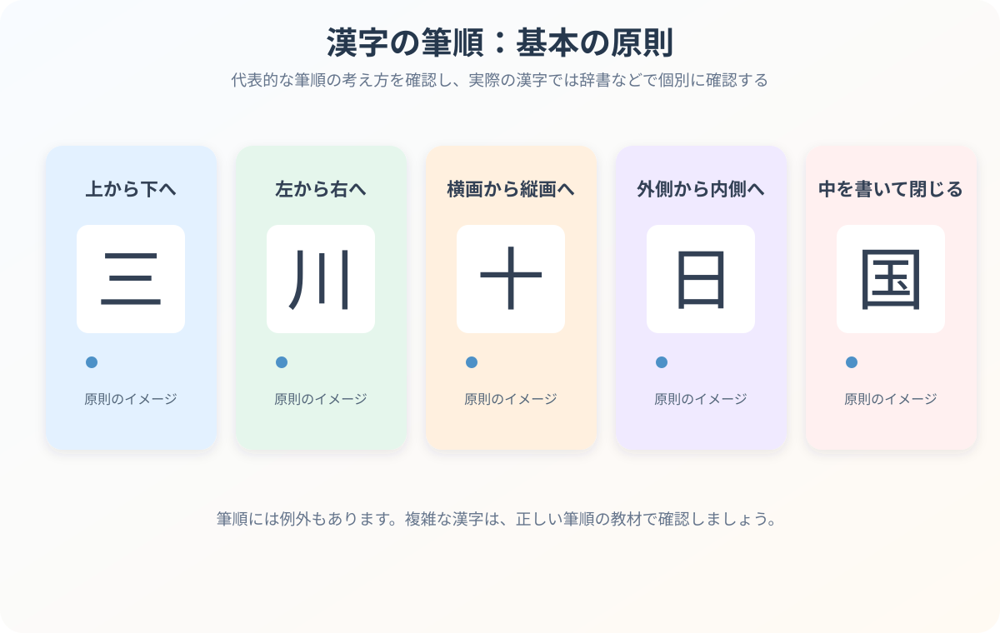

# 筆順・書き方の基本

## 1. 筆順とは

筆順は、漢字を書くときの線や点を書く順番です。基本的な筆順を身につけると、字形のバランスを整えやすくなり、漢字を正確に覚えやすくなります。

## 2. 基本的な筆順の原則

| 原則            | 内容              | 例   |
| ------------- | --------------- | --- |
| 上から下          | 上の部分から先に書く      | 三、言 |
| 左から右          | 左側から右側へ書く       | 川、林 |
| 横線から縦線        | 横線を先に書く場合が多い    | 十、干 |
| 外側から内側        | 囲みの外側を先に書く場合が多い | 同、国 |
| 中を先に書き、最後に閉じる | 囲みの内部を書いてから閉じる  | 国、回 |
| 中央を先に書く場合     | 左右のバランスを取る      | 小、水 |
| はね・払い         | 線の終わり方を意識する     | 木、手 |

※ 筆順には例外や個別の決まりがあります。迷った場合は、信頼できる漢字辞典などで漢字ごとに確認しましょう。

## 3. 画数と基本的な線の形

* **画数**：漢字を書くために必要な線の数です。
* **止め**：線の終わりで筆を止める書き方です。
* **はね**：線の終わりを軽く跳ね上げる書き方です。
* **払い**：線の終わりを方向に沿って払う書き方です。

## 4. 字形のバランス

* 左右に分かれる漢字は、左右の幅を意識する。
* 上下に分かれる漢字は、上下の大きさを整える。
* 囲みのある漢字は、中の部分が窮屈にならないようにする。
* 同じ部首を持つ漢字でも、全体の形は異なるため、見本を確認する。

## 5. 練習方法

1. 見本の漢字をよく観察する。
2. 画数と筆順を確認する。
3. 一画ずつゆっくり書く。
4. 見本と比べ、形や大きさを確認する。
5. 見ないで書き、正しく再現できるか確認する。

## 6. 例

* 「木」：横・縦・左払い・右払いの順に書きます。
* 「十」：横線を書いてから縦線を書きます。
* 「口」：左・上から右へ続く線・下の線の順で書きます。

## 7. 練習問題

1. 「筆順」とは何ですか。
2. 「画数」とは何ですか。
3. 「止め」「はね」「払い」のうち、線の終わりを軽く跳ね上げるものはどれですか。
4. 囲みのある漢字では、内部を書いてから最後に閉じることが多い漢字を一つ挙げましょう。
5. 漢字を書くときに筆順を確認する理由を説明しましょう。

## 8. 解答・解説

1. 漢字を書くときの線や点を書く順番です。
2. 漢字を書くために必要な線の数です。
3. はねです。
4. 国、回などです。
5. 字形のバランスを整え、正確に覚えるためです。

## 9. まとめ

筆順と字形の基本を理解し、見本を確認しながら繰り返し書くことが大切です。基本原則だけで判断せず、漢字ごとの筆順も確認しましょう。
