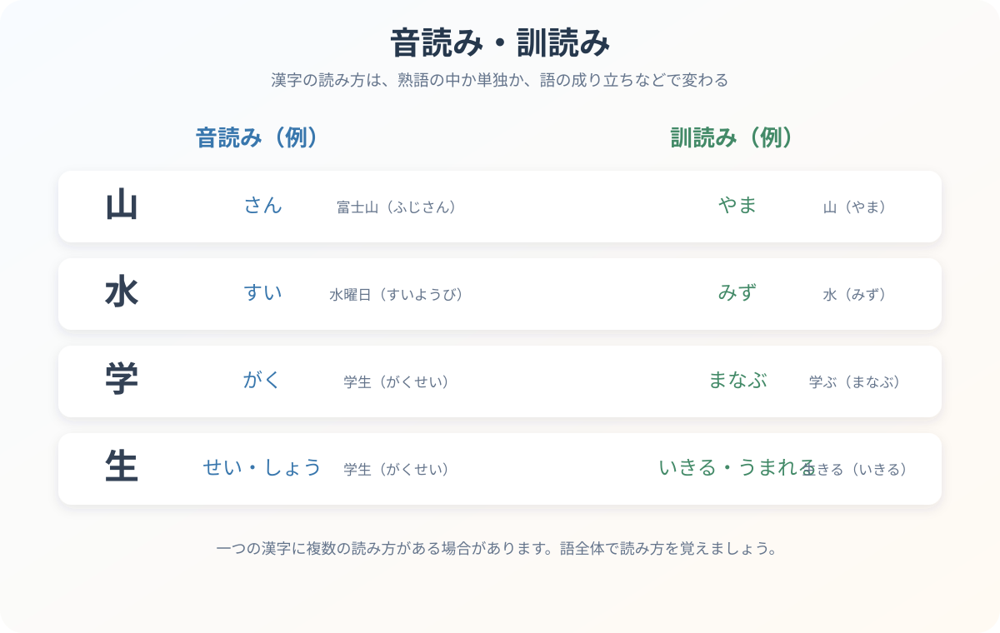

# 音読み・訓読み

## 1. 音読み・訓読みとは

漢字には、主に音読みと訓読みがあります。同じ漢字でも、使われる単語によって読み方が変わります。

* **音読み**：漢字が中国から伝わったときの音をもとにした読み方です。
* **訓読み**：漢字の意味に対応する日本語を当てた読み方です。

## 2. 音読み・訓読みの例

| 漢字 | 音読み    | 訓読み            | 単語の例                |
| -- | ------ | -------------- | ------------------- |
| 山  | サン     | やま             | 火山（かざん）、山道（やまみち）    |
| 水  | スイ     | みず             | 水曜日（すいようび）、水（みず）    |
| 火  | カ      | ひ              | 火山（かざん）、火（ひ）        |
| 木  | モク・ボク  | き・こ            | 木曜日（もくようび）、木（き）     |
| 人  | ジン・ニン  | ひと             | 日本人（にほんじん）、人（ひと）    |
| 学  | ガク     | まなぶ            | 学校（がっこう）、学ぶ（まなぶ）    |
| 生  | セイ・ショウ | いきる・うまれる・なま など | 学生（がくせい）、生まれる（うまれる） |
| 口  | コウ・ク   | くち             | 人口（じんこう）、口（くち）      |

## 3. 熟語での読み方

漢字二字以上の熟語では、音読み同士の組み合わせがよく見られます。

例：

* 学校（がっこう）
* 電話（でんわ）
* 文化（ぶんか）
* 安全（あんぜん）

一方、訓読みを中心とする言葉もあります。

例：

* 花火（はなび）
* 手紙（てがみ）
* 山道（やまみち）

## 4. 音読みと訓読みが混ざる言葉

音読みと訓読みが混ざった熟語もあります。

* 重箱（じゅうばこ）：音読み＋訓読み
* 湯桶（ゆとう）：訓読み＋音読み

また、「今日（きょう）」「大人（おとな）」のように、漢字一字ずつの読みから単純に予測できない熟字訓もあります。

## 5. 読み方を覚えるコツ

* 漢字一字の読みだけでなく、熟語や短い文で覚える。
* 同じ漢字を使う複数の単語を比べる。
* 送り仮名がある場合は、訓読みであることが多いと意識する。
* 例外的な読み方は、単語全体で覚える。

## 6. 例文

* 毎朝、山を見ながら水を飲みます。
* 学校で日本の文化を学びます。
* 木曜日に友達と会います。
* 今日は早く家に帰ります。

## 7. 練習問題

### 問題1：読み方を書きましょう。

1. 学校
2. 水曜日
3. 山
4. 日本人
5. 手紙

### 問題2：太字の漢字の読みが音読みか訓読みか答えましょう。

1. **山**に登る。
2. 火**山**を見学する。
3. **水**を飲む。
4. **水**曜日に会う。

### 問題3：「音読み」と「訓読み」の違いを説明しましょう。

## 8. 解答・解説

### 問題1

1. がっこう
2. すいようび
3. やま
4. にほんじん
5. てがみ

### 問題2

1. やま：訓読み
2. さん：音読み
3. みず：訓読み
4. すい：音読み

### 問題3

音読みは中国から伝わった音をもとにした読み方、訓読みは漢字の意味に対応する日本語を当てた読み方です。

## 9. まとめ

漢字の読み方は単語によって変わります。音読み・訓読みの特徴を理解し、熟語や例文と一緒に覚えましょう。
