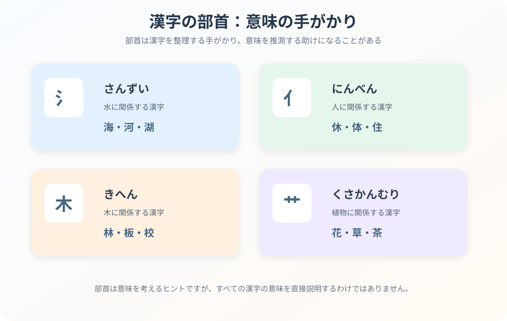

# 部首・漢字の構成

## 1. 部首とは

部首は、漢字を分類したり、漢和辞典で検索したりするときの手掛かりとなる部分です。漢字の左側にあるとは限らず、上・下・右・外側などに位置する場合もあります。

## 2. よく使われる部首

| 部首 | 呼び方     | 例     | 意味を推測する手掛かり    |
| -- | ------- | ----- | -------------- |
| 亻  | にんべん    | 休・体・住 | 人に関係する字が多い     |
| 氵  | さんずい    | 海・河・洗 | 水に関係する字が多い     |
| 木  | きへん     | 林・村・橋 | 木や植物に関係する字が多い  |
| 言  | ごんべん    | 話・語・読 | 言葉や発話に関係する字が多い |
| 扌  | てへん     | 持・打・投 | 手の動作に関係する字が多い  |
| 忄  | りっしんべん  | 忙・情・性 | 心や感情に関係する字が多い  |
| 艹  | くさかんむり  | 花・草・茶 | 植物に関係する字が多い    |
| 宀  | うかんむり   | 家・室・安 | 建物や屋内に関係する字が多い |
| 口  | くち・くちへん | 吃・味・呼 | 口や発声に関係する字が多い  |
| 辶  | しんにょう   | 道・近・返 | 移動や道に関係する字が多い  |

## 3. 漢字の構成要素

漢字には、意味の手掛かりとなる部分と、音の手掛かりとなる部分を組み合わせたものがあります。

例：

* 河：さんずいが水に関係する意味の手掛かりとなり、「可」が音の手掛かりになります。
* 晴：日が天候や明るさに関係し、「青」が音の手掛かりになります。
* 銅：金が金属に関係し、「同」が音の手掛かりになります。

ただし、すべての漢字がこの規則で説明できるわけではありません。

## 4. 部首を使った学習方法

1. 漢字の中で部首を見つける。
2. 部首の名前と位置を確認する。
3. 同じ部首を持つ漢字を集める。
4. 意味の共通点があるか考える。
5. 熟語と例文で実際の意味を確認する。

## 5. 注意点

* 部首は意味を推測する手掛かりですが、意味を完全に決定するものではありません。
* 見た目が似ている部分でも、部首としての役割が異なる場合があります。
* 漢字の分類方法や部首の取り方は、辞書によって説明が異なることがあります。

## 6. 例文

* 川の近くに大きな橋があります。
* 彼は忙しいので、後で電話します。
* 旅行の前に、道を確認しました。
* 花や草に水をあげました。

## 7. 練習問題

### 問題1：部首を答えましょう。

1. 海
2. 休
3. 話
4. 持
5. 花

### 問題2：部首から意味の分野を考えましょう。

1. さんずいを持つ漢字には、どのような意味のものが多いですか。
2. てへんを持つ漢字には、どのような意味のものが多いですか。
3. しんにょうを持つ漢字には、どのような意味のものが多いですか。

## 8. 解答・解説

### 問題1

1. さんずい
2. にんべん
3. ごんべん
4. てへん
5. くさかんむり

### 問題2

1. 水や液体に関係する意味の漢字が多いです。
2. 手を使う動作に関係する漢字が多いです。
3. 道や移動に関係する意味の漢字が多いです。

## 9. まとめ

部首は漢字の形や意味を理解するための便利な手掛かりです。同じ部首の漢字をまとめて学び、意味や熟語との関係を確認しましょう。
