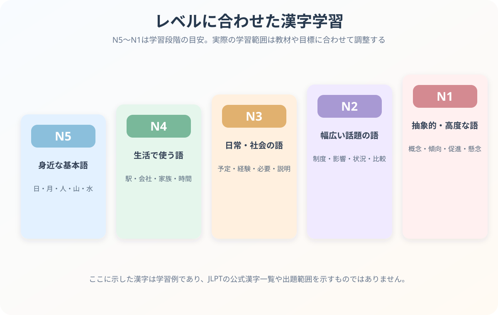

# 漢字学習の基本ガイド

## 1. 漢字学習の目的

漢字は、意味を表す文字です。日本語では漢字をひらがな・カタカナと組み合わせて使います。漢字を学ぶと、文章の意味を推測しやすくなり、語彙を効率よく覚えられます。

## 2. 漢字を学ぶときの基本要素

| 要素  | 内容            | 学習例            |
| --- | ------------- | -------------- |
| 字形  | 漢字の形・構成       | 部首、画数、構成要素     |
| 読み  | 音読み・訓読み       | 学校（がっこう）、山（やま） |
| 意味  | 漢字が表す概念       | 水、時間、行動        |
| 熟語  | 漢字を組み合わせた語    | 学生、読書、安心       |
| 書き方 | 筆順・止め・はね・払い   | 左から右、上から下など    |
| 表記  | 送り仮名・漢字と仮名の選択 | 食べる、申し込む       |

## 3. 漢字を覚える基本手順

1. 漢字の形と部首を確認する。
2. 基本的な意味を理解する。
3. 音読み・訓読みを、単語と一緒に覚える。
4. 熟語や例文の中で使い方を確認する。
5. 筆順を確認しながら、実際に書く。
6. 翌日や数日後に読みと意味を復習する。

## 4. 音読みと訓読み

* **音読み**：漢字が中国から伝わったときの音をもとにした読み方です。熟語の中で使われることが多いです。
* **訓読み**：漢字の意味に対応する日本語を当てた読み方です。送り仮名を伴うこともあります。

例：

* 山：やま（訓読み）、サン（音読み）
* 学：ガク（音読み）、「学ぶ」はまなぶ（訓読み）
* 生：セイ・ショウ（音読み）、いきる・うまれる・なま（訓読みなど）

一つの漢字に複数の読み方があるため、漢字だけでなく単語単位で覚えましょう。

## 5. 部首と漢字の構成

部首は漢字を分類・検索するための手掛かりです。部首から意味を推測できる場合がありますが、すべての漢字の意味を部首だけで判断できるわけではありません。

例：

* さんずい：海・河・湖（水に関係する漢字が多い）
* にんべん：休・体・住（人に関係する漢字が多い）
* きへん：林・森・橋（木に関係する漢字が多い）
* ごんべん：話・語・読（言葉に関係する漢字が多い）

## 6. 熟語と送り仮名

漢字は単独で使うだけでなく、複数の漢字を組み合わせて熟語を作ります。また、動詞や形容詞では、活用する部分を送り仮名で表します。

例：

* 学＋校 → 学校
* 安＋心 → 安心
* 食べる、読みます、新しい、暖かい

## 7. JLPTとの関係

このカテゴリーでは、N5からN1までの学習段階に合わせて、基本的な漢字から抽象的・専門的な語彙まで整理します。掲載する漢字は学習用の選定例であり、試験実施機関が公表する公式の完全な出題漢字一覧を意味するものではありません。

## 8. 練習問題

1. 「山」の訓読みを書きましょう。
2. 「学校」の読み方を書きましょう。
3. 「海」の部首を答えましょう。
4. 「食べる」の送り仮名はどこですか。
5. 漢字を覚えるとき、読み方だけでなく単語や例文も学ぶ理由を説明しましょう。

## 9. 解答・解説

1. やま
2. がっこう
3. さんずい（水）
4. 「食」の後の「べる」です。
5. 漢字は単語や文脈によって読み方・意味が変わるため、単語や例文と一緒に覚えると実際の文章で使いやすくなります。

## 10. まとめ

漢字学習では、字形・意味・読み・熟語・書き方を組み合わせて学ぶことが大切です。漢字一字だけを暗記せず、単語や例文を通して理解を深めましょう。
