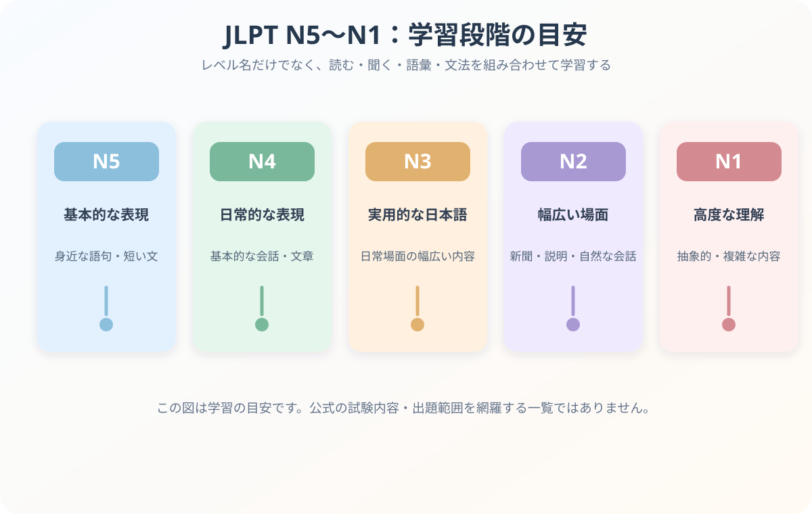

# 05 JLPT対策

## 1. このカテゴリーについて

このカテゴリーでは、日本語能力試験（JLPT）のN5からN1まで、レベルに応じた学習方法と問題への取り組み方を整理します。文字・語彙、文法、読解、聴解をバランスよく学び、知識を実際の問題で使えるようにすることが目標です。

## 2. レベル別の学習方針

| レベル | 学習の中心      | 重点                |
| --- | ---------- | ----------------- |
| N5  | 基本語彙・基本文型  | 短い文、身近な会話、基本情報    |
| N4  | 日常生活の語彙・文法 | 普通形、授受・可能・受身、短い説明 |
| N3  | 中級語彙・複文    | 文脈判断、接続表現、文章の要点   |
| N2  | 抽象語彙・複雑な文型 | 論理展開、筆者の主張、細部の理解  |
| N1  | 高度な語彙・表現   | 含意、論理関係、話者の態度や意図  |

## 3. 4つの学習領域

* **文字・語彙**：漢字の読み、表記、語彙の意味、文脈に合う言葉を学ぶ。
* **文法**：接続、意味、ニュアンスを理解し、似た文型を使い分ける。
* **読解**：文章の主題、理由、具体例、筆者の意見を読み取る。
* **聴解**：場面、話者の意図、必要な情報、結論を聞き取る。

## 4. おすすめの学習サイクル

1. そのレベルの語彙・漢字・文法を学ぶ。
2. 短い文章や会話で使い方を確認する。
3. 時間を測って練習問題を解く。
4. 間違えた理由を「知識不足」「読み違い」「時間不足」などに分類する。
5. 間違いノートに記録し、数日後に解き直す。

## 5. 模擬問題について

各レベルのページにある練習問題は、本サイト向けに作成したオリジナルの学習問題です。公式の過去問題や試験問題を転載したものではありません。実際の試験形式・実施時間・出題内容は、受験する回の最新案内で確認してください。

## 6. 学習のポイント

* 正解したかどうかだけでなく、正解の根拠を説明できるようにする。
* 語彙・文法は、単語単体ではなく文脈の中で覚える。
* 読解は設問を先に確認し、本文から根拠を探す練習をする。
* 聴解は聞き取れなかった部分を分類し、音読やシャドーイングで補う。
* 本番前は、時間配分と見直しの手順を決めておく。

## 7. まとめ

JLPT対策では、知識を増やすことと、問題の中で正しく使うことの両方が必要です。自分の弱点を記録し、語彙・文法・読解・聴解を継続的に復習しましょう。
