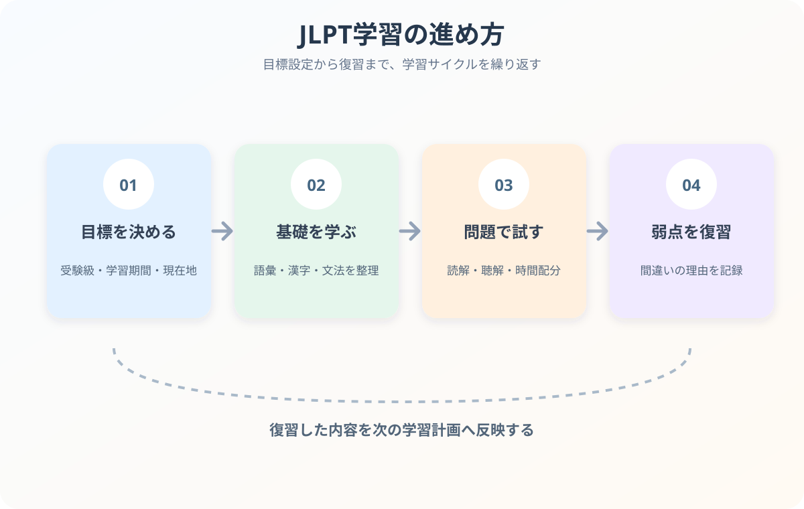

# N2 日本語能力試験対策

## 1. N2の学習目標

N2では、幅広い話題について書かれた文章や、自然な速度の会話を理解する力を高めます。抽象的な語彙や複雑な文型を理解し、筆者・話者の主張や意図を根拠とともに捉えることが重要です。

## 2. 学習する内容

| 分野    | 学習内容           | 学習のポイント     |
| ----- | -------------- | ----------- |
| 文字・語彙 | 抽象語、慣用表現、漢字熟語  | 意味の細かな差と用法  |
| 文法    | 複合表現、硬い文体、文脈判断 | 接続・論理関係を確認  |
| 読解    | 論説文、比較、主張、情報検索 | 根拠と筆者の結論を特定 |
| 聴解    | 自然な速度の会話、説明、講義 | 要旨と必要な詳細を聞く |

## 3. よく確認したい表現

* ～にほかならない
* ～にすぎない
* ～わけにはいかない
* ～ものの／～とはいえ
* ～に伴って／～につれて
* ～をめぐって
* ～に基づいて
* ～かねない／～おそれがある

## 4. オリジナル練習問題

### 問題1：文に合う表現を選びましょう。

1. 十分な根拠がないため、その結論は正しい（とは言い切れない・に決まっている）。
2. 彼は忙しい（ものの・ために）、毎日運動を続けています。
3. 制度の変更（に伴って・に比べて）、申請方法も変わりました。
4. その説明は事実に（基づいて・めぐって）作成されています。

### 問題2：文章の主張を読み取りましょう。

「業務の効率化を進めるには、新しいシステムを導入するだけでは十分ではない。利用者が操作方法を理解し、業務の流れに合わせて運用を見直すことが必要である。」

1. 新しいシステムを導入するだけでは十分でないのはなぜですか。
2. 筆者が必要だと述べていることを二つ挙げましょう。
3. 筆者の主張を一文でまとめましょう。

### 問題3：語彙の違いを説明しましょう。

1. 「懸念」と「課題」
2. 「妥当」と「正確」

## 5. 解答・解説

### 問題1

1. とは言い切れない：根拠が十分でないため、断定できないことを表します。
2. ものの：忙しいという事実と、運動を続けていることを対比します。
3. に伴って：制度変更と同時に別の変化が起きることを表します。
4. 基づいて：事実を根拠として作成したことを表します。

### 問題2

1. 利用者が操作方法を理解し、業務に合わせた運用を整える必要があるからです。
2. 操作方法を理解すること、業務の流れに合わせて運用を見直すことです。
3. システム導入だけでなく、利用者教育と運用の見直しが必要です。

### 問題3

1. 「懸念」は悪い結果になる可能性への心配、「課題」は解決や対応が必要な問題・テーマです。
2. 「妥当」は判断や方法に無理がなく適切であること、「正確」は情報や数値に誤りがないことです。

## 6. 学習のポイント

* 抽象語彙は、前後の文と一緒に意味を判断する。
* 読解では筆者の主張と具体例を区別する。
* 接続表現から、逆接・追加・原因・結果の関係を整理する。
* 聴解では、話者の結論や決定事項をメモする。

## 7. まとめ

N2では、文章の論理展開を理解し、細かな意味の違いを正確に判断する力が必要です。根拠を探しながら読み、聞いた内容を自分の言葉で要約する練習を続けましょう。
