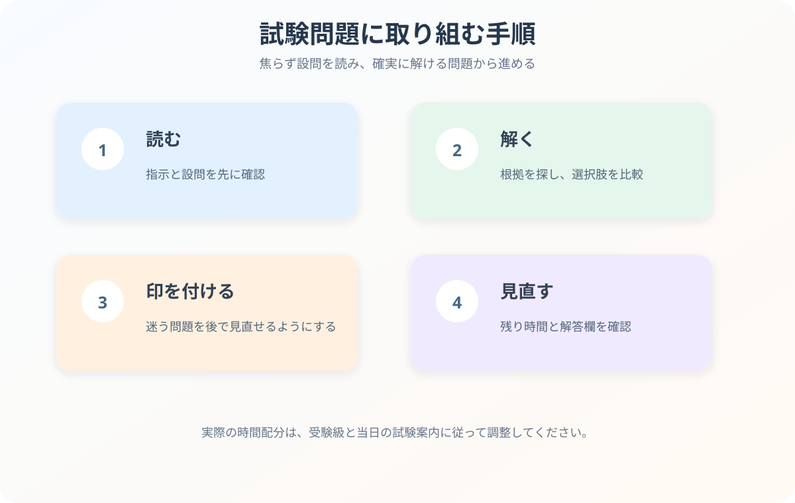

# N5 日本語能力試験対策

## 1. N5の学習目標

N5では、基本的な日本語を理解する力を身につけます。身近な場面で使う語彙や漢字、基本文型、短い会話や文章を中心に学習します。

## 2. 学習する内容

| 分野    | 学習内容                   | 学習のポイント            |
| ----- | ---------------------- | ------------------ |
| 文字・語彙 | ひらがな、カタカナ、基本漢字、日常語彙    | 読み方と意味をセットで覚える     |
| 文法    | 名詞文、形容詞文、動詞のます形、助詞、疑問文 | 文の形と助詞を正確にする       |
| 読解    | 短い案内、メモ、簡単な説明          | 誰が・いつ・どこで・何をするかを探す |
| 聴解    | ゆっくりした日常会話、簡単な指示       | 数字、時間、場所、依頼を聞き取る   |

## 3. よく確認したい文法

* ～は～です／～ではありません
* ～ます／～ません／～ました
* ～てください
* ～てもいいです
* ～てはいけません
* ～があります／～がいます
* ～たいです
* ～から～まで

## 4. オリジナル練習問題

### 問題1：正しい助詞を選びましょう。

1. 私（は・を）学生です。
2. 毎朝七時（に・で）起きます。
3. 図書館（に・で）本を読みます。
4. 友達（と・を）映画を見ます。

### 問題2：文に合う言葉を選びましょう。

1. 昨日、学校へ（行きます・行きました）。
2. ここで写真を撮っても（いいです・いけませんか）。
3. 部屋に猫が（あります・います）。

### 問題3：短い文章を読みましょう。

「田中さんは土曜日に友達と図書館へ行きます。午前十時から十二時まで日本語を勉強します。」

1. 田中さんは何曜日に図書館へ行きますか。
2. 何時から何時まで勉強しますか。

## 5. 解答・解説

### 問題1

1. は：話題を示します。
2. に：具体的な時刻を示します。
3. で：本を読む動作を行う場所です。
4. と：一緒に行動する相手です。

### 問題2

1. 行きました：昨日の出来事なので過去形です。
2. いいです：許可を求める表現です。
3. います：猫は生き物なので「います」を使います。

### 問題3

1. 土曜日です。
2. 午前十時から十二時までです。

## 6. 学習のポイント

* 基本漢字は、読み方と単語を一緒に覚える。
* 助詞の使い方を短い文で繰り返し練習する。
* 聴解では数字・時刻・場所・依頼表現に注意する。
* 短い文章を読み、必要な情報を探す練習をする。

## 7. まとめ

N5では、基本的な語彙・文型を正確に理解することが重要です。短い文を自分で作り、毎日少しずつ読み書きと聞き取りを続けましょう。
