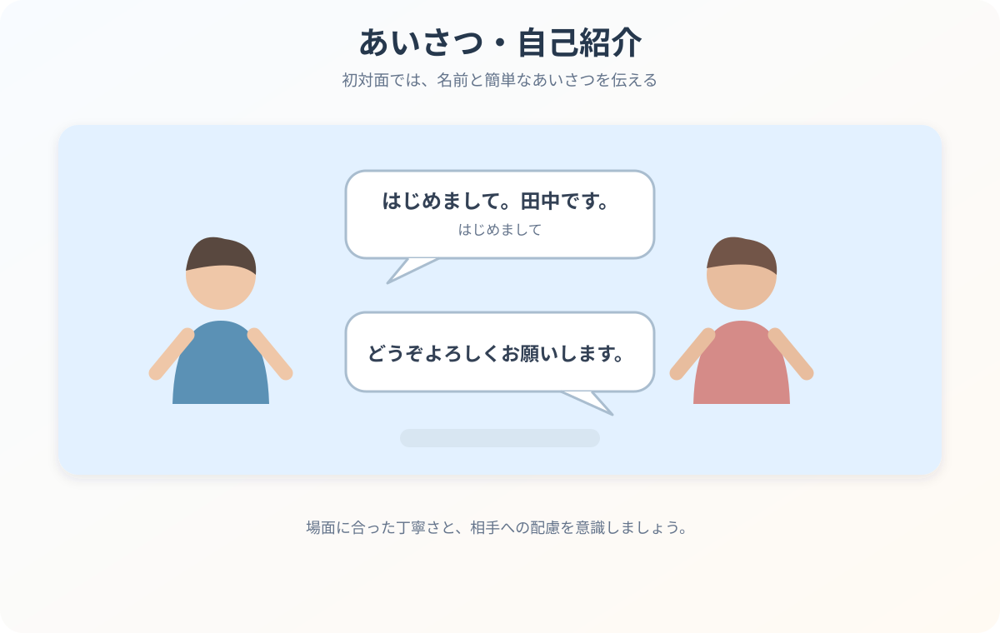

# 挨拶・自己紹介

## 1. このテーマについて

挨拶と自己紹介は、会話を始めるための基本です。相手との関係や時間帯に合わせて、自然な表現を選びましょう。

## 2. 時間帯・場面別の挨拶

| 表現        | 読み方         | 意味・使う場面     |
| --------- | ----------- | ----------- |
| おはようございます | おはようございます   | 朝の丁寧な挨拶     |
| こんにちは     | こんにちは       | 日中の挨拶       |
| こんばんは     | こんばんは       | 夜の挨拶        |
| お疲れさまです   | おつかれさまです    | 職場での挨拶・労い   |
| お先に失礼します  | おさきにしつれいします | 自分が先に帰るとき   |
| いってきます    | いってきます      | 出かけるとき      |
| いってらっしゃい  | いってらっしゃい    | 出かける人を見送るとき |
| ただいま      | ただいま        | 帰宅したとき      |
| おかえりなさい   | おかえりなさい     | 帰宅した人を迎えるとき |

## 3. 初対面の自己紹介

| 表現            | 意味・使い方          |
| ------------- | --------------- |
| はじめまして        | 初めて会ったときの挨拶     |
| ～と申します        | 自分の名前を丁寧に伝える    |
| ～出身です         | 出身地を伝える         |
| ～に住んでいます      | 現在住んでいる場所を伝える   |
| ～の仕事をしています    | 職業・仕事内容を伝える     |
| 趣味は～です        | 趣味を伝える          |
| どうぞよろしくお願いします | 自己紹介の最後に使う丁寧な表現 |

## 4. 自己紹介の例

**A：はじめまして。陳と申します。中国の上海出身で、現在は東京に住んでいます。趣味は映画を見ることです。どうぞよろしくお願いします。**

**B：はじめまして。佐藤です。こちらこそ、よろしくお願いします。**

意味：初次见面。我姓陈，来自中国上海，现在住在东京。我的爱好是看电影。请多关照。

## 5. 自己紹介で使える質問

* ご出身はどちらですか。
* お仕事は何をされていますか。
* こちらには長く住んでいらっしゃいますか。
* 休日は何をして過ごしますか。

## 6. 使い分け・注意点

* 初対面や仕事の場面では、丁寧な「です・ます」を使います。
* 「よろしくお願いします」は依頼・挨拶の両方で使われます。
* 相手の名前を聞くときは「お名前を伺ってもよろしいですか」と言うと丁寧です。
* 親しい友人には「よろしくね」のようなくだけた表現も使えます。

## 7. 練習問題

### 問題1：場面に合う挨拶を選びましょう。

1. 朝、会社で同僚に会ったとき：（おはようございます・こんばんは）
2. 先に帰るとき：（お先に失礼します・いってきます）
3. 帰宅した家族を迎えるとき：（おかえりなさい・いってらっしゃい）

### 問題2：自己紹介を完成させましょう。

1. 初めて会ったときの挨拶：（　　　）
2. 名前を丁寧に伝える表現：「～と（　　　）」
3. 自己紹介の最後に使う表現：「どうぞ（　　　）」

### 問題3：自分の名前・出身・趣味を使って、3文以上の自己紹介を作りましょう。

## 8. 解答・解説

### 問題1

1. おはようございます
2. お先に失礼します
3. おかえりなさい

### 問題2

1. はじめまして
2. 申します
3. よろしくお願いします

### 問題3

例：はじめまして。山田と申します。大阪出身です。趣味は旅行です。どうぞよろしくお願いします。

## 9. まとめ

挨拶は時間帯や相手との関係に合わせて選びます。自己紹介では、名前・出身・仕事・趣味などを短く伝え、最後に丁寧な挨拶を添えましょう。
