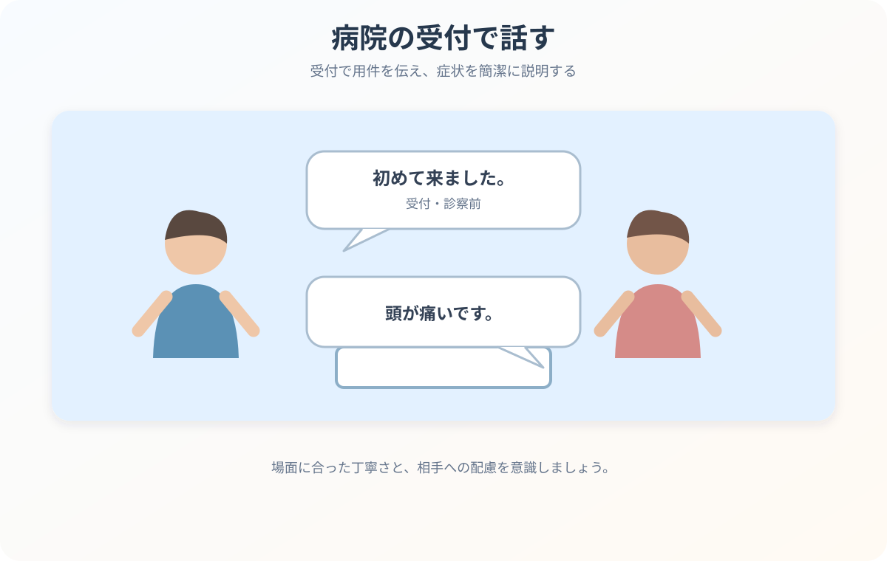

# 病院・薬局での会話

## 1. このテーマについて

病院や薬局では、自分の症状を伝えたり、診察・薬について質問したりします。いつから、どこが、どのように不調なのかを、簡潔に説明できるようにしましょう。

## 2. 受付で使う表現

| 表現           | 意味・使い方        |
| ------------ | ------------- |
| 初診です         | 初めて受診すると伝える   |
| 予約しています      | 予約済みであることを伝える |
| 保険証を持っています   | 保険証の有無を伝える    |
| 今日はどうされましたか  | 受付・医療従事者からの質問 |
| こちらに記入してください | 書類の記入を依頼する    |

## 3. 症状を伝える表現

| 表現          | 意味            |
| ----------- | ------------- |
| 頭が痛いです      | 頭痛がある         |
| 熱があります      | 発熱している        |
| 咳が出ます       | 咳が出る          |
| 喉が痛いです      | 喉に痛みがある       |
| お腹の調子が悪いです  | 胃腸などの調子が悪い    |
| ～日前から続いています | 症状が始まった時期を伝える |
| ～すると痛みます    | 痛みが出る条件を伝える   |

## 4. 診察・薬局で使う表現

* いつから症状がありますか。
* 昨日の夜からです。
* 薬を飲んだ後、眠くなりました。
* この薬は食前ですか、食後ですか。
* 一日に何回飲めばいいですか。
* 飲み合わせについて確認したいです。

## 5. 会話例

**受付：今日はどうされましたか。**

**患者：昨日から喉が痛く、熱もあります。**

**受付：初診ですか。**

**患者：はい、初診です。**

**薬剤師：こちらの薬は、説明書に従って服用してください。**

**患者：食後に飲めばいいですか。**

**薬剤師：はい。詳しい服用方法は薬袋の説明をご確認ください。**

## 6. 使い分け・注意点

* 「頭が痛い」は症状、「頭痛」は症状名として使われます。
* 「薬を飲む」は日本語で一般的な表現です。
* 症状を伝えるときは、いつから・どこが・どのように、を整理します。
* このページは日本語学習用です。診断や服薬の判断は医療専門家に確認してください。

## 7. 練習問題

### 問題1：文に合う表現を選びましょう。

1. 昨日から頭が（痛い・痛みますでした）。
2. 薬は食事の後に飲むことを（食後・食前）と言います。
3. 初めて病院を受診するときは（初診・再診）です。

### 問題2：意味に合う言葉を書きましょう。

1. 咳が出ること：（　　　）
2. 体の温度が高い状態：（　　　）
3. 医師が患者の状態を確認すること：（　　　）

### 問題3：症状を伝えるときに必要な情報を二つ挙げましょう。

## 8. 解答・解説

### 問題1

1. 痛い
2. 食後
3. 初診

### 問題2

1. 咳
2. 発熱
3. 診察

### 問題3

例：症状が始まった時期、痛む場所、症状の程度、どのようなときに症状が出るか。

## 9. まとめ

病院や薬局では、症状・期間・薬の使い方などを具体的に伝えることが大切です。よく使う表現を会話の流れに沿って練習しましょう。
