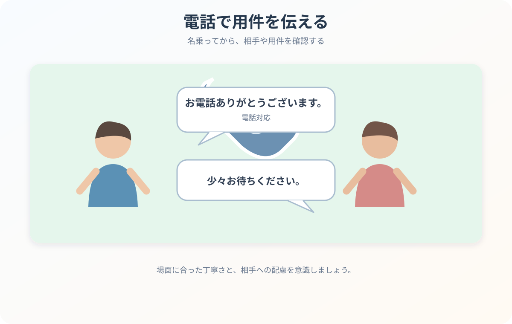

# 予約・電話での会話

## 1. このテーマについて

電話では、相手の顔が見えないため、最初に名乗り、用件を簡潔に伝えることが大切です。予約、変更、確認、問い合わせなどの場面別に表現を覚えましょう。

## 2. 電話を始める表現

| 表現             | 意味・使い方         |
| -------------- | -------------- |
| もしもし           | 電話に出たときの一般的な挨拶 |
| いつもお世話になっております | 仕事上の電話で使う挨拶    |
| ～と申します         | 自分の名前を丁寧に伝える   |
| ～様はいらっしゃいますか   | 相手の在席を尋ねる      |
| 今、お時間よろしいでしょうか | 話せる状況か確認する     |

## 3. 予約・変更の表現

* 来週の土曜日に予約をお願いしたいのですが。
* 午後三時に空きはありますか。
* 予約の日時を変更できますか。
* 予約をキャンセルしたいのですが。
* 予約内容を確認してもよろしいでしょうか。

## 4. 電話を終える表現

* ご確認ありがとうございます。
* それでは、よろしくお願いいたします。
* お忙しいところ、ありがとうございました。
* 失礼いたします。

## 5. 会話例

**店員：お電話ありがとうございます。さくらホテルでございます。**

**客：お世話になります。来月の十日に一泊、予約をお願いしたいのですが。**

**店員：かしこまりました。何名様でしょうか。**

**客：大人二名です。**

**店員：禁煙のお部屋でよろしいでしょうか。**

**客：はい、お願いします。**

## 6. 使い分け・注意点

* 電話では、最初に名前と用件を伝えると相手が理解しやすくなります。
* 「～したいのですが」は、依頼や相談を柔らかく切り出す表現です。
* 相手の名前や日時など、重要な情報は復唱して確認しましょう。
* 電話を切る前に、決定した内容を簡単に確認すると誤解を防げます。

## 7. 練習問題

### 問題1：電話の場面に合う表現を選びましょう。

1. 自分の名前を丁寧に伝える：（～と申します・～とおっしゃいます）
2. 相手の都合を確認する：（今、お時間よろしいでしょうか・お時間でした）
3. 電話を丁寧に終える：（失礼いたします・行ってきます）

### 問題2：予約の電話で確認する情報を三つ挙げましょう。

### 問題3：予約日時を変更したいときの丁寧な表現を作りましょう。

## 8. 解答・解説

### 問題1

1. ～と申します
2. 今、お時間よろしいでしょうか
3. 失礼いたします

### 問題2

例：予約日、時間、人数、名前、部屋・席の希望など。

### 問題3

例：予約の日時を変更していただくことはできますか。

## 9. まとめ

電話では、挨拶・名乗り・用件・確認・終了の順に話すと分かりやすくなります。日時や名前などの重要情報は、復唱して確認しましょう。
