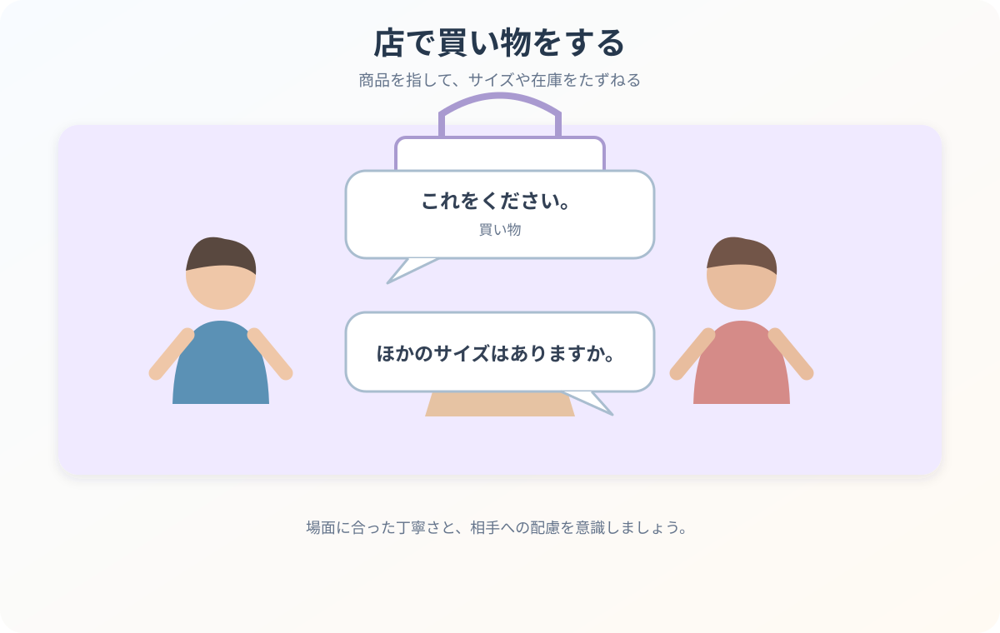

# 買い物・店での会話

## 1. このテーマについて

買い物では、商品を探す、サイズや色を確認する、試着する、支払う、返品・交換を相談するなど、さまざまな会話が必要です。

## 2. 商品を探す・確認する表現

| 表現           | 意味・使い方       |
| ------------ | ------------ |
| ～を探しているのですが  | 欲しい商品を伝える    |
| ～はありますか      | 在庫の有無を尋ねる    |
| ほかのサイズはありますか | サイズを確認する     |
| 色違いはありますか    | 別の色を尋ねる      |
| こちらはいくらですか   | 価格を尋ねる       |
| もう少し見てもいいですか | 商品を見続けたいと伝える |

## 3. 試着・購入の表現

* 試着してもいいですか。
* 少し大きいので、Sサイズはありますか。
* これにします。
* こちらを一つください。
* プレゼント用に包んでもらえますか。

## 4. 支払い・返品の表現

| 表現             | 意味            |
| -------------- | ------------- |
| クレジットカードは使えますか | 支払い方法を確認する    |
| 交通系ICカードで払えますか | 電子決済の可否を尋ねる   |
| レシートをください      | 領収の記録を求める     |
| 返品できますか        | 商品を返せるか尋ねる    |
| サイズを交換できますか    | 別のサイズへの交換を尋ねる |

## 5. 会話例

**客：すみません。このシャツのMサイズはありますか。**

**店員：確認いたします。少々お待ちください。**

**店員：申し訳ございません。Mサイズは現在、在庫がございません。**

**客：そうですか。では、Lサイズを試着してもいいですか。**

**店員：もちろんです。こちらへどうぞ。**

## 6. 使い分け・注意点

* 店員に依頼するときは「～してもらえますか」「～をお願いします」を使うと丁寧です。
* 「返品」は商品を返すこと、「交換」は別の商品やサイズに取り替えることです。
* 返品・交換の条件は店舗や商品によって異なるため、購入前に確認しましょう。
* 「いくらですか」は日常会話で自然な価格の質問です。

## 7. 練習問題

### 問題1：店で使う表現を選びましょう。

1. 商品の在庫を尋ねる：（ありますか・しましたか）
2. 試着したいとき：（試着してもいいですか・試着しましたか）
3. 別のサイズに替えたいとき：（交換できますか・返金できますか）

### 問題2：会話を完成させましょう。

客：この靴の24センチは（　　　）か。 店員：確認いたします。

### 問題3：「返品」と「交換」の違いを説明しましょう。

## 8. 解答・解説

### 問題1

1. ありますか
2. 試着してもいいですか
3. 交換できますか

### 問題2

あります

### 問題3

「返品」は購入した商品を店に返すこと、「交換」は別のサイズや商品に取り替えることです。

## 9. まとめ

買い物では、探す・確認する・試着する・支払う・返品や交換を相談する表現を場面ごとに覚えましょう。丁寧な依頼表現を使うと、店員と円滑にやり取りできます。
