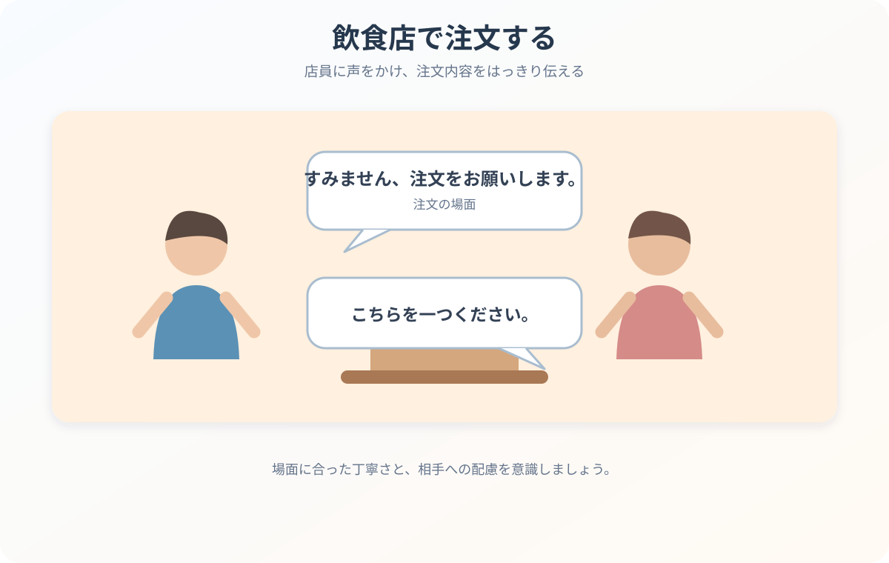

# 飲食店・レストランでの会話

## 1. このテーマについて

飲食店では、入店、人数の確認、注文、追加の依頼、会計などの表現を使います。店員とのやり取りを想定して、自然な言い方を覚えましょう。

## 2. 入店・席の確認

| 表現           | 意味・使い方        |
| ------------ | ------------- |
| 二人ですが、入れますか  | 人数を伝えて空席を確認する |
| 予約している田中です   | 予約者の名前を伝える    |
| 禁煙席はありますか    | 席の条件を確認する     |
| 窓側の席は空いていますか | 希望の席を尋ねる      |
| メニューをいただけますか | メニューを依頼する     |

## 3. 注文・追加の表現

* おすすめは何ですか。
* こちらを一つお願いします。
* ご飯を少なめにできますか。
* 水をもう一杯いただけますか。
* すみません、注文をお願いします。
* 以上でお願いします。

## 4. 食事・会計の表現

| 表現             | 意味               |
| -------------- | ---------------- |
| 取り皿をいただけますか    | 料理を取り分ける皿を依頼する   |
| アレルギーの表示はありますか | 原材料・アレルギー情報を確認する |
| お会計をお願いします     | 支払いを依頼する         |
| 別々に払えますか       | 個別会計を尋ねる         |
| 領収書をいただけますか    | 領収書を依頼する         |

## 5. 会話例

**店員：いらっしゃいませ。何名様ですか。**

**客：二人です。予約はしていません。**

**店員：こちらの席へどうぞ。**

**客：ありがとうございます。おすすめの料理は何ですか。**

**店員：本日の魚料理がおすすめです。**

**客：では、それを一つと、サラダを一つお願いします。**

## 6. 使い分け・注意点

* 店員は「何名様ですか」、客は「二人です」と答えます。
* 注文を決めたら「～をお願いします」「～をください」が使えます。
* 「お会計」は支払いの場面で使う表現です。
* 食べられない食材がある場合は、注文前に具体的に確認しましょう。

## 7. 練習問題

### 問題1：場面に合う表現を選びましょう。

1. 店に入って人数を伝える：（二人です・二人でした）
2. 注文を終えるとき：（以上でお願いします・以上でした）
3. 支払いを頼むとき：（お会計をお願いします・ご注文をお願いします）

### 問題2：会話を完成させましょう。

店員：何名様ですか。 客：（　　　）です。

### 問題3：「おすすめは何ですか」と尋ねるのは、どのような場面ですか。

## 8. 解答・解説

### 問題1

1. 二人です
2. 以上でお願いします
3. お会計をお願いします

### 問題2

例：一人／二人／三人

### 問題3

料理や飲み物を選ぶときに、店員に人気のある商品や店の推奨メニューを尋ねる場面です。

## 9. まとめ

飲食店では、入店・注文・追加依頼・会計の順に表現を覚えると、実際の場面で使いやすくなります。人数や注文内容は、短くはっきり伝えましょう。
