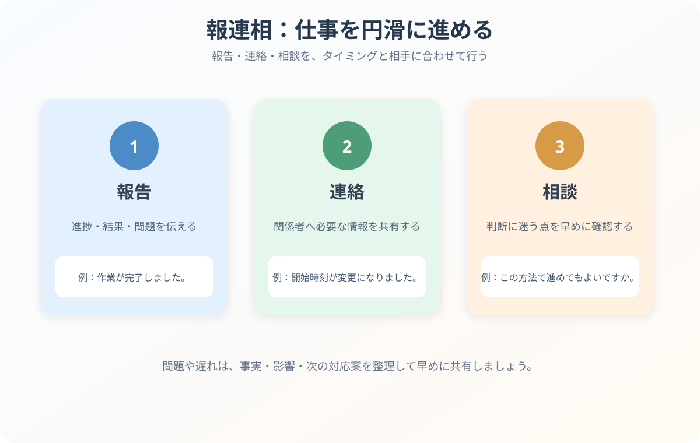

# 報告・連絡・相談（報連相）

## 1. 報連相とは

報連相は、職場で必要な情報を適切なタイミングで共有し、業務を円滑に進めるための基本です。

| 項目 | 目的            | 例               |
| -- | ------------- | --------------- |
| 報告 | 結果・進捗・問題を伝える  | 作業が完了しました       |
| 連絡 | 関係者に必要な情報を伝える | 会議時間が変更になりました   |
| 相談 | 判断や助言を求める     | 対応方法について相談したいです |

## 2. 報告で使う表現

* 現在の進捗をご報告いたします。
* 予定どおり完了しました。
* 一部の作業に遅れが発生しています。
* 原因は現在確認中です。
* 対応が完了次第、改めてご報告いたします。

## 3. 連絡で使う表現

* 日程に変更がありましたので、ご連絡いたします。
* 関係者にも共有をお願いいたします。
* 念のため、再度お知らせいたします。
* 先ほどの内容に一部訂正がございます。

## 4. 相談で使う表現

* 対応方針についてご相談したいことがあります。
* どのように進めるべきか、ご意見をいただけますでしょうか。
* 判断に迷っている点がございます。
* 代替案についても検討しております。

## 5. 報告の基本構成

1. 結論・現在の状況
2. 理由・背景
3. 影響範囲
4. 対応内容・今後の予定
5. 判断や支援が必要な事項

## 6. 会話例

**担当者：現在の進捗をご報告いたします。主要機能の実装は完了しましたが、結合テストで一件の不具合が見つかりました。**

**上司：リリース日程への影響はありますか。**

**担当者：現在、影響範囲を確認中です。本日中に対応方針をご報告いたします。**

## 7. 練習問題

### 問題1：報告・連絡・相談に分類しましょう。

1. 作業が完了したことを上司に伝える。
2. 会議の時間が変更されたことを関係者に伝える。
3. 問題の対応方法について上司の意見を求める。

### 問題2：進捗に遅れが出たときの報告文を作りましょう。

### 問題3：報告するときに含める情報を三つ挙げましょう。

## 8. 解答・解説

### 問題1

1. 報告
2. 連絡
3. 相談

### 問題2

例：現在、作業に遅れが発生しております。原因と影響範囲を確認し、本日中に対応方針をご報告いたします。

### 問題3

例：現在の状況、原因・背景、影響範囲、対応内容、今後の予定など。

## 9. まとめ

報連相では、情報を必要な相手に、適切なタイミングで、分かりやすく伝えることが重要です。結論と必要な対応を明確にしましょう。
