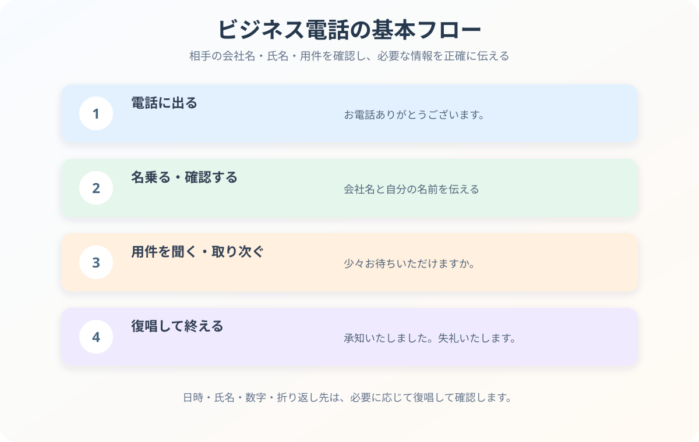

# ビジネス電話応対

## 1. 電話応対の基本

ビジネス電話では、会社名・部署名・氏名を明確に伝え、相手の用件を正確に聞き取ることが大切です。電話の内容は、日時・担当者・依頼事項などをメモして確認しましょう。

## 2. 電話を受ける表現

* お電話ありがとうございます。〇〇株式会社でございます。
* いつもお世話になっております。
* 恐れ入りますが、お名前を伺ってもよろしいでしょうか。
* どのようなご用件でしょうか。
* 少々お待ちいただけますでしょうか。

## 3. 取次・不在の表現

| 場面   | 表現                       |
| ---- | ------------------------ |
| 取次   | 担当の者におつなぎいたします。          |
| 確認   | 担当者に確認いたしますので、少々お待ちください。 |
| 不在   | 申し訳ございません。ただいま席を外しております。 |
| 会議中  | ただいま会議中でございます。           |
| 折り返し | 戻り次第、こちらからお電話いたしましょうか。   |
| 伝言   | よろしければ、ご伝言を承ります。         |

## 4. 電話をかける表現

* 〇〇株式会社の山田と申します。
* △△様はいらっしゃいますでしょうか。
* 先日お送りした資料について確認したく、お電話いたしました。
* お手数ですが、折り返しご連絡いただけますでしょうか。

## 5. 会話例

**受電：お電話ありがとうございます。〇〇株式会社でございます。**

**相手：いつもお世話になっております。△△株式会社の佐藤と申します。田中様はいらっしゃいますか。**

**受電：田中でございますね。確認いたしますので、少々お待ちください。**

**受電：申し訳ございません。田中はただいま席を外しております。戻り次第、折り返しお電話いたしましょうか。**

## 6. 注意点

* 相手の会社名・氏名は復唱して確認する。
* 電話を保留にするときは、相手に一言伝える。
* 不在理由を詳しく説明しすぎない。
* 電話の最後に、決定事項や折り返し先を確認する。
* 聞き取れないときは「恐れ入りますが、もう一度お願いできますでしょうか」と尋ねる。

## 7. 練習問題

### 問題1：適切な表現を選びましょう。

1. 電話を受けるとき：（お電話ありがとうございます・お先に失礼します）
2. 担当者が不在のとき：（席を外しております・席を外しましたです）
3. 聞き取れなかったとき：（もう一度お願いできますでしょうか・もう一度言って）

### 問題2：不在の担当者への伝言を受ける表現を書きましょう。

### 問題3：電話で確認すべき情報を三つ挙げましょう。

## 8. 解答・解説

### 問題1

1. お電話ありがとうございます
2. 席を外しております
3. もう一度お願いできますでしょうか

### 問題2

例：よろしければ、ご伝言を承ります。

### 問題3

例：相手の会社名・氏名、用件、連絡先、折り返し希望時間など。

## 9. まとめ

電話応対では、挨拶・名乗り・用件確認・取次・終了の順に対応します。重要事項を復唱し、聞き間違いや伝達漏れを防ぎましょう。
