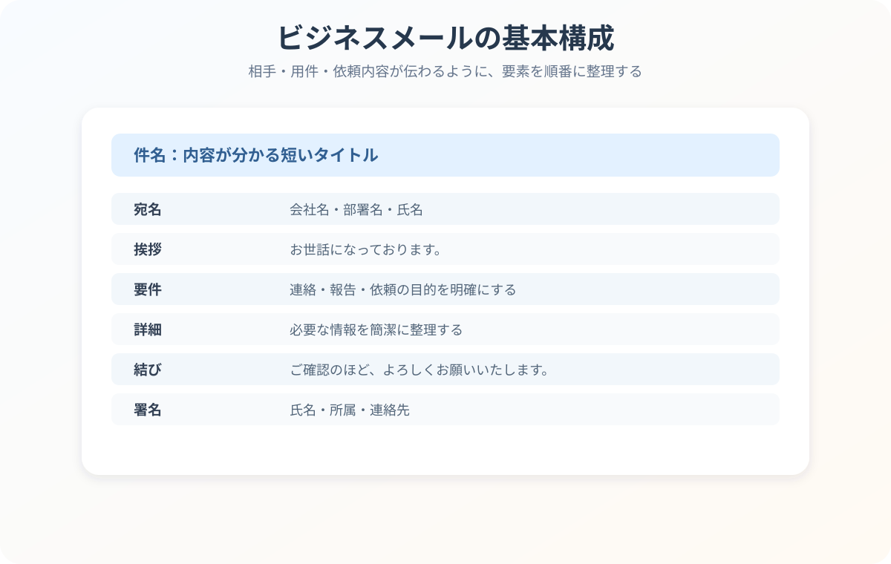

# ビジネスメールの基本

## 1. ビジネスメールの構成

ビジネスメールは、件名・宛名・挨拶・用件・結び・署名の順に整理すると、内容が伝わりやすくなります。

| 項目 | 内容        | 例                    |
| -- | --------- | -------------------- |
| 件名 | 用件を短く示す   | 【日程確認】定例会議について       |
| 宛名 | 会社・部署・氏名  | 株式会社〇〇 営業部 田中様       |
| 挨拶 | 定型の挨拶     | いつもお世話になっております。      |
| 用件 | 目的・背景・依頼  | 次回会議の日程についてご相談です。    |
| 結び | 相手への配慮    | ご確認のほど、よろしくお願いいたします。 |
| 署名 | 自分の所属・連絡先 | 会社名、部署、氏名            |

## 2. よく使う表現

| 目的 | 表現                     |
| -- | ---------------------- |
| 依頼 | ご確認いただけますでしょうか。        |
| 添付 | 資料を添付いたしましたので、ご確認ください。 |
| 回答 | ご連絡いただき、ありがとうございます。    |
| 謝罪 | ご返信が遅くなり、申し訳ございません。    |
| 送付 | 修正版をお送りいたします。          |
| 結び | 何卒よろしくお願いいたします。        |

## 3. メール作成例

**件名：【ご確認依頼】検証結果について**

株式会社〇〇 田中様

いつもお世話になっております。 △△株式会社の山田です。

検証結果をまとめた資料を添付いたしました。 お手数をおかけしますが、内容をご確認いただけますでしょうか。

ご不明点がございましたら、お知らせください。 何卒よろしくお願いいたします。

―――― △△株式会社 システム部 山田

## 4. 注意点

* 件名だけで用件が分かるようにする。
* 一つのメールに複数の依頼を詰め込みすぎない。
* 添付ファイルがある場合は、本文で添付したことを伝える。
* 期限がある場合は、日付を具体的に書く。
* 「了解しました」は社外向けでは「承知いたしました」が無難です。
* 返信先・宛先・添付ファイルを送信前に確認します。

## 5. 練習問題

### 問題1：適切な表現を選びましょう。

1. 社外の相手に「分かりました」と伝える：（承知いたしました・了解です）
2. 資料を送ることを伝える：（資料を添付いたしました・資料を見ました）
3. 返信が遅れたことを謝る：（ご返信が遅くなり申し訳ございません・返事が遅れた）

### 問題2：メールの件名を作りましょう。

「来週の会議の日程を確認してほしい」という用件に合う件名を書きましょう。

### 問題3：メール本文に必要な基本項目を三つ挙げましょう。

## 6. 解答・解説

### 問題1

1. 承知いたしました
2. 資料を添付いたしました
3. ご返信が遅くなり申し訳ございません

### 問題2

例：【日程確認のお願い】来週の会議について

### 問題3

例：宛名、挨拶、用件、結び、署名など。

## 7. まとめ

ビジネスメールでは、用件を簡潔に伝え、相手が次に何をすればよいか分かるように書きます。件名・宛名・本文・署名を送信前に確認しましょう。
