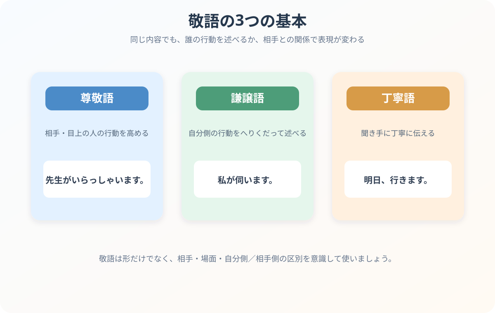

# ビジネス敬語の基本

## 1. 敬語の種類

ビジネスでは、相手との関係や場面に合わせて敬語を使います。敬語は主に尊敬語・謙譲語・丁寧語に分けられます。

| 種類  | 働き              | 例                  |
| --- | --------------- | ------------------ |
| 尊敬語 | 相手や第三者の動作を高める   | いらっしゃる、おっしゃる、ご覧になる |
| 謙譲語 | 自分側の動作をへりくだって表す | 伺う、申し上げる、拝見する      |
| 丁寧語 | 聞き手に丁寧に伝える      | です、ます、ございます        |

## 2. よく使う敬語

| 普通の表現  | 尊敬語           | 謙譲語     |
| ------ | ------------- | ------- |
| 行く・来る  | いらっしゃる、お越しになる | 伺う、参る   |
| 言う     | おっしゃる         | 申し上げる   |
| 見る     | ご覧になる         | 拝見する    |
| 聞く     | お聞きになる        | 伺う、拝聴する |
| 食べる・飲む | 召し上がる         | いただく    |
| 知っている  | ご存じだ          | 存じている   |
| する     | なさる           | いたす     |
| 会う     | お会いになる        | お目にかかる  |

## 3. ビジネスでよく使う依頼表現

* ご確認いただけますでしょうか。
* ご対応いただけますと幸いです。
* お手数をおかけしますが、よろしくお願いいたします。
* ご都合のよい日時をお知らせください。
* 恐れ入りますが、もう一度ご説明いただけますか。

## 4. よくある誤用

| 誤った表現     | 自然な表現       | 理由           |
| --------- | ----------- | ------------ |
| ご覧になられました | ご覧になりました    | 尊敬表現を重ねない    |
| 私が参られます   | 私が参ります      | 自分の動作に謙譲語を使う |
| 先生が拝見しました | 先生がご覧になりました | 相手の動作には尊敬語   |
| おっしゃられました | おっしゃいました    | 二重敬語を避ける     |

## 5. 会話例

**担当者：資料をご確認いただけましたでしょうか。**

**上司：はい、拝見しました。内容について一点確認したいことがあります。**

**担当者：承知しました。確認のうえ、改めてご説明いたします。**

## 6. 使い分け・注意点

* 敬語を選ぶときは、誰の動作かを最初に確認します。
* 相手の動作には尊敬語、自分の動作には謙譲語を使うのが基本です。
* 丁寧にしようとして敬語を重ねすぎないようにします。
* 社内の上司・同僚と社外の顧客では、適切な敬意の示し方が異なる場合があります。

## 7. 練習問題

### 問題1：正しい敬語を選びましょう。

1. お客様はもう（いらっしゃいました・参りました）。
2. 私は資料を（拝見しました・ご覧になりました）。
3. 部長が内容を（おっしゃいました・申し上げました）。
4. 私から改めてご連絡（いたします・なさいます）。

### 問題2：誤りを直しましょう。

1. 社長が資料を拝見しました。
2. 先生がおっしゃられました。

### 問題3：尊敬語と謙譲語の違いを説明しましょう。

## 8. 解答・解説

### 問題1

1. いらっしゃいました：お客様の動作なので尊敬語です。
2. 拝見しました：自分の動作なので謙譲語です。
3. おっしゃいました：部長の発言なので尊敬語です。
4. いたします：自分の動作なので謙譲語です。

### 問題2

1. 社長が資料をご覧になりました。
2. 先生がおっしゃいました。

### 問題3

尊敬語は相手の動作を高める表現、謙譲語は自分側の動作をへりくだって表す表現です。

## 9. まとめ

敬語は、相手と自分のどちらの動作かを意識して使い分けます。よく使う動詞の尊敬語・謙譲語を例文と一緒に覚えましょう。
