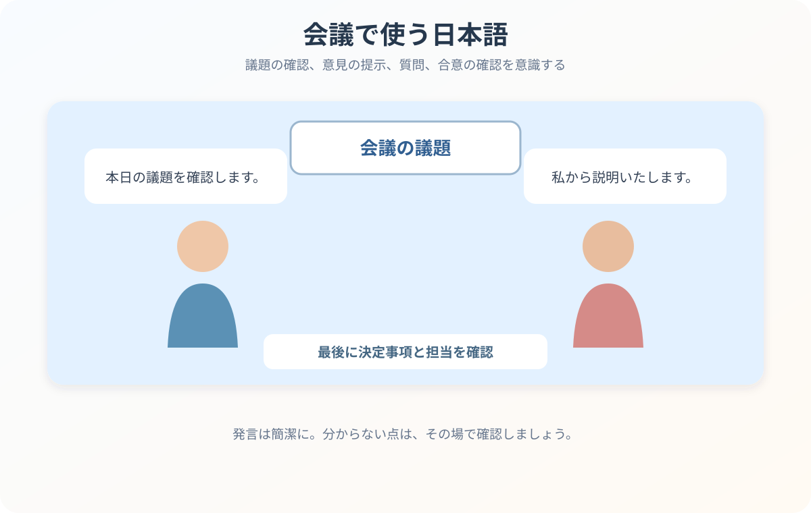

# 会議・打ち合わせ

## 1. 会議の基本的な流れ

会議では、目的・議題・時間を確認し、意見を出し合い、決定事項と担当者を明確にします。

1. 開会・目的の確認
2. 議題の説明
3. 現状・課題の共有
4. 意見交換・検討
5. 決定事項・担当・期限の確認
6. 閉会

## 2. 会議で使う表現

| 目的 | 表現                      |
| -- | ----------------------- |
| 開始 | それでは、定例会議を始めます。         |
| 議題 | 本日の議題は三点ございます。          |
| 説明 | まず、現状についてご説明いたします。      |
| 意見 | 私の考えでは、別の方法がよいと思います。    |
| 確認 | ここまでの内容で認識に相違はありませんか。   |
| 質問 | 一点確認させていただいてもよろしいでしょうか。 |
| 決定 | それでは、この方針で進めることにします。    |
| 終了 | 本日の決定事項を確認して、終了いたします。   |

## 3. 意見を述べる・調整する表現

* その点については、私も同意いたします。
* 一方で、費用面に課題があると考えます。
* 別の案も検討してはいかがでしょうか。
* いったん持ち帰って確認いたします。
* 期限を含めて再調整する必要があります。

## 4. 議事録に記録する項目

* 会議名・日時・場所
* 参加者
* 議題
* 主な意見・確認事項
* 決定事項
* 担当者・期限・次回予定

## 5. 会話例

**司会：本日の議題は、リリース日程と残課題の確認です。**

**担当者：現時点では、主要機能の実装が完了しています。**

**参加者：テスト工程への影響はありませんか。**

**担当者：一部の確認作業が残っていますが、明日までに完了する予定です。**

**司会：では、明日完了を確認したうえで、次の工程へ進むことにします。**

## 6. 注意点

* 意見と決定事項を区別する。
* 決定した内容は、担当者と期限まで明確にする。
* 反対意見を述べるときは、理由や代替案を添える。
* 会議後は議事録を共有し、認識のずれを防ぐ。

## 7. 練習問題

### 問題1：会議の場面に合う表現を選びましょう。

1. 議題を示す：（本日の議題は三点です・本日の議題が三点でした）
2. 認識を確認する：（認識に相違はありませんか・認識は違いません）
3. 決定を伝える：（この方針で進めます・この方針で進めましたか）

### 問題2：議事録に記録すべき項目を四つ挙げましょう。

### 問題3：反対意見を丁寧に伝える表現を一つ作りましょう。

## 8. 解答・解説

### 問題1

1. 本日の議題は三点です
2. 認識に相違はありませんか
3. この方針で進めます

### 問題2

例：会議名・日時、参加者、議題、決定事項、担当者、期限など。

### 問題3

例：ご提案の方向性は理解いたしましたが、費用面については別の案も検討する必要があると考えます。

## 9. まとめ

会議では、意見を述べるだけでなく、決定事項・担当者・期限を明確にすることが重要です。会議の前後に必要な確認と共有を行いましょう。
