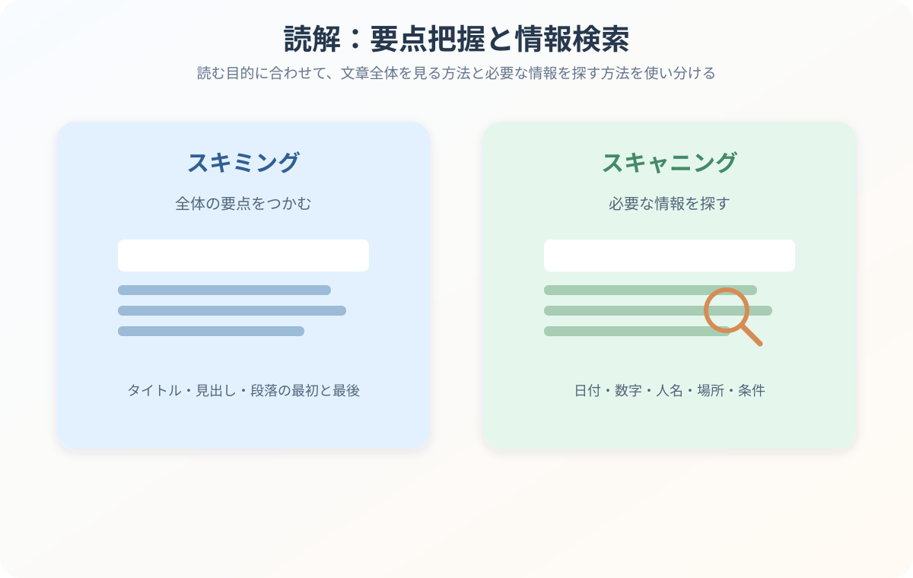

# 情報検索・広告・案内文の読解

## 1. 情報検索型の読解とは

情報検索型の読解では、広告・案内・予定表・申込要項などから、設問に必要な情報を正確に探します。文章を最初から最後まで詳しく読むよりも、設問で求められる条件を整理して該当箇所を確認することが重要です。

## 2. 確認する項目

| 項目  | 確認する内容       |
| --- | ------------ |
| 対象者 | 誰が利用・申込できるか  |
| 日時  | 開始・終了・受付時間   |
| 場所  | 会場・住所・集合場所   |
| 料金  | 金額、税込・税別、割引  |
| 条件  | 必要書類、定員、年齢制限 |
| 締切  | 申込期限、キャンセル期限 |
| 注記  | 例外、対象外、注意事項  |

## 3. 案内文で注意する表現

* ～に限る：対象を限定する。
* ～を除く：対象から外す。
* ～まで：期限や範囲の終点を示す。
* ～必須：必ず必要である。
* ～の場合：条件を示す。
* 先着順：申し込みなどの順番で決まる。
* 事前予約制：前もって予約する必要がある。

## 4. オリジナル案内文

**日本語学習セミナーのご案内**

| 項目   | 内容                      |
| ---- | ----------------------- |
| 開催日  | 11月20日（金）               |
| 時間   | 14:00～16:00             |
| 会場   | 第2会議室                   |
| 対象   | 社員・研修参加者                |
| 定員   | 30名（先着順）                |
| 参加費  | 無料                      |
| 申込締切 | 11月15日（日）17:00          |
| 注意事項 | 申込後に欠席する場合は、前日までに連絡すること |

## 5. 読み取りの手順

1. 設問で必要な条件を確認する。
2. 案内文から日時・対象・料金などを探す。
3. 条件に合うか、一つずつ照合する。
4. 注記や例外条件を見落としていないか確認する。
5. 選択肢の数字や条件が本文と一致するか確認する。

## 6. 練習問題

### 問題1：案内文を読んで答えましょう。

1. セミナーは何時から始まりますか。
2. 参加費はいくらですか。
3. 申し込みは何日までですか。
4. 定員を超えた場合、どのように参加者が決まりますか。
5. 欠席する場合、いつまでに連絡する必要がありますか。

### 問題2：正しいものを選びましょう。

* ア：参加費は必要である。
* イ：定員は30名で、先着順である。
* ウ：申込締切は開催日の当日である。

## 7. 解答・解説

### 問題1

1. 14時です。
2. 無料です。
3. 11月15日（日）17時までです。
4. 先着順です。
5. 前日までです。

### 問題2

イ：案内文に「定員30名（先着順）」と記載されています。

## 8. まとめ

情報検索型の読解では、設問の条件と案内文の情報を照合します。日時・料金・対象・締切・注記を見落とさないようにしましょう。
