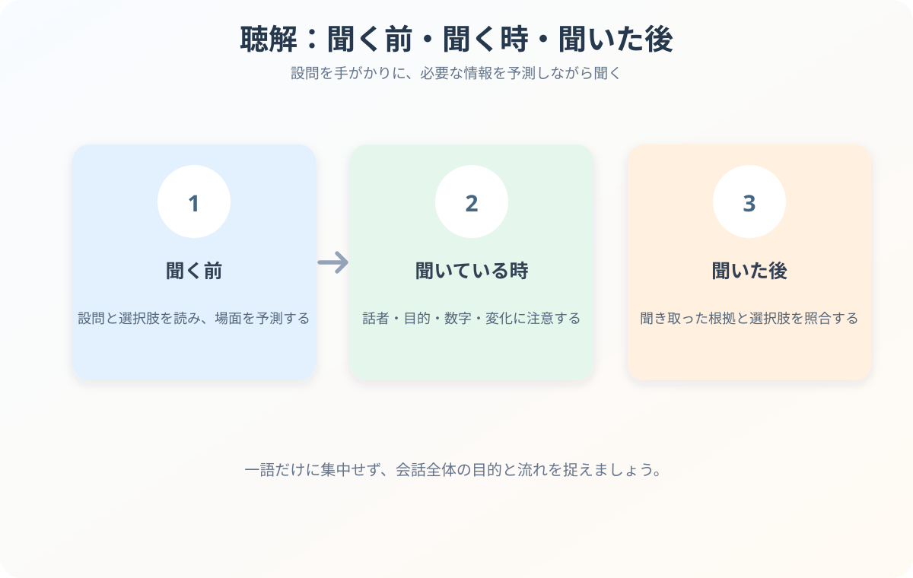

# 聴解の基本・聞き取り方

## 1. 聴解で大切なこと

聴解では、すべての言葉を聞き取ることよりも、場面・話者・目的・重要情報をつかむことが大切です。聞き取れない単語があっても、前後の内容から意味を推測しましょう。

## 2. 聞く前に確認すること

* 誰と誰が話しているか。
* どこで話しているか。
* 何について話しているか。
* 何を答える必要があるか。

## 3. 聞き取りのポイント

| ポイント  | 注目する内容          |
| ----- | --------------- |
| 数字・日時 | 時刻、日付、金額、人数     |
| 場所    | 駅、店、会議室、目的地     |
| 依頼    | ～てください、～てもらえますか |
| 変更    | 予定変更、追加、取り消し    |
| 理由    | なぜそうするのか        |
| 結論    | 最終的に何をするのか      |
| 話者の態度 | 賛成、反対、迷い、驚き     |

## 4. 聴解の練習方法

1. 音声を聞く前に設問を確認する。
2. 一回目は場面と全体の流れをつかむ。
3. 二回目は数字・理由・結論などを確認する。
4. スクリプトを見て、聞き取れなかった部分を確認する。
5. 短い文を音読し、必要に応じてシャドーイングする。

## 5. オリジナル聴解用スクリプト

次の会話を、まず文章を見ずに読み上げてもらうか、自分で音読して聞き取り練習をしましょう。

**男：明日の打ち合わせですが、開始時間を午後二時から三時に変更できますか。**

**女：三時ですね。問題ありません。ただ、会議室は三時半までしか予約できていません。**

**男：では、議題を先に確認して、三時半までに終わるようにしましょう。**

## 6. 練習問題

### 問題1：会話を聞いて答えましょう。

1. 打ち合わせの開始時間は何時に変更されましたか。
2. 会議室は何時半まで予約されていますか。
3. 二人はどうすることにしましたか。

### 問題2：聞き取るときに重要な情報を三つ挙げましょう。

## 7. 解答・解説

### 問題1

1. 午後三時です。
2. 午後三時半までです。
3. 議題を先に確認し、三時半までに終わるようにします。

### 問題2

例：日時、場所、依頼内容、理由、変更点、最終的な決定など。

## 8. まとめ

聴解では、場面と目的をつかみ、数字・理由・変更・結論などの重要情報を聞き取る練習をしましょう。聞き取れなかった箇所はスクリプトで確認し、音読や反復練習につなげます。
