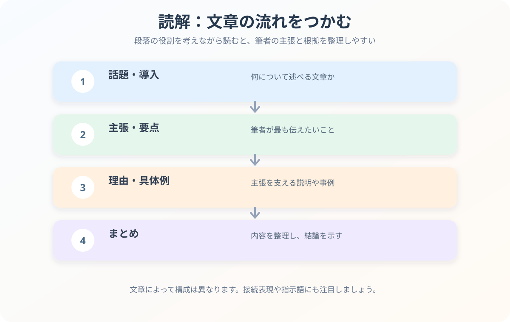

# 読解の基本・文章構造

## 1. 読解で確認すること

読解では、単語や文の意味だけでなく、文章全体が何について述べているか、筆者が何を伝えたいかを理解します。

| 要素  | 確認すること            |
| --- | ----------------- |
| 主題  | 文章全体のテーマ          |
| 要点  | 段落ごとの重要な内容        |
| 主張  | 筆者が最も伝えたい考え       |
| 根拠  | 主張を支える理由や事実       |
| 具体例 | 抽象的な説明を分かりやすくする例  |
| 指示語 | これ・それ・そのような、が指す内容 |
| 接続語 | 前後の文の論理関係         |

## 2. 文章の基本構造

説明文や論説文は、次のような構造で書かれることがあります。

1. **導入**：テーマや問題を提示する。
2. **説明・展開**：理由、事実、具体例を示す。
3. **対比・検討**：別の考え方や課題を示す。
4. **結論**：筆者の考えやまとめを示す。

すべての文章がこの順序とは限りません。接続語や段落の役割を手掛かりに構造を考えましょう。

## 3. 接続語から論理関係を読む

| 接続語        | 働き          |
| ---------- | ----------- |
| しかし・ところが   | 逆接・予想と異なる内容 |
| そのため・したがって | 原因から結果・結論   |
| つまり・要するに   | 内容の言い換え・要約  |
| 例えば        | 具体例         |
| 一方         | 対比          |
| さらに・また     | 追加          |
| ところで       | 話題の転換       |

## 4. 指示語の確認方法

「これ」「それ」「このような」などが出てきたら、前の文や段落に戻り、何を指しているか確認します。直前の一語だけでなく、前の文全体や複数の内容を指す場合もあります。

## 5. 読解の手順

1. 設問を読み、何を探す必要があるか確認する。
2. 文章のテーマと段落の役割をつかむ。
3. 接続語に注目して論理関係を整理する。
4. 答えの根拠となる箇所を本文から探す。
5. 選択肢が本文の内容と一致するか確認する。

## 6. 練習問題（オリジナル読解問題）

次の文章を読んで、質問に答えましょう。

「在宅勤務を導入する企業が増えている。通勤時間を減らせるため、社員が仕事と生活の時間を調整しやすくなるという利点がある。一方で、対面で相談する機会が減り、情報共有に時間がかかる場合もある。そのため、在宅勤務を効果的に活用するには、オンライン会議や業務記録など、情報を共有する仕組みを整えることが重要である。」

### 問題1

1. 文章の主題は何ですか。
2. 在宅勤務の利点を一つ挙げましょう。
3. 在宅勤務の課題を一つ挙げましょう。
4. 筆者が重要だと考えていることは何ですか。

### 問題2

「一方で」は、ここでどのような働きをしていますか。

## 7. 解答・解説

### 問題1

1. 在宅勤務の利点と課題、効果的に活用する方法です。
2. 通勤時間を減らし、仕事と生活の時間を調整しやすくなることです。
3. 対面で相談する機会が減り、情報共有に時間がかかる場合があることです。
4. オンライン会議や業務記録など、情報共有の仕組みを整えることです。

### 問題2

利点を説明した後に、反対側の課題を示す対比の働きです。

## 8. まとめ

文章の主題・要点・主張・根拠を区別し、接続語と指示語を手掛かりに文章全体の構造を理解しましょう。
