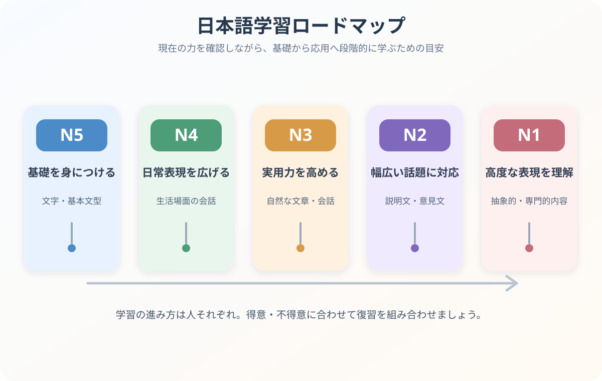

# 09 学習資料

## 1. このカテゴリーについて

このカテゴリーでは、日本語学習を計画し、記録し、振り返るための実用的な方法とテンプレートをまとめています。語彙・文法・漢字の復習、弱点分析、模擬試験、学習習慣の維持に活用しましょう。

## 2. 学習資料の内容

| テーマ        | 使い方                      |
| ---------- | ------------------------ |
| 日本語学習計画    | 目標・期間・週間計画を作る            |
| 語彙ノート      | 読み方・意味・例文・関連語を記録する       |
| 文法復習シート    | 接続・意味・使用場面・類似表現を比較する     |
| 漢字・熟語復習シート | 部首・読み・意味・熟語を整理する         |
| 間違いノート     | 誤答の原因と対策を記録する            |
| 模擬試験・時間管理  | 正答率・時間配分・弱点を分析する         |
| 毎日の学習習慣    | 無理なく続けられる学習サイクルを作る       |
| 辞書・学習資料の活用 | 必要な情報を正確に調べ、整理する         |
| 学習リンク・教材案内 | 試験申込、公式問題、正版教材、無料学習資料を探す |

## 3. 学習リンク・教材案内

試験申込サイト、JLPT公式サンプル、N5～N1教材、PPT・講義資料などは、[日本語学習リンク集・教材案内](rinku.md)にまとめています。

## 4. おすすめの活用方法

1. 最初に学習計画を作り、目標と学習時間を決める。
2. 新しく学んだ語彙・文法・漢字を各復習シートに記録する。
3. 問題を解いたら、間違いノートに原因と対策を書く。
4. 週末に学習記録を見直し、翌週の計画を調整する。
5. 定期的に模擬試験を行い、学習の成果を確認する。
6. 必要な教材はリンク集から探し、利用条件と出典を確認する。

## 5. 記録を続けるポイント

* すべてを細かく記録しようとせず、必要な項目に絞る。
* 学習した当日に短く記録する。
* 正解した問題でも、根拠を説明できない場合は復習する。
* 計画は固定せず、生活や進捗に合わせて調整する。
* 他の教材や資料を利用した場合は、出典と確認日を記録する。

## 6. 自己確認

* [ ] 学習目標と週間計画を作成できる。
* [ ] 語彙・文法・漢字を整理して記録できる。
* [ ] 間違いの原因と対策を説明できる。
* [ ] 模擬試験の結果を次の学習に反映できる。
* [ ] 無理のない学習習慣を続けられる。
* [ ] 外部教材の出典と利用条件を確認できる。

## 7. まとめ

学習資料は、作ること自体が目的ではありません。学習内容を整理し、弱点を把握し、次の行動につなげるために活用しましょう。
