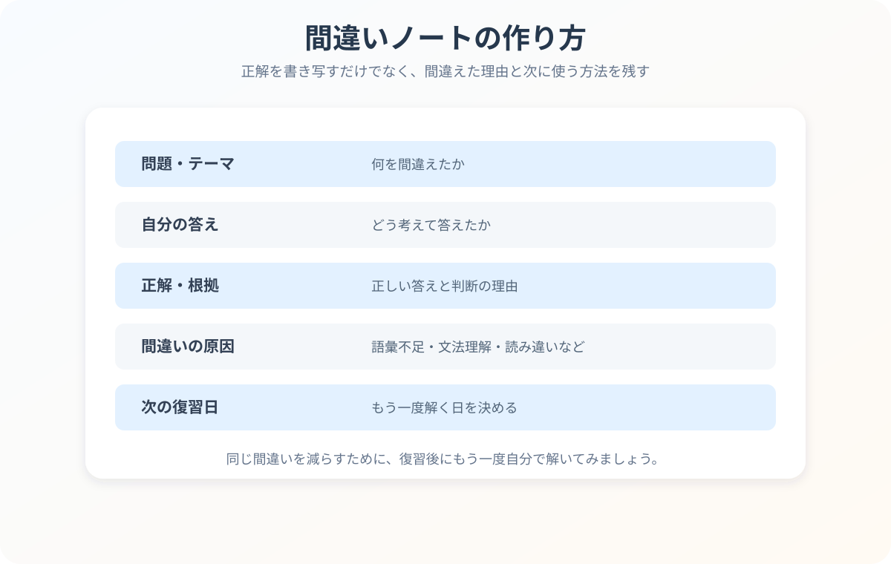

# 間違いノート・弱点分析

## 1. 間違いノートの目的

間違いノートは、間違えた問題を記録するだけでなく、なぜ間違えたのかを分析し、同じ誤りを繰り返さないための学習資料です。

## 2. 記録する項目

| 項目    | 記録内容                  |
| ----- | --------------------- |
| 日付    | 問題を解いた日               |
| 分野    | 語彙・文法・漢字・読解・聴解        |
| 問題    | 問題番号や内容               |
| 自分の答え | 実際に選んだ答え              |
| 正解    | 正しい答え                 |
| 原因    | 知識不足・読み違い・聞き逃し・時間不足など |
| 対策    | 次に行う具体的な学習            |
| 再確認日  | 解き直す日                 |

## 3. 間違いの原因を分類する

* **知識不足**：単語・漢字・文法を知らなかった。
* **意味の混同**：似た語や文型を取り違えた。
* **文脈の読み違い**：前後の内容を正しく理解できなかった。
* **設問の読み違い**：何を答える問題か誤解した。
* **聞き逃し**：数字・理由・結論などを聞き取れなかった。
* **時間不足**：考えすぎて最後まで解けなかった。

## 4. 記録例

| 項目   | 記入例                   |
| ---- | --------------------- |
| 分野   | 文法                    |
| 間違い  | 「～ために」と「～ように」を混同した    |
| 原因   | 目的と状態の実現の違いを理解していなかった |
| 対策   | 接続と例文を比較し、各3文を作る      |
| 再確認日 | 3日後                   |

## 5. 弱点を分析する方法

1. 間違いを分野別に集計する。
2. 同じ原因の間違いが繰り返されていないか確認する。
3. 原因に合った対策を決める。
4. 数日後に同じ問題を解き直す。
5. 正解できた後も、時間を空けて再確認する。

## 6. 練習問題

### 問題1：次の間違いの原因を分類しましょう。

1. 「増加」の読み方を知らなかった。
2. 設問で「正しくないもの」を選ぶのに、正しいものを選んだ。
3. 聴解で最後の決定内容を聞き逃した。

### 問題2：間違いノートに記録する項目を五つ挙げましょう。

### 問題3：同じ問題を解き直す目的を説明しましょう。

## 7. 解答・解説

### 問題1

1. 知識不足
2. 設問の読み違い
3. 聞き逃し

### 問題2

例：日付、分野、問題、自分の答え、正解、原因、対策、再確認日です。

### 問題3

正解を覚えただけでなく、間違いの原因を克服できたか確認するためです。時間を空けて解き直すことで、知識が定着しているか確認できます。

## 8. まとめ

間違いは弱点を見つけるための情報です。正解だけを記録せず、原因と具体的な対策、再確認日まで記録して学習に生かしましょう。
