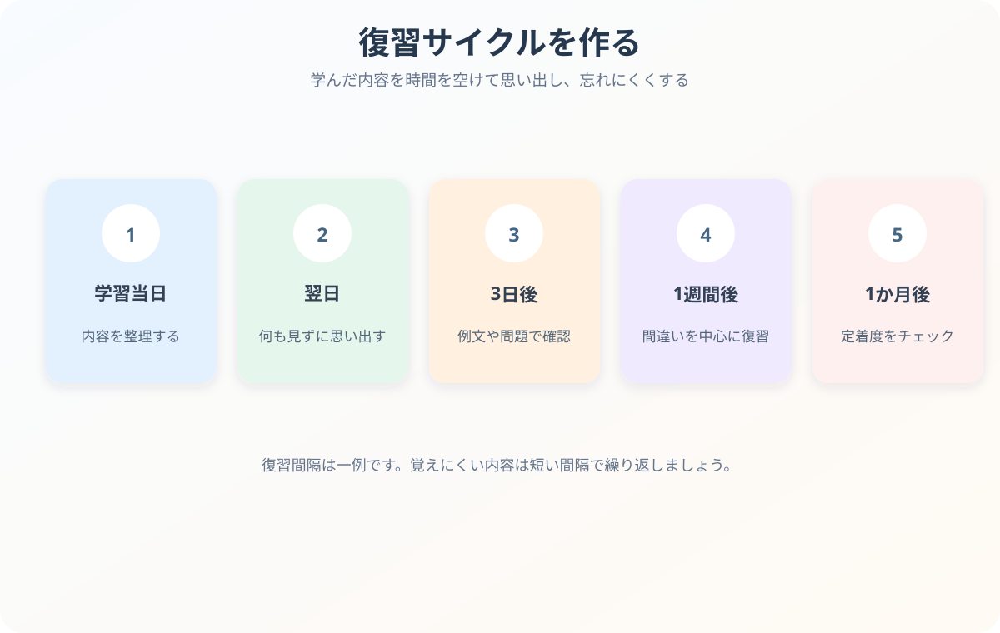

# 毎日の学習習慣・継続方法

## 1. 学習を継続するために

日本語学習では、一度に長時間勉強することより、無理のない量を継続することが重要です。毎日行う学習を小さく決め、生活の中に組み込みましょう。

## 2. 習慣化のポイント

* 学習する時間と場所をできるだけ固定する。
* 一回の目標を小さくする。
* 学習を始める前に、今日やることを一つ決める。
* 学習後に実施内容を記録する。
* 忙しい日は短い復習だけでも続ける。
* 休息日を計画に含める。

## 3. 30分の学習例

|  時間 | 内容                |
| --: | ----------------- |
|  5分 | 前日に学んだ語彙を復習       |
| 10分 | 新しい語彙・漢字・文法を学習    |
| 10分 | 読解または聴解を一題練習      |
|  5分 | 間違いを記録し、次回の目標を決める |

## 4. 学習記録の例

| 日付  | 学習内容        |  時間 | 気づいたこと     |
| --- | ----------- | --: | ---------- |
| 月曜日 | 語彙20語・文法2項目 | 30分 | 類義語の区別が難しい |
| 火曜日 | 読解1題        | 25分 | 接続語を見落とした  |
| 水曜日 | 聴解2題        | 30分 | 数字の聞き取りを復習 |

## 5. 継続できないときの見直し方

* 目標が大きすぎないか確認する。
* 学習内容が多すぎないか確認する。
* 苦手な分野ばかり続けていないか確認する。
* できたことも記録し、進歩を確認する。
* 予定が崩れた場合は、翌日から再開する。

## 6. 練習問題

### 問題1

毎日学習を続けるために有効な工夫を三つ挙げましょう。

### 問題2

忙しい日に学習時間が取れない場合、どのような方法で習慣を維持できますか。

### 問題3

自分が毎日続けられる最小の学習内容を決めましょう。

## 7. 解答・解説

### 問題1

例：時間を固定する、目標を小さくする、学習記録を付ける、休息日を設定するなどです。

### 問題2

例：単語を5語復習する、短い文章を一つ読む、音声を数分聞くなど、短時間でできる内容に切り替えます。

### 問題3

自分の生活に合った、無理なく実行できる内容を設定できていれば正解です。

## 8. まとめ

学習を継続するには、目標を小さくし、実施した内容を記録することが大切です。できなかった日があっても、無理に取り戻そうとせず、次の日から再開しましょう。
