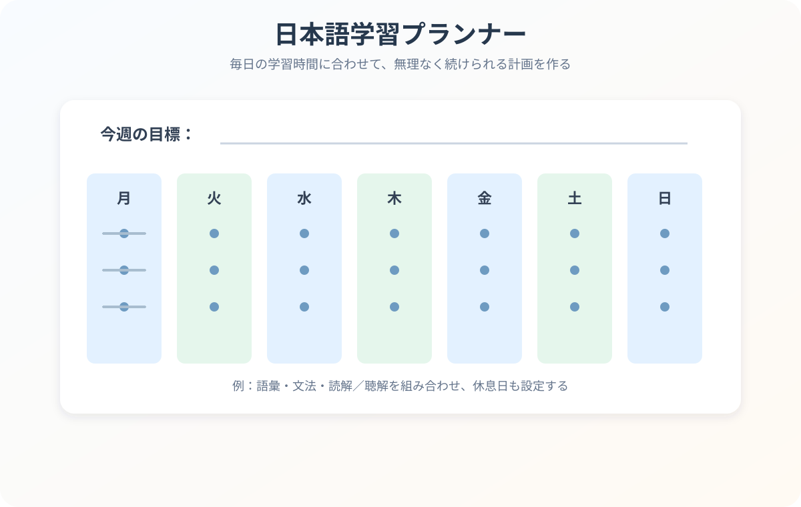

# 日本語学習計画の立て方

## 1. 学習計画を立てる目的

学習計画は、目標に向けて何を・いつ・どのくらい学ぶかを決め、継続しやすくするためのものです。最初から多くの時間を設定するより、無理なく続けられる量から始めましょう。

## 2. 目標の決め方

目標は、できるだけ具体的に設定します。

| 項目    | 設定例                |
| ----- | ------------------ |
| 最終目標  | 12月のJLPT N2に合格する   |
| 現在の課題 | 読解の時間配分と聴解         |
| 期間目標  | 1か月で文法テーマを20項目復習する |
| 週間目標  | 語彙を週50語、読解を週3題     |
| 毎日の行動 | 30分の語彙復習、20分の読解    |

## 3. 目標を小さく分ける

1. 最終目標を決める。
2. 試験日や達成したい日から逆算する。
3. 月ごとの目標を決める。
4. 週ごとの学習内容に分ける。
5. 毎日実行する最小単位を決める。
6. 週末に達成度を確認して調整する。

## 4. 週間学習計画のテンプレート

| 曜日 | 学習内容     | 予定時間 | 実施結果 |
| -- | -------- | ---: | ---- |
| 月  | 語彙・漢字    |  30分 |      |
| 火  | 文法       |  30分 |      |
| 水  | 読解       |  30分 |      |
| 木  | 聴解       |  30分 |      |
| 金  | 語彙・文法の復習 |  30分 |      |
| 土  | 総合問題     |  60分 |      |
| 日  | 間違い直し・休息 |  30分 |      |

## 5. 計画を見直す方法

* 予定どおり進まなかった場合は、学習量を調整する。
* 正答率が低い分野には、翌週の時間を多く配分する。
* 同じ間違いが続く場合は、学習方法そのものを見直す。
* 休息日も計画に含め、無理なく継続する。

## 6. 練習問題

### 問題1

「日本語が上手になりたい」という目標を、具体的で確認できる目標に書き換えましょう。

### 問題2

学習計画を週単位に分ける利点を二つ挙げましょう。

### 問題3

予定どおり学習できなかった場合、どのように計画を調整すればよいですか。

## 7. 解答・解説

### 問題1

例：3か月後までに、毎週50語を覚え、週3回の読解練習を行い、模擬問題の正答率を10ポイント上げる。

### 問題2

例：学習量を管理しやすいこと、進捗を確認して早めに調整できることです。

### 問題3

学習できなかった原因を確認し、優先順位を付け直して、実行可能な量に調整します。遅れをすべて一度に取り戻そうとしないことが大切です。

## 8. まとめ

学習計画は、目標・期間・行動・振り返りをセットで考えます。達成度を定期的に確認し、自分に合った学習量へ調整しましょう。
