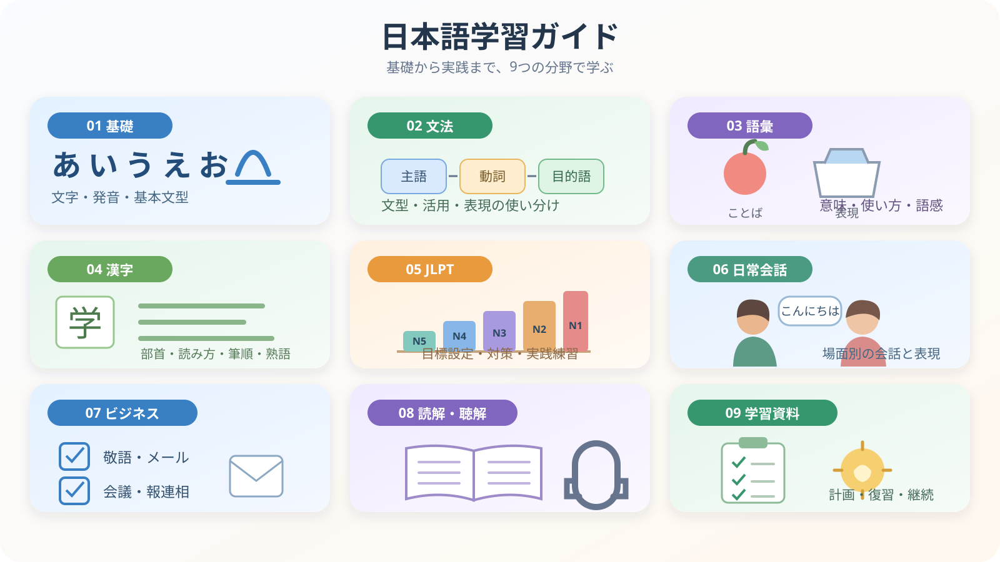

# 00 はじめに

## ようこそ！日本語学習ノートへ

このサイトは、日本語を学習する方が、基礎から応用まで段階的に学べるように内容を整理した学習サイトです。

日本語の文字・発音・文法・語彙・漢字から、JLPT対策、日常会話、ビジネス日本語、読解・聴解、学習方法まで幅広く扱います。

## 学習コンテンツ

| カテゴリー      | 内容                      |
| ---------- | ----------------------- |
| 01 日本語の基礎  | 文字、発音、基本文型、助詞、活用        |
| 02 文法      | 基本文型、複文、敬語、推量、文末表現      |
| 03 語彙      | 日常生活、社会、仕事、専門分野の語彙      |
| 04 漢字      | 部首、音読み・訓読み、筆順、熟語、レベル別漢字 |
| 05 JLPT対策  | N5からN1までの学習方針とオリジナル練習問題 |
| 06 日常会話    | 挨拶、買い物、飲食店、旅行、電話、トラブル対応 |
| 07 ビジネス日本語 | 敬語、メール、電話、会議、報連相、業務文書   |
| 08 読解・聴解   | 文章構造、論説文、情報検索、聴解、音読     |
| 09 学習資料    | 学習計画、復習シート、間違いノート、模擬試験  |

## おすすめの学習方法

1. まず「日本語の基礎」で文字・発音・基本文型を確認する。
2. 「文法」「語彙」「漢字」を並行して学習する。
3. 学んだ表現を「日常会話」「ビジネス日本語」で使ってみる。
4. 「読解・聴解」で理解力を高める。
5. 「JLPT対策」でレベルに合った問題に取り組む。
6. 「学習資料」を使って、学習記録と弱点を定期的に見直す。

## 練習問題について

新たに追加した練習問題・例文は、このサイト向けに作成した学習用コンテンツです。公式のJLPT過去問題を転載したものではありません。掲載する漢字や語彙の例は学習用の選定例であり、公式の完全な出題一覧を示すものではありません。

## 学習を続けるために

一度に多くの内容を覚えようとせず、毎日少しずつ学習し、間隔を空けて復習しましょう。正解したかどうかだけでなく、なぜその答えになるのかを説明できることを目指してください。

## 一緒に日本語を学びましょう！

このサイトが、日本語の理解を深め、実際の会話や文章で使える力を身につけるための助けになれば幸いです。
